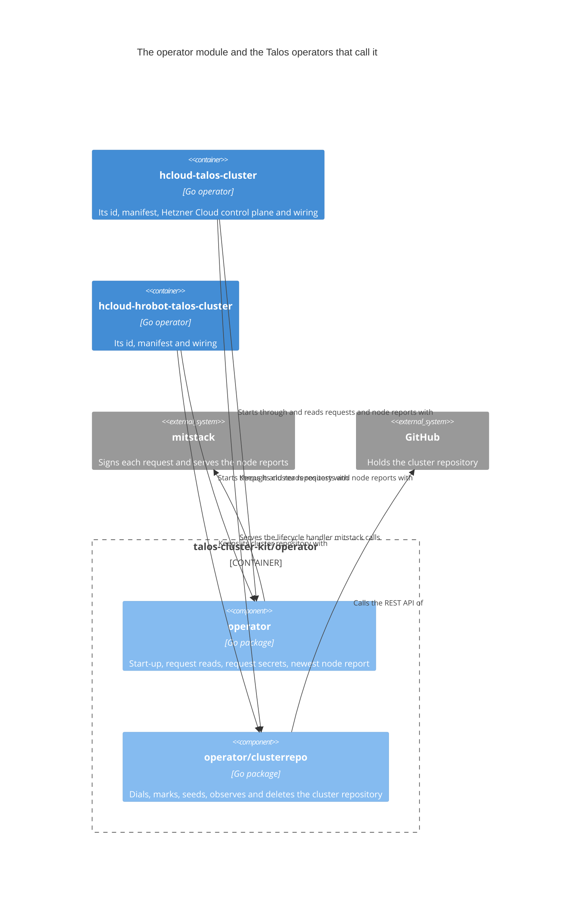
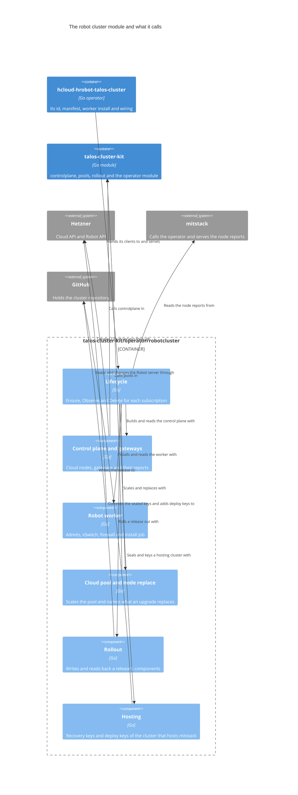

# talos-cluster-kit

This repository holds the Talos install that mitstack's Hetzner Talos cluster
blocks share. It is for an engineer who changes what a Talos node boots, what
its cluster starts with, or how etcd recovers. A block is a unit of
infrastructure an app subscribes to, as
[the workspace glossary](https://github.com/mitstack-eu/mitstack-workspace/blob/main/docs/glossary.md)
defines. hcloud-talos-cluster imports this module to run a cluster on Hetzner
Cloud servers. hcloud-hrobot-talos-cluster runs its control plane on Cloud
servers from the `controlplane` package, and builds its workers on Hetzner
dedicated servers from the module's worker render, as
[ADR 0103](https://github.com/mitstack-eu/mitstack/blob/main/docs/adr/0103-mitstack-offers-five-hetzner-capacity-blocks-and-keeps-the-k3s-block.md)
decides. hcloud-talos-cluster still keeps its own copy of that control plane.

Talos Linux is an operating system that runs only Kubernetes and is managed
through an API, with no shell and no SSH. The module follows the fourth Talos
proof of 19 October 2026, recorded in the workspace note
[Talos on Hetzner Cloud from an embedded configuration](https://github.com/mitstack-eu/mitstack-workspace/blob/main/product/knowledge/2026-10-19-talos-on-hetzner-cloud-from-an-embedded-configuration.md),
and the design that
[ADR 0095](https://github.com/mitstack-eu/mitstack/blob/main/docs/adr/0095-mitstack-clusters-run-talos-across-fsn1-nbg1-and-hel1-with-a-load-balancer-per-location.md)
accepts.

The module renders and the block acts. Every package but `controlplane` takes
its inputs as values and returns bytes, or runs one local command, and calls
neither Hetzner, GitHub nor the platform. `controlplane` is the one package
that calls Hetzner: it creates and deletes a Cloud control plane through
Hetzner's Cloud API. The block hands it the token, the HTTP client that sends
every call, and the poll schedule, which says how long to wait before each ask
whether Hetzner has finished a change it started. It imports neither block-kit
nor operator-kit, so any block framework can drive it. Keeping the
install in one module means a fix to the boot, to etcd recovery or to the
Cloud control plane lands once and reaches every block.

The `operator/` directory is not part of this module and does import
block-kit. It is a Go module of its own, holding the start-up and repository
code both Talos cluster operators run, as
[How an operator shares its start-up and repository code](#how-an-operator-shares-its-start-up-and-repository-code)
describes.

## What a cluster is built from

A node boots from a disk image that embeds its whole machine configuration, so
the server needs no user data. The nodes have no public address. A gateway in
each location is the cluster's only server with one: it forwards the nodes'
DNS, NTP and HTTPS, each further port its block opens, and HTTP to the
cluster's ingress load balancer. It
records that traffic, and serves the image mirror and the
larger manifests over TLS on the private network. The table names the parts in
the order a block uses them.

| Package | What it does | Main entry points |
|---|---|---|
| `components` | Holds the pinned component set: Cilium, the custom resource definition (CRD) of Cilium's cluster-wide policy, Argo CD, the policy that keeps pods from Hetzner's metadata service at `169.254.169.254`, Istio's ambient mesh with its mesh-wide mutual TLS policy and the mesh probe's target, Kyverno with the admission policies [How a cluster isolates each app](#how-a-cluster-isolates-each-app) lists, the CloudNativePG operator with the database-slice policy, the local path provisioner behind the default StorageClass, and the node-local OpenTelemetry Collector. It also holds the boot set of a cluster that hosts the platform, and the telemetry Collector of a cluster that requires an OTLP backend, which [ships its events, metrics and app logs](#how-a-cluster-ships-its-events-metrics-and-app-logs). It renders the CoreDNS Deployment that [keeps a replica in each location](#how-coredns-keeps-a-replica-in-each-location) | `Default`, `Hosting`, `HostingServed`, `Set.PublishingIngress`, `Manifest` (whose `Name` is a component's name), `Set.Images`, `LogCollector`, `Set.TelemetryCollector`, `TelemetryExport`, `CoreDNS`, `ParseImage` |
| `nodeconfig` | Renders a control-plane node's or a worker node's machine configuration with Talos's own `machinery` module and validates it against Talos's schema | `Render`, `RenderWorker`, `Rerender`, `Cluster`, `Node`, `NewSecrets`, `ParseSecrets`, `Secrets.AdminTalosconfig` |
| `image` | Runs imager, Sidero Labs' open-source image builder, with the `hcloud` or the `metal` profile, and discards its output | `Run`, `Build` |
| `mirror` | Lists every image the nodes pull, each by digest | `List`, `Render` |
| `gateway` | Renders the cloud-config of the gateway in each location, and mints the cluster's gateway CA and each gateway's certificate | `Render`, `Inputs`, `Deadline`, `NewCA`, `CA.Issue` |
| `etcd` | Renders the Job that removes a lost node's etcd member and then its Node object, and holds the gateway's script that bootstraps etcd empty or from a snapshot | `RemoveMemberJob`, `BootstrapScript`, `Bootstrap.Args` |
| `noderollout` | Renders the Job that gives every running node the machine configuration a release renders for it, without a reboot and one node at a time, as [How the rollout Job gives each node the release](#how-the-rollout-job-gives-each-node-the-release) explains | `Job`, `Rollout`, `Release`, `Path`, `IsPath`, `JobName` |
| `report` | Renders the node report, a CronJob that reads the cluster and posts what it read to the platform, signed for its exact body. [What the node report carries](#what-the-node-report-carries) lists its members, the nine checks it names and what happens when a read fails. It also renders the outside probe, a CronJob in `kube-system` that calls the mesh probe's target with no workload identity and reads each gateway's mirror from outside the mesh, the admission probe namespace and the daily security scan. The report holds no right on Secrets | `Manifests`, `Interval` |
| `topology` | Renders the topology labeller, a CronJob that labels each Cloud node with its zone and region, labels each burst member of a Cloud pool, a member above the pool's minimum, `mitstack.dev/burst=true`, and holds the zone and region label names | `Manifests`, `Labels`, `ZoneLabel`, `RegionLabel`, `FieldManager` |
| `openbaoinit` | Renders OpenBao's init Job, which the hosting set carries. On a hosting cluster, a cluster that runs mitstack's own control plane, it initialises OpenBao once, commits the root token and recovery key to the cluster repository as PGP messages, then writes the policy that External Secrets reads with in each slice, the namespace a block gives one app | `Manifests`, `Inputs`, `InitFile` |
| `rollout` | Gives a running cluster a release's component set, the manifests one kit release carries; [How a running cluster takes a release's components](#how-a-running-cluster-takes-a-releases-components) defines each term. A block commits the set's files to the cluster repository, where Argo CD applies each component through an Application of its own, which is Argo CD's record of one repository directory it keeps applied to the cluster. Files that an earlier release committed and this release no longer states are retired, which means deleted. Each component's sync runs a handover Job, which has Talos give up the fields it set when it created the component's objects, so they hold only what the release states. After OpenBao's sync, OpenBao's rollout Job moves each member onto the StatefulSet's new revision, as [How OpenBao's members take a new revision](#how-openbaos-members-take-a-new-revision) explains, which also says what a member, a StatefulSet and a revision are. Every Application reads the cluster repository at `Release.RepoURL`, the one address the cluster holds a credential for. The read-back then checks from the node report that the cluster runs each component as the release states it | `Release.Files`, `Release.Retired`, `Release.ReadBack`, `Release.ToolsImage`, `Release.RepoURL`, `LegacyFiles` |
| `controlplane` | Builds and deletes a Talos control plane on Hetzner Cloud: a network, a firewall, a builder that makes the cluster's own snapshot, one or three nodes with a gateway beside each, and an API and an ingress load balancer. Three nodes run in `fsn1`, `nbg1` and `hel1`, and one node runs in `fsn1`. Each call reads the resources by their labels and takes the one change still missing, and [How a request reads the Cloud once](#how-a-request-reads-the-cloud-once) says how one request lists each kind once. A refusal is a `*Refusal` with a `Class` and a `Message`, which the block answers as its own framework's refusal | `Plane`, `Plane.NodeLocations`, `DefaultSize`, `KeySize`, `Plane.Read`, `ReadOncePerRequest`, `RequestReads`, `NewRequestReads`, `WithoutRequestReads`, `Plane.EnsureNetwork`, `Plane.SizeRefusal`, `Plane.NextStep`, `Plane.Problems`, `Plane.Unhealthy`, `Plane.Outputs`, `Plane.CopyIdentityStep`, `State.IngressAddresses`, `Plane.Release`, `ErrNoIngressAddress`, `Plane.GatewaysAwaitRelease`, `Plane.GatewaysServeRelease`, `Plane.Delete`, `Plane.Busy`, `Plane.Unsettled`, `NewAPI`, `Calls`, `Refusal`, `TopologyLabels`, `GatewayUpgradeBound`, `GatewayCertRenewBefore`, `KeyGatewayCertExpires` |
| `tools` | Holds `tools/tools.env`, which pins the talosctl and kubectl that the tools image carries and the gateway copies out of it, `tools/jq.env`, which pins the tools image's jq, and `tools/kube-bench-talos.yaml`, the settings kube-bench reads over its own on Talos. Its Dockerfile builds `cmd/machine-config` into the tools image. It names the tools image a release published and the directory in that image that holds the node report's, its outside probe's, the labeller's, the cluster tokens', the handover's and OpenBao's rollout's scripts, and where in that image each served manifest sits | `Env`, `Pin`, `Image`, `ScriptDir`, `ManifestPath` |
| `redundant` | Carries a removal's redundant set, each member with its reading, to the guard the block passes, block-kit's `redundancy.Set.AllowRemoval`, which this module does not import. A set's `Minimum` is how many members it keeps serving: `Majority`, `AllButOne`, or `NoRedundancy`, which lets the one member of a set of one go | `Set`, `Guard`, `Held`, `Minimum` |
| `scaling` | Decides from the node reports alone how a Cloud pool whose minimum is below its maximum follows its cluster's load, so only the block's operator, which holds the Hetzner token, changes the pool. [How a Cloud pool scales with the load](#how-a-cloud-pool-scales-with-the-load) gives the rules | `Decide`, `Decision`, `CauseAtMaximum`, `CauseNoTypeHolds` |
| `testutil` | Holds the fixtures, fakes and decoders this module's tests and a block's tests share | `NewCluster`, `NewTools`, `Golden` |

For example, this renders the configuration a Cloud cluster's image embeds,
for a cluster with one location:

```go
cfg, err := nodeconfig.Render(nodeconfig.Cluster{
	Name:                 "shop",
	SubscriptionID:       "sub_0123456789ab",
	Profile:              nodeconfig.HCloud,
	Components:           components.Default(),
	Secrets:              secrets, // from nodeconfig.NewSecrets(time.Now())
	Network:              netip.MustParsePrefix("10.0.0.0/16"),
	APIAddresses:         []netip.Addr{netip.MustParseAddr("10.0.0.3")},
	Gateways:             []netip.Addr{netip.MustParseAddr("10.0.0.2")},
	GatewayCA:            gatewayCA.Cert, // from gateway.NewCA
	Logs:                 components.LogExport{Endpoint: "otlp.mitstack.dev:4317", CA: receiverCA}, // the log receiver's CA
	ServiceAccountIssuer: issuer, // the issuer every token names, such as https://mitstack-oidc-7kq2m4xw3pa3hd6rz5tn2cjvle.s3.eu-central-1.amazonaws.com/sub_0123456789ab
}, nodeconfig.Node{})
```

Log export is optional. A builder whose cluster has no log receiver leaves
`Logs` at the zero `components.LogExport`. The configuration then carries no
Collector and no log destination, and the gateway's `Inputs.Logs` left at zero
forwards HTTPS alone. `nodeconfig.Render` refuses a `LogExport` with only one
of its two fields set.

A block opens further outbound ports with `controlplane.Plane.GatewayEgressPorts`,
which the plane passes to each gateway as `gateway.Inputs.EgressPorts`. Every
gateway then forwards those TCP ports to any outside address, beside 443, which
it forwards whether the list names it or not. The robot cluster module, the Go
code in `operator/robotcluster/` that a block's operator builds its planes
with, takes the ports as `robotcluster.Config.GatewayEgressPorts` and gives
them to every plane it builds. A block whose nodes must reach outside hosts
over plain HTTP, such as a runner cluster running a repository's CI jobs, sets
`[]int{80, 443}`. A CI job, one build or test run on those nodes, can then
reach an outside host over plain HTTP. `gateway.Render` refuses a port outside 1
to 65535.

The ports also decide when a gateway is replaced. Each gateway is built from a
gateway list, the images it mirrors and the manifests it serves to the nodes,
which the kit release pins. `gateway.List.Mark` gives the gateway's
`mitstack.dev/gateway-list` label from that list and the ports. With no port
beyond 443 the label is the list's digest, the label every gateway already
carries, so a block that leaves the field unset keeps its gateways. A change of
the ports beyond 443 changes the label. The block's next upgrade brings a running
cluster to the kit release the block pins, and it replaces each gateway with one
that forwards the new ports.

A Cloud cluster renders once with an empty `Node`, because every node boots
from one snapshot and takes its name from Hetzner's metadata service. A
dedicated node has no metadata service, so a dedicated cluster renders once per
node with that node's `Node.Hostname`.

A worker is a node that runs the apps' pods and holds no key of the cluster's
certificate authorities. It joins the cluster through
`nodeconfig.RenderWorker`, which takes the same `Cluster` and the same secrets
as `Render`. `Cluster.Profile` names the
server the configuration boots on. A block whose control plane runs on Cloud
servers therefore renders a dedicated worker from a copy of its `Cluster`
with `Profile` set to `nodeconfig.Metal`:

```go
robot := cluster // the Cluster the control plane rendered from
robot.Profile = nodeconfig.Metal
cfg, err := nodeconfig.RenderWorker(robot, nodeconfig.Node{
	Hostname: "wk-hel1",
	VSwitch: &nodeconfig.VSwitch{
		// The public card's permanent MAC, read in the rescue system, such as 9c:6b:00:55:d8:f5.
		MAC: mac,
		// The vSwitch's VLAN in Robot.
		VLAN: 4000,
		// The node's address in the network's vSwitch subnet.
		Address: netip.MustParsePrefix("10.0.1.2/24"),
	},
})
```

A dedicated server reaches the cluster's network over a vSwitch, Robot's
private VLAN between dedicated servers, which a Hetzner Cloud network couples
to. `Node.VSwitch` gives the node three documents. A `LinkAliasConfig` names
the public card `pub0` by its permanent MAC, since Talos's names for links
are not known before the first boot. A `LinkConfig` brings `pub0` up with no
address, which keeps Talos's default DHCP off it. A `VLANConfig` gives the
node its address on `vsw0`, with MTU 1400 and its default route through the
vSwitch subnet's first address, Hetzner's vSwitch gateway. These are the
documents that booted the node in the workspace note
[Talos on a Hetzner Robot server behind a vSwitch gateway](https://github.com/mitstack-eu/mitstack-workspace/blob/main/product/knowledge/2026-10-28-talos-on-a-hetzner-robot-server-behind-a-vswitch-gateway.md).
`vswitchDocuments` in `nodeconfig/documents.go` renders them, and a Metal
node without `VSwitch` runs Talos's default DHCP on every link.

### How a running node takes a release's configuration

A node keeps the configuration it booted with until something applies another
one. Talos calls this the machine configuration: a YAML file of several
documents, each of a kind such as `KubeletConfig`, that sets the node's disks,
network, Kubernetes and keys. A release here is one published version of this
kit, named by the digest, the content hash, of its tools image, the container image that carries
talosctl and the kit's scripts (see the `tools` row above). `Cluster.Release`
holds that digest.

`nodeconfig.Rerender` takes a node's current machine configuration as YAML
bytes and returns the configuration this release gives that node. It applies
nothing. Its caller reads the configuration from the node through the Talos
API and applies the result. That caller is the rollout Job below, and the
tools image carries `Rerender` as the command `machine-config` for it, since
the Job runs inside the cluster, where the nodes hold the cluster's keys.

A block is the program mitstack runs to create and update one kind of cluster,
such as hcloud-hrobot-talos-cluster, and it renders each node through this
kit. It keeps no copy of the cluster's keys or of the choices it made at
creation. Only the node still holds them, so `Rerender` reads them back from
these documents, each named by its Talos kind:

| What it reads back | From the running document |
|---|---|
| The cluster's keys | Every key document, through Talos's `NewBundleFromConfig` |
| The cluster's name and the API's first address, the private load balancer every node reaches Kubernetes through | `KubeClusterConfig`, the cluster section |
| The API's other addresses, one load balancer in each further location | The machine's `certSANs`, the names its API certificate holds |
| The subscription, the mitstack subscription the cluster was created for, the private network the nodes share, and the node's own labels | `KubeNodeConfig`: the subscription and the node's own labels from its Kubernetes labels, the network from the subnet its kubelet binds to |
| Whether apps stay off the control plane | The control-plane taint in `KubeNodeConfig` |
| The Kubernetes version | The kubelet image in `KubeletConfig` |
| The issuer, the URL each service-account token names so AWS can check it | `KubeServiceAccountConfig` |
| The gateways, the Cloud servers that give the nodes their route out and serve their images, and the gateway CA, the certificate the nodes trust them by | The `RegistryTLSConfig` names and the `mitstack-gateway` `TrustedRootsConfig` |
| The profile, `hcloud` for a Hetzner Cloud server or `metal` for a dedicated server | The `eth0` `LinkConfig`, which only a Cloud server carries |
| Whether each CI job's pod runs in its own user namespace, the Linux feature that makes root inside the pod an unprivileged user of its node, as [the runner services page](docs/runner-services.md#how-a-runner-group-isolates-its-jobs) explains | A worker's `mitstack-job-isolation` `CRICustomizationConfig`. The worker's `SysctlConfig`, which lets the kernel give out user namespaces, is rendered again from it |
| The user volumes, the disk space Talos gives a component such as the local path provisioner, which backs the cluster's default storage | Each `UserVolumeConfig` |
| A dedicated server's name and its vSwitch, Hetzner's private link to the Cloud network | `HostnameConfig`, the `pub0` `LinkAliasConfig` for its public link and the `vsw0` `VLANConfig` for the vSwitch |

A control-plane node's configuration also holds the Kubernetes manifests it
applied at install. Every node's configuration also says whether it sends its
logs to the node-local Collector, the OpenTelemetry agent that ships them
off the node. `Rerender` keeps the manifests and that log setting as the node holds them, since Argo CD
carries each later change of a component, as
[How a running cluster takes a release's components](#how-a-running-cluster-takes-a-releases-components)
explains. The result sets the node annotation `mitstack.dev/machine-config`
(`nodeconfig.MachineConfigAnnotation`) to `Cluster.Release`, so each node
names the release its configuration came from. `Render` and `RenderWorker`
set the same annotation when `Cluster.Release` is set.

Talos applies a new configuration without a reboot, yet a node takes some
settings only when it boots. `Rerender` refuses such a release with
`nodeconfig.ErrRebootOnly`, naming the setting, and the caller applies nothing
to that node. These settings are the install disk and image
(`machine.install`), the kernel's arguments and modules (`machine.kernel`),
every etcd setting (`cluster.etcd`), and a volume, either a system one such as
`EPHEMERAL` (`VolumeConfig`) or a user one (`UserVolumeConfig`). The etcd CA
key is left out of that comparison, since `Rerender` copies it from the node
and so the result always holds the node's own key.

`Rerender` also refuses a configuration it cannot read back whole, so nothing on
a node changes without a reason it can name. It refuses one with no
`KubeClusterConfig`, `KubeNodeConfig` or `mitstack-gateway`
`TrustedRootsConfig`, or with an API endpoint that is a host name, since the
kit renders that endpoint as the load balancer's address. It refuses
a taint other than the control plane's, and that taint on a worker. It refuses
a kubelet image from another registry or pinned by digest, since the node
keeps the Kubernetes version that image names. It refuses a worker that trusts
no API server CA, or more than one. It also refuses a node running a document
this release does not render, naming that document, such as one a person added
to the node by hand. A registry that trusts another CA than the gateways' is
such a document.

This example takes `running`, the configuration the caller read from the node,
and renders what the node takes from the release whose tools image is
`sha256:5f0c…`:

```go
// running is the node's machine configuration, which the caller read through the Talos API.
next, err := nodeconfig.Rerender(running, "sha256:5f0c…")
if errors.Is(err, nodeconfig.ErrRebootOnly) {
	return fmt.Errorf("leave this node as it runs: %w", err)
}
if err != nil {
	return err
}
// next is the configuration the caller applies to the node.
```

In the tools image the same rendering reads the node's configuration on stdin
and writes the next one on stdout. It exits 3 and prints nothing when the
release changes a setting the node takes only at reboot, 2 on a wrong
argument, and 1 on any other refusal, naming the reason on stderr:

```sh
machine-config --release sha256:5f0c… < running.yaml > next.yaml
```

### How the rollout Job gives each node the release

`noderollout.Job` renders the Job that reads, renders and applies each node's
configuration. A block commits it to the cluster repository at
`noderollout.Path`, in the `cluster/` directory the cluster's own Argo CD
Application applies, beside the member removals of
[the etcd package](#what-a-cluster-is-built-from). The Job runs the tools image
in `mitstack-node` with a Talos identity that holds `os:admin`, the only role
Talos gives a node's configuration to and applies one from. Its Kubernetes
identity may only read the Node objects. A release here is the tools image's
digest, which `noderollout.Release` reads. Each node's configuration sets the
`mitstack.dev/machine-config` annotation on its Node object to the release it
was rendered from, so the annotation tells which release a node runs.

A block holds one rollout file at a time. It takes out an earlier release's
file in the commit that adds the next one, and takes the file out once every
node names its release. Two files would apply two releases against each other.
A finished Job is deleted after a day, and while its file stays, the cluster's
Application, which heals what it is missing, creates it again.

A node that takes a replaced node's place boots from the snapshot an install
built, so it runs that install's release until the rollout reaches it. A block
that rolls the release out sets `Plane.RollsOutMachineConfig`, and the plane
then ends a node's or a Cloud worker's replacement only once a node report
reads every node on the release. The rollout waits on no such replacement:
`Plane.RolloutBlockers` leaves out a node's replacement whose successor serves,
and `pools.HoldsRollout` holds the rollout only until a worker's successor
reads Ready, so neither waits on the other.

`Job` renders nothing unless the newest node report shows every etcd member
serving since the block's Update began, the step that changes a running
cluster. The block passes the guard that judges it, the same one the member
removals take, so the refusal names the member that is not serving.

A control plane of one node has one etcd member, and changing it leaves no
other member serving. The guard counts only the members a change leaves, so
`Job` asks it to judge that set as one with no redundancy. `Job` then checks
the member's own reading, and renders the Job only when a report made since
the Update began reads that member serving. Otherwise it refuses with the
guard's class `redundancy-below-minimum`, naming that reading.

The Job's script, `noderollout/scripts/apply-machine-config.sh`, then works in
this order:

1. It lists the nodes and leaves out each one whose `mitstack.dev/machine-config`
   annotation names the release already, so an Update sent again after a
   stopped rollout changes only the nodes it had not reached.
2. It reads each remaining node's configuration through the Talos API and
   renders the next one with `machine-config`. When any node would take a
   setting only at reboot, the Job exits 3, naming the node and the setting,
   before any node changes. Its pod failure policy fails the Job on that code
   without a retry, since a retry renders the same refusal.
3. It applies each configuration with `talosctl apply-config --mode no-reboot`,
   one node at a time, the control-plane nodes first. Before each node it
   follows Talos's watch of the etcd service until etcd reads healthy on every
   control-plane node, and after each it follows `kubectl wait` until the node
   names the release and reads Ready, so it goes on as soon as each change
   lands rather than on a timer. A node that does not within
   `NODE_WAIT_SECONDS`, 300 unless set, stops the Job before the next one,
   and so does any call to Kubernetes or the Talos API that does not answer
   within it, or a watch that reads the etcd service destroyed.

Any other failure retries up to three times.

The Job fails when it refuses the release with exit 3 or uses up its retries.
The cluster's status then reads unknown. It names the nodes not yet on the
release's configuration and quotes the message the failed pod left, such as
the setting a node takes only at reboot.

The configurations the Job writes hold the cluster's keys, so they sit in a
memory-backed volume, are deleted as soon as they are applied, and are never
printed.

## How a block drives the Cloud control plane

The Cloud control plane is the part of a cluster that runs on Hetzner Cloud
servers: one or three Talos nodes, which run Kubernetes itself, and a gateway
in each node's location, a Cloud server that gives
the nodes their only route out and serves them their images and manifests. The plane builds
the nodes from the cluster's own snapshot, a Hetzner disk image that a
short-lived builder server writes and that holds every key of the cluster.

The platform calls a block's verbs, such as subscribe, and gives each call
two minutes, while a control plane takes far longer to build. So
`controlplane.Plane` keeps no state of its own. Every resource it creates
carries the labels `mitstack.dev/block`, `mitstack.dev/subscription` and
`mitstack.dev/role`. The roles are `gateway`, `builder`, `node`, `image` for
the snapshot, `worker-builder`, `worker-image`, `serving`, `api` and
`ingress`. Each call reads the labels back and takes
the one change still missing, such as creating the firewall once the network
exists. A block names its plane once per call, from its own id and the
subscription. `calls` is a `controlplane.Calls` holding the block's HTTP
client and its poll schedule. A block on block-kit takes both from that kit's
`capabilities/hetzner/cloud` package:

```go
calls := controlplane.Calls{HTTP: cloud.HTTPClient(), PollBackoff: cloud.PollBackoff}
plane := controlplane.Plane{
	API:               controlplane.NewAPI(token, "hcloud-hrobot-talos-cluster", calls), // token: the app's Hetzner Cloud API token
	Block:             "hcloud-hrobot-talos-cluster",
	Subscription:      "sub_0123456789ab",
	AppName:           "shop",
	Size:              3,                         // 1 or 3 control-plane nodes; 0 builds 3
	ServerTypes:       []string{"cx23", "cpx22"}, // in order of preference; each node takes the first whose disk holds the cluster's snapshot
	Boundary:          "mitstack-hcloud-hrobot-talos-cluster", // separates the parts of the gateway's user data
	PlatformURL:       "https://api.mitstack.dev",             // where every node registers and reports
	ReportProofScript: reportproof.TokenRequestScript,         // block-kit's script that signs each node report
	RepoURL:           "https://github.com/acme/shop-cluster", // the Git repository Argo CD applies to the cluster
	Installed:         install,                                // the block's own func(ctx, controlplane.Network, nodeconfig.Cluster, gateway.CA) error
	GatewayCA:         kept,                                   // the CA the block keeps, nil before the install
	Upgrading:         operation == "upgrade",                 // starts replacing gateways built from an earlier list
	ReadGateway:       readGateway,                            // reads a gateway from the newest node report since a time
	ReadReport:        readReport,                             // returns the newest node report since a time, for removals and kept images
	Guard:             guard,                                  // block-kit's redundancy guard, judging every removal
	Notify:            emitEvent,                              // receives each certificate, route move, power-on and deletion
	ReplaceNodes:      replace,                                // the locations whose node a confirmed upgrade replaces
	Removals:          removals,                               // the block's two functions that list and write a member removal in the cluster repository
	Records:           records,                                // what the upgrade's call records beside the plane, such as pools.ReplaceWorkers
	AppsOnWorkers:     true,
	WorkerAddresses:   []string{"10.0.1.2"}, // the Robot worker's address in the network's vSwitch subnet

	RollsOutMachineConfig: true, // the block gives each running node the release's machine configuration
}
st, err := plane.Read(ctx)
```

`ServerTypes` lists the server types of the control-plane nodes and the
builders by preference, so one sold-out type does not stop a node. Each builder
takes the first type Hetzner can order in its location at the moment it is
created, through `controlplane.OrderableTypes`, as each gateway does from
`GatewayServerTypes`. A running server keeps its type. When Hetzner can order
none of the list in a location, the call refuses with the class
`server-unavailable`, naming the list and the location.

A node boots from the cluster's snapshot, a saved copy of the builder's disk,
so the snapshot is as large as that disk. Hetzner creates no server from a
snapshot larger than the server type's disk. So each node takes the first type
of the list that Hetzner can order in its location and whose disk holds the
snapshot, through `OrderableTypes.FirstHolding`. With `ServerTypes` set to
`cx33, cx43` and `cx33` sold out in `fsn1` while the builder is created, the
builder runs on `cx43` and its snapshot holds 160 GB. Every node, in each
location, then takes `cx43`, since a `cx33` disk holds 80 GB. Where a node
takes a type later in the list, an event names the types it skipped and the
snapshot's disk. When
no type of the list fits in a location, the call refuses with
`server-unavailable` before it creates that node. The refusal names the
location, the snapshot's disk, and each type's disk or that it is not on sale.

A call then runs in this order:

1. `plane.Refusal(st)` returns a `*Refusal` when the plane's size is one it
   cannot build or differs from the size the cluster was subscribed with, or
   when the labelled resources are ambiguous, such as two gateways. The block stops and answers it as its
   framework's refusal, with the `Class` and `Message` it carries, before any
   change.
2. `plane.EnsureNetwork(ctx, st)` creates the network when none exists and
   returns it.
3. `plane.NextStep(ctx, st, network)` returns the next change with a name,
   such as `create the firewall`, and the block runs it with `Step.Take`. Each
   change waits on one Hetzner action at most.

When `NextStep` returns no change, the work in flight is Hetzner's or the
nodes', such as the builder writing the snapshot. The block answers that the
subscription is still converging, and the platform calls it again later. `Problems` names what is wrong with a
plane that stands, `Outputs` gives the private API endpoint and the ingress
address the block provides, and `Delete` removes everything the labels find.

`Installed` runs once, inside the `NextStep` change that creates the gateway
and the builder, since that change renders the cluster's configuration.
That call is the only moment the cluster's keys exist outside the snapshot,
so a block that adds workers renders them there with
`nodeconfig.RenderWorker`. When `Installed` returns an error, the plane
deletes the gateways and builders it just created, and a later call starts the
install again.

### How the plane waits on a server Hetzner is still changing

Hetzner changes a server through an action, such as `start_server` when it
powers the server on. While an action runs, Hetzner locks the server and
refuses any other action on it. Each call to the plane has two minutes, as
[How a block drives the Cloud control plane](#how-a-block-drives-the-cloud-control-plane)
explains, and an action can outlast the call that sent it. A wait on an
action can therefore span many calls, each of which reads the servers again.

So a server with a running Hetzner action reads as busy, and the plane sends
it no new action. When a call has chosen to power a server on or off, or to
attach it to a network, the plane first asks Hetzner through
`API.RunningAction` which action still runs on that server. That is one read
of the server's actions, and `Plane.Busy` turns the action's name, such as
`start_server`, into what the server is doing, such as "starting".

A call that only waits reads no action at all. Such a call waits for a node
report, which the cluster's report CronJob reads of the cluster and posts to
the platform, or for the Job that moves a Cloud worker's pods off it before
its replacement. `Problems`, the list of what holds the cluster back, is a
call of its own. While an action runs, it reads the action itself and names
the server and what it is doing. Here the builder, the short-lived server
that writes the cluster's snapshot, has the Hetzner server ID 1008:

```text
builder 1008, created at 2026-10-21T12:00:00Z, is starting, since Hetzner still runs its start_server action on it
```

An action can also end after the call lists the servers and before it acts.
So once Hetzner runs nothing on the server, the plane reads that one server
again through `API.GetServer`. When the server's status or its networks
differ from the list, the plane changes nothing in this call, and the next
call lists the server as it now stands. `Plane.Unsettled` holds both checks.
The worker replacement in the `pools` package, which
[How a Cloud worker is replaced](#how-a-cloud-worker-is-replaced) describes,
calls it before it sends a Cloud worker an action.

A block whose tests stand in for Hetzner with their own implementation of
`controlplane.API` adds both reads, `RunningAction` and `GetServer`, to it.

A wait on a busy server ends in one of three ways. Only a build and a gateway
powered back on have a deadline of their own:

- **A build.** A build waits on a busy server only until `BuildDeadline`, 60
  minutes after the builder was created. Past it, the plane deletes the
  builder and refuses the build, naming the server and the action Hetzner
  still runs. The refusal's class is `image-build-failed` for the cluster's
  snapshot and `worker-image-build-failed` for the image the Cloud workers
  boot from. A builder that already finished its build is kept, since it
  holds the cluster's keys until its snapshot exists, and the build waits on.
- **A gateway powered back on.** A gateway is the Cloud server that gives a
  location's nodes their route out, as
  [How the gateways are kept](#how-the-gateways-are-kept) explains. One the
  plane powered back on after an outage is not judged down while Hetzner
  still runs an action on it. The power-on boots the gateway again, so its
  deadline counts afresh: once `gateway.Deadline`, the 77 minutes a new
  gateway has from its creation, has passed since that power-on, the plane
  judges the gateway down whatever Hetzner still runs. It then replaces the
  gateway once a node report reads the other gateways serving. A plane in one
  location has no other gateway, so it replaces its only one at once, and
  `Unhealthy` names that replacement as a short outage.
- **An action that ends.** An action that finishes lets the work carry on. An
  action that fails leaves the server as it was, and a later call sends the
  action once more. No other wait on a busy server has a deadline, such as
  the wait on a node's or a Cloud worker's power-off during its replacement.
  It lasts until Hetzner ends the action, and `Problems` names the server on
  every call until then.

### How a request reads the Cloud once

One request to a block, such as a single subscribe call from the engine,
often reads its control plane several times. Each `Plane.Read` lists five
kinds of resource: servers, load balancers, networks, firewalls and
snapshots. Each list is a call to the
Hetzner API, and Hetzner caps how many calls it answers in an hour. So a block
can have one request list each kind once.

The block wraps its API with `controlplane.ReadOncePerRequest`. It also passes
a function that finds the request's `controlplane.RequestReads` in a call's
`context.Context`, which is the Go value that carries one request's data from
call to call. The block makes the `RequestReads` with
`controlplane.NewRequestReads` when the request starts. It keeps one state for
each plane selector, so one `RequestReads` serves the planes of one Hetzner
project. In this example
`plane` is the block's `controlplane.Plane`, `token` its Hetzner API token,
the second argument of `controlplane.NewAPI` the name each call to Hetzner
carries in its user agent, and `calls` the block's client and poll schedule:

```go
type requestReadsKey struct{}

readsOf := func(ctx context.Context) *controlplane.RequestReads {
	reads, _ := ctx.Value(requestReadsKey{}).(*controlplane.RequestReads)
	return reads
}
plane.API = controlplane.ReadOncePerRequest(controlplane.NewAPI(token, "hcloud-hrobot-talos-cluster", calls), readsOf)
ctx = context.WithValue(ctx, requestReadsKey{}, controlplane.NewRequestReads())
```

From then on, the plane reads in three steps.

1. The first `Plane.Read` in a request lists the servers, load balancers,
   networks, firewalls and snapshots. A request is one call from mitstack to
   the block, such as a validate, which asks what the block would do before it
   writes anything, or a subscribe, which builds or changes a cluster. That
   first `Plane.Read` keeps the five lists only when every one answered, so a
   failed `Plane.Read` keeps nothing.
2. A later `Plane.Read` in the same request answers from what was kept. Each
   caller gets its own copy, so a caller that changes its copy changes no
   other caller's.
3. Every write through the wrapped API drops what was kept when it starts and
   again when it ends, whether Hetzner took the write or refused it. While any
   write runs, every `Plane.Read` lists and nothing is kept, so no
   `Plane.Read` answers from a list made before a write that has not ended. A
   write is any API method that changes the project, such as `CreateServers`
   or `SetServerLabels`. An API method that only lists or checks something,
   such as `ListServers` or `ServerStarted`, is no write. The wrapper sends
   such a call to Hetzner each time and keeps nothing it returns, apart from
   each location's server types, as described below. A list that
   a write overlapped is not kept either, since it may have run before the
   write took effect.

Two `Plane.Read` calls that run at the same time in one request may each list,
because neither waits on the other's calls to Hetzner.

`AvailableServerTypes`, the server types Hetzner sells in a location, is the
one list method the wrapper keeps. The first call for a location in a request
lists, and every later one answers a copy of that list. A write keeps it,
since what Hetzner sells does not follow the project's own writes. So a Cloud
pool that weighs three waiting pods lists each location's types once. A
context with no `RequestReads`, or one marked by `WithoutRequestReads`, lists
the types on every call.

A context without a `RequestReads`, or a plane whose API is not wrapped, makes
all five lists on every `Plane.Read`. `ReadOncePerRequest` must be the
outermost wrapper around the plane's API, because the function that finds the
request's `RequestReads` lives in that wrapper, and `Plane.Read` can reach the
wrapper only through `Plane.API`. The `API` interface has no method that
returns the API a wrapper holds, so `Plane.Read` finds the read-once wrapper
only when `Plane.API` is that wrapper itself. A plane whose API is another
wrapper around it lists on every `Plane.Read`.

A subscribe can start a background job and leave it running after the block
has answered the request. Such work outlives its request, so it runs under
`controlplane.WithoutRequestReads(ctx)`. That function adds a flag to the
context and keeps everything else the context carries, the request's
`RequestReads` included. When the wrapper serves a `Plane.Read`, it checks the
flag first, and when the flag is set it lists afresh and keeps nothing. When
the wrapper serves a write, it never checks the flag. It finds the
`RequestReads` through the block's function, as it would in the request, and
drops what the request kept, so the request's next `Plane.Read` lists afresh
too.

A block's loop that waits for the Cloud to change, such as a wait for a server
to take its address, calls an API list method on each check, such as
`ListServers`. The wrapper keeps nothing such a call returns, so each check
sees the Cloud as it stands then. A `Plane.Read` in the loop could answer every
check from the request's first list, so the loop would never see the change.

### How many control-plane nodes a plane runs

`Plane.Size` is how many control-plane nodes the plane runs, 1 or 3, and a
plane given none runs 3, as every cluster built before the size was a choice
does. Three nodes keep etcd, Kubernetes' store, serving while one is down,
since two of the three members still agree. One node holds one etcd member,
so a lost node stops the cluster until a replacement comes back.

`Plane.NodeLocations` gives the locations the plane builds in:

| Size | Nodes | Gateways | What else changes |
|---|---|---|---|
| 1 | One in `fsn1` | One in `fsn1`, at `10.0.0.2` | Every node, the node report and the gateway CA name the one gateway. CoreDNS keeps the Deployment Talos created, and the labeller names the one node |
| 3 | One in each of `fsn1`, `nbg1` and `hel1` | One beside each node | Nothing: the plane is the one a cluster built before the size was a choice runs |

The network records the size at its creation under the label
`mitstack.dev/control-plane-size`, and a network created before the size was
a choice reads as 3. `Plane.Refusal` refuses a size other than the recorded
one with the class `control-plane-size-fixed`, naming the recorded size, so
an upgrade never rebuilds a cluster in another shape. It refuses a size other
than 1 or 3 with `invalid-param`. It refuses one node for a plane that hosts
the platform with `restore-drill-missing`, naming the ADR 0125 restore drill,
since OpenBao's data would then sit on that one server alone.

A block reads the size from its request with the operator module's
`operator.ControlPlaneSize`, which the section on
[the operator module](#how-an-operator-shares-its-start-up-and-repository-code) describes.

### Which public address a load balancer holds

A Hetzner load balancer's public interface is the switch that lets it take
traffic from the internet. The plane keeps it on for the ingress load balancer
and turns it off on the API load balancer, which then serves only the private
network. Hetzner still assigns the API load balancer a public IPv4 address.

The state `Plane.Read` returns holds each load balancer as a
`controlplane.LoadBalancer` with two fields for that address:

| Field | What it holds | Who reads it |
|---|---|---|
| `PublicIPv4` | The address the load balancer serves from the internet, and "" while its public interface is off | `State.IngressAddresses`, and so `publicIpByLocation` and Traefik's published address |
| `AssignedPublicIPv4` | The IPv4 address Hetzner assigned the load balancer, whether or not its public interface is on | A block that reports every public address its cluster holds, so the platform can scan each one |

The plane reads both from the `public_net` object Hetzner's Cloud API returns.
The address comes from `ipv4.ip`, and the plane copies it into `PublicIPv4`
only when `enabled` is true. Whether the API load balancer answers on its
assigned address from the internet is untested, so a block reports it as a
public address and leaves the answer to the platform's scan.

## How the gateways are kept

Each location runs one gateway at a fixed private address: `fsn1` at
`10.0.0.2`, `nbg1` at `10.0.0.248` and `hel1` at `10.0.0.249`. Every node
trusts all three, and the network's default route goes to one of them. A
gateway is immutable. Nothing reaches it after its first boot, and a change of
the pinned image list replaces it.

The gateway CA carries critical name constraints that permit those three
addresses and no host name. `Installed` hands the block the CA, key included.
The block keeps it in its own store and passes it back as `Plane.GatewayCA`.
Without the CA, the plane refuses to build a gateway, with class
`gateway-ca-unknown`.

A gateway serves when Hetzner reads it running at its address and the newest
node report since its creation reads its mirror answering. A gateway no report
has read does not serve. `ReadGateway` gives the plane that reading, with `At`,
the time it was taken, which `report.GatewayReadAt` reads: the outside probe's
`probedAt`, else the body's `madeAt`, else the time the platform received the
report. The route is a problem only while its gateway is off its address or a
report reads its mirror failing, since a new cluster sends its first report
once it is built. Each call does one of the following,
as the cluster needs:

1. It moves the default route off a gateway that does not serve, to one that
   does, by deleting the route and adding it again.
2. It powers a stopped gateway back on, once. A gateway that still does not
   serve is never powered on again.
3. It replaces one gateway built from an earlier list, once the upgrade's own
   call, with `Upgrading` set, has marked the network with the label
   `mitstack.dev/gateway-upgrade`, which holds the digest of this release's
   list. That call writes the mark before any other step, in the one write
   that also records each node the upgrade names, as
   [the section on node replacement](#how-a-control-plane-node-is-replaced)
   describes. It takes first a gateway that does not serve, since replacing it
   takes nothing from those that do. It moves the route off the old gateway to
   one that serves, leaving it where it is when none does, and labels the old
   gateway with the time its replacement began, `mitstack.dev/removal-began`,
   and the digest of the list it is replaced for, `mitstack.dev/removal-for`.
   A label for another list counts for nothing, so an upgrade that took over
   from an abandoned one begins the replacement again. It deletes it only once
   block-kit's redundancy guard finds every other gateway read serving by a
   node report from after that time, and its event names each of those
   readings. Until then it deletes nothing, and each call records the guard's
   refusal, naming every other gateway with its reading or that it has none.
   It then builds the replacement at the same address with a fresh
   certificate, from a node report read after the deletion, as the
   paragraphs below explain. The next location waits until a node report
   reads the replacement serving.
4. It replaces a gateway built from this release's list that has failed,
   before an upgrade's next replacement. A gateway has failed when it is still
   down after that one power-on, or when it was never powered back on, runs
   past its deadline, and the newest node report since its creation does not
   read it serving. The
   plane moves the route off it and labels it as in step 3, with this
   release's digest, and deletes it once the guard finds every other gateway
   read serving by a node report from after that time. Just before the
   deletion it records the gateway's id on the network as
   `mitstack.dev/gateway-failed-<location>`. The location's next gateway is
   built from the same list at the same address, as the paragraphs below
   explain, and carries that id as `mitstack.dev/gateway-replaces`. A
   gateway that carries it and fails too is left in place, since a fault that
   repeats on one list needs a release with a new one. A gateway read serving
   again before its deletion keeps its place, and the plane takes its
   replacement label off.
5. It replaces a gateway whose serving certificate has reached its renewal
   point, which is `GatewayCertRenewBefore`, 30 days, before the certificate
   lapses. Hetzner fixes a server's user data when it creates the server, so
   the plane renews a certificate by replacing its gateway and never edits
   one. A certificate is valid for 365 days, and the plane labels each
   gateway with the time its certificate lapses,
   `mitstack.dev/gateway-cert-expires`, in Unix seconds. A gateway built
   before that label is judged from its creation, and so is one whose label
   names no time, which `Problems` names. The plane leaves a gateway that
   step 4 replaces to that step. Of the others it takes first one that does
   not serve, as in step 3, and else the first in location order. It moves
   the route off it and labels it as in step 3, with `certificate-renewal` in
   place of a digest. It deletes it once the guard finds every other gateway
   read serving by a node report from after that time. The location's next
   gateway is built at the same address with a new key and a certificate the
   kept CA signs, so the nodes trust it with no change to their
   configuration, and the old key goes with its server.

A renewal waits while an upgrade runs, since each gateway an upgrade builds
carries a new certificate. When no upgrade runs, a gateway built from an
earlier list is renewed like any other. Its successor is built from this
release's list and keeps each image the node report names, so once every
location's gateway has been renewed the gateways serve this release.

The plane keeps a gateway past its renewal point, and its event says why, in
four cases. In three it renews no gateway: the block holds no gateway CA, it
passes no redundancy guard, or no node report lists the images a replacement
keeps. In the fourth, Hetzner can order no gateway type in the gateway's
location, and the plane goes on to the next location's gateway.

No replacement begins, and none deletes a gateway, while Hetzner can order no
gateway type in that location, since the location would stay without a
gateway. An upgrade's replacement and a failed gateway's refuse with class
`server-unavailable`.

A plane in one location has one gateway, which is the cluster's only way out
of its network. Each of these replacements therefore cuts the cluster off
until the successor serves. The plane asks the redundancy guard for no
redundancy, `redundant.NoRedundancy`, which lets it delete the only gateway
without waiting on another to serve. The deletion's event says an outage
begins and names how long it lasts at most. The nodes pull no image and reach
nothing outside the network until the successor serves, within its deadline,
`gateway.Deadline`, of 77 minutes from the successor's creation. A plane in three locations
asks the guard to keep every gateway but the one removed serving, so it never
deletes the last gateway that serves.

Before it deletes the only gateway, a plane in one location checks that it
could build the successor. It refuses with class `gateway-images-unread`
while no node report lists the cluster's images, and with class
`gateway-labels-lost` while neither the network nor the gateway holds the
cluster's identity. That is two labels: the enrolment digest, which the block
outputs as `enrolmentTokenSha256`, and the issuer bucket, the S3 bucket behind
the `issuerUrl` output. A later paragraph of this section says where they
live.

A plane in one location judges its only gateway failed past the deadline only
on two node reports in a row that read it not serving, since its replacement
is an outage. It records the first as the gateway's label
`mitstack.dev/gateway-unserved`, and only a report received after that time
can be the second. A report that reads the gateway serving takes the label off
again. Until a report received after that time reads the gateway at all, the
plane judges nothing and waits. The plane reads only the newest report on
each call, so "in a row" counts the reports it read: a report that reads the
gateway serving and arrives between two calls, followed by one that does not,
goes unseen. A plane in three locations replaces a gateway on the first such
report.

The plane acts only when a block calls it, so a renewal begins on the block's
first call at or after the renewal point.

The plane hands `Notify` an event for each route move, power-on, deletion and
kept gateway above, and for each certificate it issues. A certificate's event
names its serial, its validity and the time its renewal begins:

```text
issued the certificate of the gateway in fsn1 at 10.0.0.2: serial 5fc39fcbfd347a646563fca9ebfa5f81, valid from 2026-10-21T12:00:00Z until 2027-10-21T12:00:00Z, renewed by replacing the gateway from 2027-09-21T12:00:00Z
```

`Unhealthy` names a failed gateway with one of these causes, and its detail
names the gateway, the reading and how its replacement stands. A block's
catalogue type lists each cause word for word.

| Cause | The gateway | What happens next |
|---|---|---|
| `CauseGatewayDown` | Built from this release's list, and still down after its power-on | The plane replaces it |
| `CauseGatewayOverdue` | Built from this release's list, running past its deadline, and not read serving by the newest node report since its creation | The plane replaces it |
| `CauseGatewayFailedAgain` | A successor that failed from the same list as the gateway it replaced | The plane leaves it, and an upgrade to a release with a new list replaces it |
| `CauseEarlierGatewayDown` | Built from an earlier list, and still down after its power-on | An upgrade replaces it |

Each node pulls through the gateways' mirrors with no fallback to a public
registry, so a gateway built once nodes run keeps every image the cluster
still runs. Without that, a worker added after an upgrade could not pull an
image of the release before, nor one an app deployed. The cluster's admission
policies alone decide which images an app may run, and the gateway adds no
list of its own.

Such a gateway mirrors the release's pinned list and each image the `images`
member of the newest node report names, which `ReadReport` gives the plane.
It mirrors each one under its name and digest. It leaves out a tag that no
pod's status resolves to a digest, and an image on a registry the nodes reach
directly, outside `components.MirroredRegistries`. `Notify` receives an event
naming the report it read, each image it keeps beyond the release's list, and
each it leaves out with the reason. A running gateway never changes, so an
image a cluster stopped running leaves at the next gateway built.

When a location loses its gateway while nodes run, whether an upgrade deleted
it or it was lost, the plane records the loss as the network label
`mitstack.dev/gateway-gone-<location>`, rounded up to a whole second. It builds
the replacement only from a report that `ReadReport` returns for that time and
that was read after it, the rule the redundancy guard holds a removal to. The
replacement therefore never misses an image deployed while the location had no
gateway. Until such a report arrives, `NextStep` returns no change, and
`Problems` names the newest report's time. The plane clears the label once the
location has its gateway again. A plane given no `ReadReport` builds no
gateway once nodes run.

A plane in one location cannot wait for a report read after the loss. This
module assumes a node report reaches the platform only through the gateway,
since the nodes reach nothing outside the network without one, and its only
gateway is gone. Its successor instead keeps the images
of the newest report received at any time, which necessarily came before the
loss. The plane refuses with class `gateway-images-unread`, naming why, when
the cluster has sent no report, when the newest report lists no images, or
when reading it failed.
It then builds no gateway, since one that mirrors none of the cluster's images
would leave the pods that run them unable to start again.

The network holds the cluster's enrolment digest,
`mitstack.dev/enrolment-sha256`, and its issuer bucket,
`mitstack.dev/issuer-bucket`, for the cluster's whole life. The install writes
both before it creates a server, and `Outputs`, `State.EnrolmentDigest` and
`Problems` read them only from the network. A successor therefore needs no
gateway left standing to copy them from. On a cluster an earlier release
built, which holds both only on its gateways, the plane's first call copies
them onto the network. Only an upgrade's first write, which records the
upgrade on the network, comes before that copy. A block takes the same copy
through `Plane.CopyIdentityStep` as its first write, ahead of any refusal the
block itself makes, so a cluster the block refuses still keeps its outputs. Until that call,
`Outputs` gives neither value. A plane in one location that
lost its gateway before the copy refuses with class `gateway-labels-lost`,
since no successor can carry the cluster's identity, and its message says to
unsubscribe and subscribe again. A plane in three locations that lost every
gateway at once refuses with class `gateway-lost`, since no node report then
reaches the platform to name the images a new gateway keeps, and its message
says to subscribe again.

An upgrade's replacement reads the same list. When the cluster has sent no
report, or the newest one lists no images or names a read that failed, the
plane replaces no gateway. A report from a CronJob that predates the list
lists no images. The plane refuses the upgrade with class
`gateway-images-unread`, naming why, before any change.

Hetzner accepts at most 32,768 bytes of user data, and the kept images would
pass that as text. The gateway's user data therefore carries its cloud-config
gzipped and base64-encoded in a MIME part of type `application/gzip`, which
cloud-init decompresses before it reads the part. The install's first gateway
adds the etcd bootstrap as a second, plain part. The plane refuses user data
over the limit. `gateway.Render` refuses a cloud-config over the limit too,
unless `Inputs.Gzipped` says its caller sends it gzipped and judges its size
once compressed. Its tests log about 18,000 bytes for the install's first
gateway and about 30,000 for a gateway keeping 300 images, or about 19,500 and
31,500 on a cluster that hosts the platform. Each figure moves by up to about
150 bytes from one run of the tests to the next.

A gateway bounds its own build. Each image copy into its mirror must finish
within 15 minutes. The tools image's read from the mirror, each file's copy
out of it and the removal of its container must each finish within 5 minutes.
The whole preparation must finish within an hour, and the TLS server's first
answer must come within 2 minutes. A stage that fails or overruns writes the
stage and its error to the VGA console, which Hetzner's web console shows, and
to the login prompt of every later boot, and then powers the gateway off. The
gateway has no login, so that screen is the only place to read why its build
failed.

The plane gives each gateway a deadline of 77 minutes after its creation,
`gateway.Deadline`, which adds 15 minutes for its boot and package install to
the bounds above. A gateway of this release's list that still runs by then,
and that the newest node report since its creation does not read serving, is
replaced, as step 4 above describes. While
an upgrade waits on such a gateway, the step's wait, which a block reports as
its status detail, names the gateway and its deadline. `Unhealthy` returns
cause `CauseGatewayOverdue` with the same words.

An upgrade replaces the gateways one location at a time, so it takes up to
`GatewayUpgradeBound`, 4 hours and 36 minutes, when no gateway fails. Each
location adds three intervals of the node report, `report.Interval`, to the
replacement's deadline. Two of them cover the reading of the other gateways,
since the report carries the outside probe's last result, and one covers the
report whose images the replacement keeps. The bound leaves out the time the
platform takes to call the block for each step between those waits. A block's
settle budget must cover the bound and that time, or the platform fails an
upgrade the plane still carries out.

Every step that removes a gateway, an etcd member or a Cloud worker asks one
guard first, block-kit's `redundancy.Set.AllowRemoval`. This module imports no
block framework, so the block passes the guard as `Plane.Guard`, or as
`RemoveMember.Guard` for etcd. The block's adapter copies each
`redundant.Set` into block-kit's own set and returns its answer unchanged. A
plane with no guard removes nothing, and its step fails naming the missing
guard. A refusal of class `redundancy-below-minimum` holds the step, and the
next call asks again. The kit's own tests pass `internal/redundanttest`, which
answers as block-kit v0.38.0's guard does, and the block's tests run the real
guard.

A cluster built before gateways ran in each location has one gateway with no
list label. The plane keeps its route and refuses its upgrade with class
`gateway-predates-zones`, and `Unhealthy` reads it as built by an older
release that must be rebuilt.

Every install also builds a worker image, so a later upgrade or scaling
creates Cloud workers from it with no rebuild. The same change that creates
the builder creates a second one, the worker builder, from the configuration
`nodeconfig.RenderWorker` returns. That configuration holds none of the
cluster's CA keys. The worker builder joins the network at `10.0.0.252`, and
it starts once the gateway runs, beside the cluster's own builder. Its snapshot carries the role `worker-image`,
and the plane deletes the worker builder once that snapshot is available.
`Delete` removes the worker image with the rest.

A block that installs a cluster hosting the platform sets `Plane.Hosting`. The
section [How the hosting set reaches the builder](#how-the-hosting-set-reaches-the-builder)
explains what changes.

`AppsOnWorkers` decides where an app's pods run. Off, as for a cluster with
Cloud nodes alone, every pod may run on the control-plane nodes. On, the
control-plane nodes keep Talos's `NoSchedule` taint, a mark Kubernetes reads
as "schedule no pod here unless the pod tolerates it", so an app's pods run
only on the workers. Cilium, the cluster's network, ztunnel, the mesh's agent
on each node, and the log collector tolerate the taint and still run on every
node. The node report and the etcd member removal Job tolerate it too, and run
only on control-plane nodes, since each reads etcd through the Talos API of
the node it runs on. Every other pod, Argo CD and the registration Job among
them, waits Pending until a worker joins.

A cluster that hosts the platform keeps its stores on the control plane and
its web traffic on the workers. OpenBao's three members tolerate the taint,
and the local volumes the hosting set pins to the control-plane nodes keep one
member on each. Traefik, cert-manager, trust-manager, External Secrets,
Sealed Secrets and OpenBao's init Job tolerate no taint, so they run on the
workers with Argo CD and the apps. Each member mounts the certificate
cert-manager issues, so the members start only once a worker has joined and
runs cert-manager.

Traefik runs where apps run, so `AppsOnWorkers` also moves the ingress load
balancer's targets. Off, it targets the nodes by their label. On, it targets
each address in `WorkerAddresses` and no control-plane node, so the nodes
that hold etcd and the Kubernetes API take no internet traffic. A worker
address must sit in a vSwitch subnet of the network, as Hetzner's [load
balancer FAQ](https://docs.hetzner.com/networking/load-balancers/faq/) requires
of a private target. The plane adds the target only once the block has
coupled that subnet, and removes any control-plane target the load balancer
holds.

`IngressTargetsCloudPool` points the ingress load balancer at the Cloud
pool's workers by their label instead of at the control-plane nodes. Hetzner
lets a load balancer reach a Cloud server by label over the private network,
so these workers need no vSwitch subnet. A cluster with no worker outside
Hetzner Cloud sets it beside `AppsOnWorkers` and names no `WorkerAddresses`,
and the plane then reports no missing worker address. A cluster with both sets
both, and its ingress reaches the pool's workers by label and the other
workers by address.

The plane reports a problem while the pool has no worker, and keeps any
control-plane target the load balancer holds until one joins. It also reports
a problem when `IngressTargetsCloudPool` is set without `AppsOnWorkers`, since
apps would then run on control-plane nodes the ingress no longer reaches.

The load balancer forwards ports 80 and 443 to Traefik's NodePorts 30080 and
30081, where Traefik's two entry points listen: `web` for HTTP and `websecure`
for HTTPS. On both ports it sends a PROXY protocol header, which carries the
client's address. Traefik sees the load balancer's private address as the
sender, so each entry point reads that header from the cluster network,
`10.0.0.0/16`, and from no other address.

Traefik writes the ingress load balancer's public address into the status of
every Ingress it serves. Argo CD v3.5.5 reads an Ingress whose status holds no
address as Progressing, which means still starting, so without that address
no app behind an Ingress ever reads Healthy. The chart's own setting copies
each node's `ExternalIP` address there, and a node of the kit holds none, since
only a gateway has a public address. `Set.PublishingIngress` in `components`
therefore replaces that setting with Traefik's `ingressEndpoint.ip` argument,
which names one address. It refuses a second address, naming it, and it
refuses to render with no address at all.

The address has one source. `State.IngressAddresses` in `controlplane` reads
it from the ingress load balancer Hetzner holds. `Plane.Outputs` gives it to
the block as `publicIpByLocation`, and `Plane.Release` gives it to Traefik, as
[the section on how a running cluster takes a release](#how-a-running-cluster-takes-a-releases-components)
describes. The gateways serve Traefik's manifest without an address, since one
tools image is built for every cluster. A new cluster's Traefik therefore
takes the address from the first commit a block makes to the cluster
repository.

An app's Ingress asks for its certificate from the ClusterIssuer
`letsencrypt-production`, which the hosting set carries in
`components/hosting/tls.yaml`. It orders from Let's Encrypt's production
directory and answers the HTTP-01 challenge with a solver pod that Traefik
reaches in the app's namespace. That pod sits behind a ClusterIP Service,
since an app's quota allows no NodePort Service. Before Let's Encrypt
validates, cert-manager fetches the challenge itself from the app's public
hostname on port 80. That fetch leaves through the gateway, which forwards
port 80 to the ingress load balancer's public address alone. Hetzner fixes a
server's user data when it creates the server, so only a cluster built on
v0.27.0 or later carries that rule. The Cilium policy `mitstack-hosting-flows`
in `components/hosting/flows.yaml` lets every pod in the `cert-manager`
namespace look names up through Cilium's DNS proxy. It also lets those pods
reach `acme-v02.api.letsencrypt.org` on 443 and `*.apps.mitstack.dev` on 80.
[The section on which flows the hosting namespaces allow](#which-flows-the-hosting-namespaces-allow)
lists that policy's flows for each set of pods.

A slice, the namespace a block gives one app, may also serve a hostname of
its own. It then holds an Issuer for that name. An Issuer works like the
ClusterIssuer `letsencrypt-production` above, but only objects in its own
namespace can name it. That Issuer answers the DNS-01 challenge, which
cert-manager meets by writing a TXT record into the zone that serves the name.
Route 53 is AWS's DNS service. STS, AWS's Security Token Service, hands out
short-lived AWS credentials. A service account is the identity a program runs
as inside Kubernetes, and Kubernetes issues tokens that prove it. For a zone in
Route 53, the Issuer names a service account in the slice. cert-manager trades
that account's token at STS for the credentials of an AWS role.

The same policy lets cert-manager's controller, and no other pod, reach
`route53.amazonaws.com`, Route 53's API, on 443. It also lets the controller
reach STS on 443, at the global host `sts.amazonaws.com` and at each regional
host that `sts.*.amazonaws.com` matches, such as `sts.us-east-1.amazonaws.com`.
The region an Issuer names picks the STS host that cert-manager calls, so the
policy admits every region's host. The policy is one fixed file, the same on
every hosting cluster, so the controller has this reach whether or not any
slice serves a hostname of its own.

The controller may also reach `acme-staging-v02.api.letsencrypt.org` on 443.
That is Let's Encrypt's staging directory, which issues test certificates. No
issuer in the kit orders from it. A slice's block can point the slice's Issuer
there for a trial order, before the Issuer orders from production.

`mitstack-hosting-flows` holds a list of specs. Each spec picks a set of pods
by their labels and lists the flows those pods may make or take. The DNS-01
reach sits in a spec of its own, which picks the controller alone by the
labels `app.kubernetes.io/name: cert-manager` and
`app.kubernetes.io/component: controller`. cert-manager's two other pods, the
CA injector and the webhook, run in the same namespace. The CA injector copies
a certificate authority's certificate into each webhook configuration that
asks for one. The webhook checks each cert-manager object the API server
receives. trust-manager runs there too, and none of the three gets this reach.

cert-manager's controller runs as the service account `cert-manager` in the
namespace `cert-manager`. The kit exports both names, as
`components.CertManagerAccount` and `components.CertManagerNamespace`, so a
slice's block can read them instead of typing them. To answer the challenge,
the controller asks the Kubernetes API for a token of the service account the
slice's Issuer names. The kit creates no permission for that request, so the
slice's block must create one in the slice's namespace. Kubernetes holds such
a permission in two objects. A Role names the right, here to request that one
account's token. A RoleBinding gives the Role to an account, here the
controller's. The `serviceAccountRef` field's description in
`components/cert-manager/cert-manager.yaml` asks for the same permission.

Before cert-manager asks Let's Encrypt to validate, it looks the TXT record up
itself. The controller runs with the option
`--dns01-recursive-nameservers-only`, which makes it ask the cluster's own DNS
server. The policy lets it reach none of the name servers that answer for a
zone, so the cluster's server is the only one it can ask.

`plane.go`, `converge.go`, `install.go` and `observe.go` hold the plane, and
`api.go` holds the Hetzner Cloud client behind the `API` interface. The
package's tests run against the fake in `controlplane/cloudtest`, which a
block's tests can share.

### The order a cluster boots in

A cluster boots in one order: the gateway, then a complete mirror, then the
nodes. A node's kubelet pulls its image from the gateway's mirror once, with
no fallback to a public registry, and Talos restarts a failed kubelet only when
its inputs change. A node that boots before the mirror holds its images
therefore stays down until Talos's boot timeout reboots it, about 70 minutes
later.

The gateway's `gateway/scripts/prepare.sh` fills the mirror first. It then
copies talosctl, kubectl and the served manifests out of the tools image the
mirror now holds, and only then writes `/var/lib/mitstack-gateway/mirror-complete`.
Caddy, which serves the mirror and the manifests on the private network, starts
only once that file exists, so the gateway answers no `/v2/` request before
the mirror is complete.

The plane reaches the cluster only through Hetzner's API, and the gateway
answers nothing from outside the private network, so the builder carries the
signal. `controlplane/scripts/build-image.sh`, which both builders run, builds
the image while the mirror fills, then asks `https://10.0.0.2/v2/` under the
gateway's CA every 10 seconds, for about 40 minutes at most, until it answers.
Only then does it write its disk and power off. The plane creates a node only
from the snapshot of that disk, so every node boots after the mirror is
complete. While the builder waits, `NextStep` returns no change and `Problems`
says the builder is building the image or waiting for the mirror.

`BuildDeadline`, 60 minutes from the builder's creation, covers the build, that
wait and the disk write, so a mirror that never answers fails the script first.
The plane deletes a builder still running past it and refuses the cluster as
`image-build-failed`, naming where the
builder's CPU and disk last moved.

The gateway copies each image with skopeo, a tool that copies container images
between registries. `skopeoImage` in `gateway/gateway.go` pins the skopeo
image by digest, the rendered `tools.env` names it as `SKOPEO_IMAGE`, and
`prepare.sh` runs it through the gateway's own Docker. Ubuntu 24.04's packaged
skopeo, version 1.13.3, cannot copy an OCI image index, the list that names one
image per CPU architecture, and keep its digest unchanged. trust-manager, one of
the hosting set's components, ships as such an index.

A copy that fails powers the gateway off, because the plane holds no
credential into the cluster and reads only what Hetzner reports. When the
gateway has run and is off before the builder finished, `NextStep` deletes the
builder and refuses the cluster with the class `gateway-mirror-failed`, whose
message names the gateway's image mirror. That refusal comes on the plane's
next call after the gateway powers off, and the plane's tests require it at
least 30 minutes before `BuildDeadline`.

## What the configuration holds

`nodeconfig.Render` starts from the configuration Talos itself generates for a
control-plane node and changes it in these ways. `nodeconfig.RenderWorker`
starts from Talos's worker configuration and makes the same changes, except
where the last row says.

| Concern | What the rendered configuration does | Where |
|---|---|---|
| DNS and time | Every node asks Hetzner's resolvers `185.12.64.1` and `185.12.64.2` and syncs from `ntp1.hetzner.de`, `ntp2.hetzner.com` and `ntp3.hetzner.net`, and Sidero's discovery service is off | `resolverDocument`, `timeSyncDocument` in `nodeconfig/documents.go` |
| Images | `docker.io`, `ghcr.io`, `public.ecr.aws`, `quay.io` and `registry.k8s.io` go to every gateway's mirror in turn, with no fallback to the public registry | `mirrorDocuments` |
| Components | Cilium, its policy CRD, Argo CD, Kyverno, the CloudNativePG operator, the local path provisioner and Istio's four charts come from the first gateway over TLS. The metadata policy, the four admission policies, the `cnpg-system` and `local-path-storage` namespaces, the database-slice policy, the provisioner's flow policy, the mesh's policies and the Collector sit in the configuration | `manifestDocuments` |
| Logs | Talos sends service and kernel logs to the node-local Collector on `127.0.0.1`, which exports them over OTLP with TLS verified. A cluster whose `Logs` is the zero `LogExport` runs no Collector and keeps its logs on the node | `adaptV1Alpha1`, `kernelLogDocument`, `components.LogCollector` |
| Networking | Flannel and kube-proxy are off, since Cilium replaces both, and etcd and the kubelet bind to the private network | `adapt` |
| Default route | A Cloud node keeps DHCP on `eth0` and routes everything outside the network through Hetzner's router at the network's first address. The block's network route of `0.0.0.0/0` then carries that traffic to the gateway. Hetzner's DHCP gives the node no default route, and Talos runs no default DHCP on a link that has a `LinkConfig`. A dedicated node with a vSwitch routes through the vSwitch gateway instead | `routeDocuments`, `vswitchDocuments` |
| Talos API from pods | Only pods in `mitstack-node` may hold a Talos identity, with `os:admin`, `os:etcd:backup` or `os:reader` | `talosAPIAccessDocument` |
| Disk encryption | `STATE` and `EPHEMERAL` are LUKS2 volumes, each under a key Talos derives from the node's UUID and the volume's name. `EPHEMERAL`'s key also takes the random salt its node's `STATE` holds. Talos 1.14's disk image holds neither volume, so every node formats and encrypts both on its first boot, under its own UUID and its own salt. The keys protect a disk that leaves its server, and not against whoever holds the Hetzner project's token | `systemVolumeDocuments` |
| User volumes | Each user volume the set names, `local-path-provisioner` on every cluster and OpenBao's in the hosting set, is a directory Talos mounts at `/var/mnt/<name>` | `userVolumeDocuments` |
| Service-account issuer | Every service-account token names `Cluster.ServiceAccountIssuer` as its issuer, which Talos passes to the API server as `--service-account-issuer`. `Render` refuses a control-plane node's cluster with no issuer, or with one that is not https, has no host, or carries a query or fragment. [How AWS comes to trust a cluster's tokens](#how-aws-comes-to-trust-a-clusters-tokens) says why | `adapt` in `nodeconfig/documents.go`, `checkIssuer` in `nodeconfig/nodeconfig.go` |
| Worker nodes | A worker joins through the first private API load balancer and carries no manifest and no Talos API access, since only a control-plane node applies either. Its secrets are the Talos and Kubernetes CA certificates, the trustd and bootstrap tokens and the discovery identity. It holds no CA key, so neither the etcd authority's key nor the service-account signing key | `RenderWorker`, `documents` |

A control-plane node's configuration holds every key of the cluster, its
certificate authorities included, but no admin client certificate. Talos's etcd
bootstrap accepts only `os:admin`, its full-rights role, so the gateway runs
it once with a short-lived talosconfig from `Secrets.AdminTalosconfig` and
deletes that file on exit.

### The order the manifests apply in

Talos applies a control-plane node's manifests in the order of their names,
after it moves every Namespace and then every CRD to the front. A create that
fails for any reason but a malformed object ends the pass, and Talos tries the
whole pass again later. A webhook that cannot answer yet therefore holds back
every object after the one it refuses.

`applyOrder` in `components/order.go` sets that order, and `TalosName` puts
each manifest's place in it before its name. A node's configuration therefore
names Cilium `00-cilium`, and the gateway serves it at `/manifests/00-cilium.yaml`.
The order runs in five groups.

| Group | Manifests | Why it comes there |
|---|---|---|
| Mesh dataplane | Cilium, its policy CRD, Istio's base chart, istiod, istio-cni and ztunnel | A pod outside `kube-system`, `istio-system` and `kyverno` starts only once istio-cni and ztunnel run |
| Cluster reporting | The node report, the cluster tokens and the Collector | A component that never starts still leaves the platform its report |
| Components and policies | Every other component, policy, key and volume | No object here waits on a webhook but Istio's, whose pod runs outside the mesh |
| What a webhook validates | external-secrets and trust-manager, whose charts hold cert-manager objects, then `mitstack-hosting-tls` and the Barman Cloud plugin, which holds two Certificates and their Issuer | cert-manager's and trust-manager's webhooks answer only once their pods run |
| Later manifests | The topology labeller, `mitstack-require-image-digest`, the signature policy and the telemetry Collector, in the order they joined | At the end a new manifest changes no other manifest's `TalosName`, so no gateway's list changes for it |

A new manifest takes a place in `applyOrder`, since `TalosName` panics on one
it leaves out. `TestBuilder_TalosAppliesEveryObjectAWebhookInterceptsAfterTheWebhookTheMeshAndTheNodeReport`
in `controlplane/render_test.go` sorts the Default and hosting sets as Talos
v1.14.4 does. It fails when an object a webhook's rules intercept applies
before the webhook's own manifests, ztunnel or istio-cni, or before the node
report and the cluster tokens.

## How each node is labelled with its zone

Every node carries two Kubernetes labels that say where it runs. The label
`topology.kubernetes.io/zone` holds its Hetzner location, `fsn1`, `nbg1` or
`hel1`. The label `topology.kubernetes.io/region` holds `eu-central`, the
Hetzner network zone every location of a cluster sits in, which
`controlplane.NetworkZone` names. A dedicated worker in Hetzner's `HEL1-DC1`
data centre takes `hel1`.

The labels reach the two kinds of node by two routes, since Talos sets a
node's labels only from its machine configuration.

| Node | Where its labels come from | Why |
|---|---|---|
| A Cloud node | The topology labeller, a CronJob in `mitstack-node` that the `topology` package renders | Every Cloud node boots a configuration its image embeds, one for the three control-plane nodes and one for every worker of a Cloud pool, so neither configuration can name a node's own location |
| A dedicated worker | Its own configuration, from `nodeconfig.Node.Labels`, which a block fills with `controlplane.TopologyLabels` and the worker's location | Each dedicated worker gets a configuration rendered for it alone |

`nodeconfig.Render` refuses `Node.Labels` on a Cloud node, which would land on
every Cloud node, and refuses a label that replaces `mitstack.dev/subscription`.
It also refuses a label in Kubernetes's own `kubernetes.io` and `k8s.io`
namespaces unless NodeRestriction lets a kubelet set it, as it does the two
topology labels. A worker's Talos applies the node's labels with the kubelet's
credentials, so the API server would refuse such a label and every other label
of the node with it. A `node-role.kubernetes.io/` label is refused this way.
The rule also holds for a dedicated control-plane node, though Talos labels one
with an administrator's client, so a dedicated node's labels follow one rule
whatever its role. Talos's own validation refuses a key or value that is no
Kubernetes label.

The labeller runs every five minutes on a control-plane node. It names each
Cloud node by the name Hetzner gives its server, which is the node's Kubernetes
name. For each one it reads the Node, labels it with `kubectl label
--overwrite`, and leaves a node that has not joined yet to a later run. A read
that fails stops the run without a label, so the CronJob's failed Job shows
it. Each label it sets names the field manager `mitstack-node-topology` in the
Node's `managedFields`. A label that `kubectl` set by hand names `kubectl-label`
there instead, until the next run takes it over. The node report carries each
zone label's managers as `zoneLabelManagers`, so the platform can tell which
mechanism set it.

The labeller also labels each burst member of a Cloud pool
`mitstack.dev/burst=true`, and takes that label off every other node it names,
as [Steady and burst members](#steady-and-burst-members) describes. Once it
has labelled every node, it reads the pods on each burst member and evicts each
pod that must not run there, meaning each of its required node affinity terms
excludes the burst label. It leaves a pod that is already leaving or has
finished. An eviction is the request a drain makes, so it honours the pod's
disruption budget, the limit a workload sets on how many of its pods may be
down at once. When a budget holds a pod, the labeller still evicts the rest,
and the run fails so that the next one tries again. kubectl's refusal of the
eviction names no budget, so the labeller asks the API again with a dry-run
eviction, which changes nothing and whose answer names the budget. The run's
last line names the first pod a budget held, its burst member and that answer,
as in:

```text
label-nodes: pod argocd/argocd-server-0 stays on burst node fsn1-3 until a later run evicts it: The disruption budget argocd-server needs 1 healthy pods and has 1 currently
```

The node report keeps the last 256 bytes of a failed kit Job's log, and
`report.Read.ScheduledFailure` reads that line back from the newest finished
run of a CronJob. A run that succeeded after it clears it. While the newest
finished run failed, the robot cluster module shows
`robotcluster.CauseLabellerFailed` in the health of a cluster whose Cloud pool
scales, with that line as the detail. A pod that has left before its eviction
counts as moved.
Any other refused eviction, or pods it cannot read, stops the run there, with
every node already labelled.

The labeller names two sets of Cloud nodes, which `Plane.topologyManifests` in
`controlplane/topology.go` lists. It names the three control-plane nodes from
the plane's own names, one for each location, so the labeller a cluster is
built with names them before their servers exist. It names the workers of a
Cloud pool, the Cloud workers a block adds to a running cluster as
[How a block takes node pools](#how-a-block-takes-node-pools) describes, from
Hetzner's list. `Plane.Release` takes the state `Plane.Read` returns, which
holds the cluster's servers as Hetzner lists them. It reads each server
labelled with the role `cloud-worker` from that state, and names it with the
location Hetzner records for that server. The workers follow the control-plane
nodes in name order, so one cluster's labeller renders the same bytes however
Hetzner orders its servers.

Each entry of the list reads `<node name>=<zone>`. A node's name is its
server's name, which starts with the app's name and the first characters of
the subscription's id. A pool worker's name ends in its location and its
number there. For example, a cluster of the app `shop` with one pool worker in `fsn1` gives the
labeller this list:

```text
shop-sub-0123-node-fsn1=fsn1 shop-sub-0123-node-nbg1=nbg1 shop-sub-0123-node-hel1=hel1 shop-sub-0123-cloud-worker-fsn1-1=fsn1
```

A pool worker therefore gets its two labels in three steps. The block creates
the worker's server. The block's next commit of the release then carries a
labeller that names the worker, as
[the section on a running cluster](#how-a-running-cluster-takes-a-releases-components)
describes. The labeller's first run after Argo CD applied that commit labels
the node. A cluster that already runs a pool worker when it takes this release
gets that worker's labels the same way, from the upgrade's commit. Until the
labels land, the worker's Node carries neither, and the node report shows its
`zone` and `region` as `null`.

The labels stay with the labeller because no other owner reaches a running
pool worker. Talos labels a node only from its machine configuration, and a
pool worker's is the one the worker image embeds, which the block holds the
keys to render only during the install. The other route would be a component,
one of the sets of manifests a release carries, that states the Node object
with its labels. Argo CD deletes an object it applied once a release stops
stating it, so it would delete the Node object of a running node.

The labeller's ClusterRole grants `get` and `patch` on the Cloud nodes it
names, `list` on pods and `create` on pod evictions, and nothing else. It
cannot change a pod but by evicting it, it cannot list nodes, and it cannot
touch a node's status, which the API server serves apart from the rest of a
Node. A `patch` on one of those nodes still reaches more than the two labels.
It can change the node's other labels and its annotations, add or remove a
taint, mark the node unschedulable, and set its pod address ranges or provider
ID while they are still empty. It can also add a finalizer, which would hold up
a deletion of the node, such as the one `etcd/scripts/remove-member.sh` makes.
Labels and taints steer where pods land, and the hosting flows admit calls from
a node by its `node-role.kubernetes.io/control-plane` label. The labeller names
each Cloud control-plane node and each Cloud pool member. On a control-plane
node, a patch can take that label away. On a pool member, a patch can add it,
and the hosting flows would then admit that member's calls to the webhook ports
10250 and 6443 they open to the control plane.

The grant is acceptable because only a pod running as the labeller's service
account holds it. Running such a pod takes the right to create pods in
`mitstack-node`, which already reaches further: a pod there can mount any
Secret in the namespace, the Talos API identities and the report token among
them. The labeller's own pod runs the kit's tools image, as a user other than
root, on a read-only root file system.

A cluster gains the labeller and the report's zone fields only when it is
built from a release that carries them. A running cluster's nodes keep the
configuration their snapshot embedded, which the kit never changes after the
install. The gateway fills its image mirror once, at its first boot, so the
nodes could pull no newer tools image either.

## How CoreDNS keeps a replica in each location

CoreDNS is the cluster's DNS server, which every pod asks to find a Service by
name. This section is for an engineer who changes where a cluster's system
pods run. A cluster whose nodes span more than one Hetzner location, such as
`fsn1`, `nbg1` and `hel1`, runs one CoreDNS replica in each, so the pods left
running keep resolving names while one location is down.

Talos creates CoreDNS itself at a cluster's first build, as a Deployment of
two replicas that prefers two different nodes. A Talos v1.14.4 machine
configuration can turn that Deployment on or off and choose its image, and
nothing else, as
[`KubeCoreDNSConfig`](https://github.com/siderolabs/talos/blob/v1.14.4/website/content/v1.14/reference/configuration/kubernetes/kubecorednsconfig.md)
says. Talos never applies the Deployment again, as
[the section on a running cluster](#how-a-running-cluster-takes-a-releases-components)
explains, and a running node never takes a new machine configuration.

The kit therefore carries CoreDNS as a release component named `coredns`. A
release is the set of components one kit version carries, and a component is
a group of manifests. A block, which the top of this file defines, commits
them to the cluster's repository at each upgrade. Argo CD, the tool in the
cluster that applies what that repository holds, applies each component
through an Application of its own, here `component-coredns`.
[How a running cluster takes a release's components](#how-a-running-cluster-takes-a-releases-components)
describes that path.

`components.CoreDNS` renders the Deployment that `CoreDNSDeployment` in
Talos's
[`coredns.go`](https://github.com/siderolabs/talos/blob/v1.14.4/internal/app/machined/pkg/controllers/k8s/internal/k8stemplates/coredns.go)
renders, with four fields changed:

| Field | Talos | The kit | Why |
|---|---|---|---|
| `replicas` | 2 | One for each distinct location it is given | Each location holds one replica |
| `topologySpreadConstraints` | None | `maxSkew: 1` over `topology.kubernetes.io/zone`, `whenUnsatisfiable: DoNotSchedule`, counting every pod labelled `k8s-app: kube-dns` | The scheduler places no second replica in a location while another location has none |
| `strategy.rollingUpdate.maxSurge` | Unset, which Kubernetes reads as 25 percent, one pod | 0 | A rollout stops one replica before it starts the next, and the spread puts the new one in a location that has none |
| `image` | The tag | The tag with the digest `components/image.go` pins | Each node pulls the exact image the gateway's mirror holds |

`Plane.Release` adds the component for `controlplane.Locations`, the three
locations the control-plane nodes run in. A Cloud pool may list only those
locations, so every cluster the `controlplane` package builds runs three
replicas. `components.CoreDNS` renders nothing for a cluster in one location,
which keeps the Deployment Talos created. The build applies none of this.
Talos's own CoreDNS manifest applies before every manifest of the kit and
creates the Deployment first, so Talos would skip a copy of the kit's. A new
cluster runs Talos's two replicas until the block commits its first release.

Every location holds a control-plane node, and CoreDNS tolerates the taint a
cluster that runs its apps on workers keeps on those nodes. Each location
therefore always has a node that can take its replica, and the kit pins no
replica to a control-plane node.

When a block commits the first release that carries the component, a running
cluster in three locations changes in these steps:

1. Argo CD's `component-coredns` Application applies the Deployment over the
   one Talos created. It applies by server-side apply, where the API server
   records which writer, its field manager, set each field. Argo CD v3.5.5
   forces conflicts on such an apply, as line 486 of gitops-engine's
   [`resource_ops.go`](https://github.com/argoproj/argo-cd/blob/v3.5.5/gitops-engine/pkg/utils/kube/resource_ops.go#L486)
   sets, so it takes `replicas` and the image over from Talos's field
   manager. The component's handover Job then removes Talos's field manager
   from the Deployment, so Talos owns no field of it and Argo CD owns the
   Deployment from then on.
2. The pod template is the part of a Deployment that says how each pod runs.
   The kit's template adds the spread and names the image by digest, so the
   Deployment rolls, replacing its pods with pods built from the new template.
   A ReplicaSet is the object through which a Deployment runs the pods of one
   template. The new replica count arrives in the same apply, so the
   Deployment controller first scales Talos's ReplicaSet up for a moment, and
   removes the extra pod again during the rollout. It starts the first new
   replica in a location that runs neither of Talos's two, while both keep
   answering.
3. Once that replica is Ready, the Deployment stops one of Talos's replicas
   and starts the next new one in a location that has none. It does the same
   for the last.
4. At least two replicas answer throughout. A replica that stops waits five
   seconds before it shuts down, the `lameduck 5s` of the Corefile Talos
   created, and reads not ready meanwhile, as
   [CoreDNS's health plugin](https://github.com/coredns/coredns/blob/v1.14.7/plugin/health/README.md)
   says. The Service then sends it no new lookup while it still runs.

No other workload restarts. A later release that renders the same Deployment
restarts no CoreDNS pod.

The scheduler counts a location while a node in it carries the zone label,
even while that node is down or cordoned. A node without the zone label yet,
such as a new pool worker before the labeller's next run, takes no replica. A
location whose last Node object is gone stops counting, so its replica then
runs beside another one until the next rollout.

When a location's nodes all go down, the replacement for its replica waits as
Pending, the replicas of the other two locations answer, and it starts there
once a node is Ready again. The Deployment meanwhile keeps `Progressing` with
reason `NewReplicaSetAvailable`, which Kubernetes never times out, as line 794
of
[`deployment_util.go`](https://github.com/kubernetes/kubernetes/blob/v1.37.1/pkg/controller/deployment/util/deployment_util.go#L794)
shows. Argo CD reads it as `Progressing` while fewer replicas are available
than updated.

When a release changes the pod template while one location takes no new pod,
the rollout stops that location's replica too, and its replacement waits as
Pending. The other two replicas answer throughout, and a cluster reads as
follows:

| When | The Deployment reads | Argo CD reads |
|---|---|---|
| Until the progress deadline | `Available=True`, and `Progressing=True` with reason `ReplicaSetUpdated`, with two replicas Ready | `Progressing` |
| 600 seconds without progress, the default `progressDeadlineSeconds` that Talos's Deployment keeps | `Progressing=False` with reason `ProgressDeadlineExceeded` | `Degraded`, as lines 39 to 58 of gitops-engine's [`health_deployment.go`](https://github.com/argoproj/argo-cd/blob/v3.5.5/gitops-engine/pkg/health/health_deployment.go#L39-L58) decide |

The block's read-back checks from
[the node report](#what-the-node-report-carries), which the cluster posts to
the platform, that the cluster runs each component as the release states it. `ReadBack` in `rollout/rollout.go` wants
every Application Healthy, so it keeps reporting `component-coredns` with
that health. Once a node of that location is Ready again, the replica starts
there and the rollout finishes, and the read-back then succeeds.

No release may drop the component from a cluster that carries it. Argo CD's
resources finalizer, the marker that has Argo CD delete every object an
Application applied before the Application itself goes, would delete the
Deployment, and Talos would not create it again.

Two tests check the render against golden files, the recordings of the
expected render in `components/testdata/golden/`.
`TestRelease_AClusterInFsn1Nbg1AndHel1RunsThreeCoreDNSReplicasWithASpreadThatAllowsNoTwoInOneLocation`
in `controlplane/release_test.go` finds in a release the Deployment that
`coredns-3-locations.yaml` records, with its spread and its `maxSurge: 0`.
`TestCoreDNS_RunsTalossDeploymentWithOneReplicaInEachLocationAndLeavesAClusterInOneLocationToTalos`
in `components/components_test.go` compares the render for two and three
locations with those recordings byte for byte, and finds none for one.

## How the database operators keep a replica in a second zone

This section is for an engineer who changes where the pods talos-cluster-kit
installs on a cluster run. Two of those pods matter here, each run by one
Deployment. The CloudNativePG operator is the Kubernetes controller that runs
every Postgres database on a cluster. On a cluster that hosts the platform,
the [Barman Cloud plugin](#how-a-postgres-cluster-backs-up) backs those
databases up. When the nodes their pods may run on span two zones or more,
each runs two replicas in two different zones, so losing one zone leaves the
other replica to promote a Postgres standby. This section calls that change
the spread. A zone here is a Hetzner location such as `fsn1`, which each node
carries as its label `topology.kubernetes.io/zone`, as
[the section on node labels](#how-each-node-is-labelled-with-its-zone)
describes.

Only one replica of each acts at a time. Both programs elect a leader through
a Kubernetes Lease, the lock object each replica tries to hold. Only the
holder of the Lease reconciles, which means it acts on the Postgres resources
to make them match what they ask for. The other replica takes the Lease over
within its 15-second lease duration once the holder stops renewing it.
CloudNativePG documents multiple replicas under its
[installation guide](https://github.com/cloudnative-pg/cloudnative-pg/blob/v1.30.1/docs/src/installation_upgrade.md).
Every replica serves the operator's admission webhook, the check the
Kubernetes API runs before it stores a Postgres resource, with the certificate
in the one Secret `cnpg-webhook-cert`. The plugin answers the operator's
backup calls from every replica, since the part that serves them needs no
leader, as the
[plugin's guide](https://github.com/cloudnative-pg/plugin-barman-cloud/blob/v0.16.0/web/docs/installation.mdx)
describes under "Running Multiple Replicas". Both of its replicas read their
certificates from the cert-manager Secrets `barman-cloud-server` and
`barman-cloud-client`, and answer behind the one Service `barman-cloud`.

`Plane.Release` in `controlplane/release.go` renders the
[release](#how-a-running-cluster-takes-a-releases-components), the components
a running cluster takes from its repository. It counts the zones from the
nodes a pod of either Deployment may run on:

| Node | Counts when | Why |
|---|---|---|
| A control-plane node | The plane keeps apps on its control-plane nodes | A plane that runs apps on workers gives these nodes a taint, a mark that keeps off every pod without a matching toleration, and neither Deployment carries one |
| A worker of a [Cloud pool](#how-a-block-takes-node-pools) | Its server is running, and it is not a [burst member](#steady-and-burst-members) | A server that is off holds no node a pod could use, and every kit pod refuses a burst member, which the pool removes once it is idle |
| A [Robot worker](#the-robot-cluster-module-for-a-cluster-with-a-robot-worker), a dedicated server | Never | The plane's state lists Hetzner Cloud servers alone, so it holds no record of the worker |

A Robot worker never counts toward the two zones the spread needs. It can
still carry a zone label: the node report of mitstack's own cluster shows its
hel1 worker labelled `hel1`, with Talos as the label's manager. On such a
worker the scheduler may still place a replica, and keeps the two replicas
apart by its zone. A Robot worker without the label takes neither replica,
since the node rule below requires it. A Cloud worker counts once Hetzner
reports its server running, which comes before its node joins the cluster,
so the second replica can wait Pending until the node joins.

For two zones or more, `Set.DatabaseOperatorsAcrossZones` in
`components/zones.go` makes the spread. It changes each Deployment of the
manifest the kit ships for it, which the CloudNativePG Helm chart or the
Barman Cloud plugin's Helm chart rendered:

| Field | As the chart renders it | As the release carries it | Why |
|---|---|---|---|
| `replicas` | 1 | 2 | One replica holds the Lease and the other waits in another zone |
| `podAntiAffinity` | None | Required over `topology.kubernetes.io/zone`, counting the Deployment's own pods | The scheduler never places both replicas in one zone |
| `nodeAffinity` | Refuses a burst member | Refuses a burst member, and requires the label `topology.kubernetes.io/zone` | The scheduler skips the zone rule on a node without the label, which the labeller adds to a new Cloud node only on its next run, up to five minutes after the node joins |
| `strategy` of the operator | Unset, which Kubernetes reads as a rolling update of 25 percent | `RollingUpdate` with `maxSurge: 0` and `maxUnavailable: 1` | A rollout stops one replica before it starts the next, so the new one finds a zone free |
| `strategy` of the plugin | `Recreate` | `Recreate` | The plugin's guide keeps it, so no two versions of the plugin serve the operator at once |

Each Deployment also gets a PodDisruptionBudget of the same name with
`maxUnavailable: 1`. That budget limits how many of the Deployment's pods an
eviction may take at once, so a node drain, which evicts every pod from a node
before the node is replaced or upgraded, evicts one replica at a time. For one
zone, the set stays as the chart renders it, with one replica and no budget,
since the zone rule would leave a second replica Pending.

The spread refuses a set that lacks the CloudNativePG operator, or that serves
cert-manager without the plugin, so a renamed manifest fails the release
rather than shipping one replica. A set without cert-manager carries no
plugin, and the spread leaves the plugin out.

While one of two zones is down, its replica cannot start again, since the zone
rule keeps it out of the zone that is left. The budget then counts that
replica as the one it allows, and refuses to evict the replica that is left.
A drain of that replica's node waits, as
[the drain's own section](#how-the-drain-waits-on-a-disruption-budget)
describes, and a Cloud worker's replacement gives up after about an hour with
`worker-drain-failed`. The operator that is left keeps running until the zone
returns.

The [gateways](#how-the-gateways-are-kept), one server in each location that
serves the cluster's images and manifests to its nodes, serve the set as the
chart renders it, and
the release alone carries the change. What the gateways serve therefore does
not change with a cluster's zones. A cluster whose Cloud pool gains a worker
in a second zone takes the spread at its next release.

When the plugin rolls, both of its replicas stop before the new ones start,
so for the time a pod takes to start the operator finds no plugin. A
CloudNativePG Cluster, the Kubernetes object that describes one Postgres
database, that names the plugin for its backups then fails its reconcile and
is retried.

`TestDatabaseOperatorsAcrossZones_RunTwoReplicasInDistinctZonesUnderADisruptionBudgetOfOneAndLeaveOneZoneAsBuilt`
in `components/components_test.go` checks each field above for two and three
zones, and the unchanged set for one.
`TestDatabaseOperatorsAcrossZones_RefusesASetThatLacksAnOperatorItMustSpread`
checks the refusals.
`TestRelease_SpreadsTheDatabaseOperatorsOverTheZonesOfTheNodesAPodWithoutATolerationRunsOn`
and `TestRelease_CountsNoZoneForACloudWorkerThatIsOff` in
`controlplane/release_test.go` check which nodes count.

## How AWS comes to trust a cluster's tokens

A pod on the cluster can call AWS, such as to pull an image from a private
registry, with a short-lived service-account token in place of a stored AWS
key. Each token names the cluster's issuer, a URL, and carries a signature
from the cluster's signing key. AWS accepts the token once the account holds
an IAM OIDC provider for that issuer, and once AWS can fetch two files from
the issuer's URL over public HTTPS. The discovery document describes the
issuer, and the key set holds the public keys that check a token's signature.
The [IAM OIDC provider page](https://docs.aws.amazon.com/IAM/latest/UserGuide/id_roles_providers_create_oidc.html)
requires an issuer that begins with `https://`, allows a path, and allows no
query.

The API server serves both files itself, at
`/.well-known/openid-configuration` and `/openid/v1/jwks`, but only on the
cluster's private network. The block therefore passes a public issuer as
`Cluster.ServiceAccountIssuer`, such as an S3 bucket's URL under the
subscription id. `adapt` in `nodeconfig/documents.go` writes it as the
`issuerURL` of Talos's `KubeServiceAccountConfig`, and Talos passes that to
the API server as `--service-account-issuer`. The node report,
`report/scripts/report.sh`, reads the API server's key set and posts it as
its `jwks` member. The platform then publishes the discovery document and that
key set at the issuer, such as in that bucket.

The report's read works only because Kubernetes serves its discovery
endpoints for an issuer that complies with
[OpenID Connect Discovery](https://openid.net/specs/openid-connect-discovery-1_0.html),
a "URL using the https scheme with no query or fragment components".
Kubernetes's
[service account issuer discovery](https://kubernetes.io/docs/tasks/configure-pod-container/configure-service-account/#service-account-issuer-discovery)
page says so, and `checkIssuer` in `nodeconfig/nodeconfig.go` therefore
refuses any other issuer. The report reads as the service account it already
runs as, because Kubernetes binds the `system:service-account-issuer-discovery`
role to every service account by default.

The platform keeps the first key set a cluster reports, and takes a different
one only with a proof, a token signed by a key in the set it holds. A
cluster's signing key comes from the `Secrets` its configuration was rendered
with. While its block keeps those secrets, the key set stays the same, so the
report carries no proof.

Each report is also signed. The report token, the bearer secret the
enrolment Job in `controlplane/manifests/cluster-tokens.yaml` takes from the
platform, proves only that the sender holds it. The signature lets the platform tell the cluster's own report
from one sent by whoever holds a leaked copy of that token. The node never
holds a private key for this. Once the body is final, the report runs the
proof script its block passes as `Plane.ReportProofScript`, or as
`report.Inputs.ProofScript`. A block passes `reportproof.TokenRequestScript`
from block-kit, mitstack's shared Go module for writing blocks, and that
script asks the API server for a token for the report's own service account.
The token names the platform's origin, the scheme and host of `PlatformURL`
such as `https://api.mitstack.dev`, and the SHA-256 of the exact body. It goes
in the `Mitstack-Report-Proof` header. The Role `mitstack-node-report-sign`
lets that service account create a token for itself by name and for no other
account.

The proof script travels in the node report's manifest, inside the builder's
user data. `report.Manifests` therefore refuses a script longer than
`report.ProofScriptLimit`, 2,048 bytes.

An error report goes unsigned, because the token request may be what failed.
A proof script that exits 0 and prints nothing counts as a failed token
request too, so the report never posts a full body without a proof. block-kit's
[Signing a node report](https://github.com/mitstack-eu/block-kit/blob/main/docs/helpers.md#signing-a-node-report)
explains the proof and how the platform checks it.

The script comes from the block because this kit requires no block framework,
so a block on any framework release can use it. A block signs its reports
once it is on block-kit v0.12.0 or later, the first release with
`reportproof`. `report.Manifests` refuses inputs without a proof script, so a
block that has not passed one finds out when it renders the report.

## What Cilium holds of each node

Cilium is the cluster's network, so its pods change each node's kernel
networking. This section lists what they hold of the node, for you if you
judge a security verdict or change `components/render/cilium-values.yaml`.
The kit renders one Cilium for every Talos cluster, in the default set and in
the hosting set.

No Cilium container runs privileged, which would give it every power root has
on the node. Each container first drops every Linux capability, a named part
of root's powers such as `NET_ADMIN` for changing routes. It then adds only
the capabilities in its row of the table.

| Workload | Container | Capabilities it adds | Where the list comes from |
|---|---|---|---|
| `cilium` | `config` | `NET_ADMIN` | The chart's template |
| `cilium` | `apply-sysctl-overwrites` | `SYS_ADMIN`, `SYS_CHROOT`, `SYS_PTRACE` | The chart's default |
| `cilium` | `clean-cilium-state` | `NET_ADMIN`, `SYS_ADMIN`, `SYS_RESOURCE` | Talos's guide |
| `cilium` | `install-cni-binaries` | None | The chart's template |
| `cilium` | `cilium-agent` | `CHOWN`, `KILL`, `NET_ADMIN`, `NET_RAW`, `IPC_LOCK`, `SYS_ADMIN`, `SYS_RESOURCE`, `DAC_OVERRIDE`, `FOWNER`, `SETGID`, `SETUID` | Talos's guide |
| `cilium-envoy` | `cilium-envoy` | `NET_ADMIN`, `BPF` | Envoy's starter |
| `cilium-operator` | `cilium-operator` | None | The chart's default |

The lists for `cilium-agent` and `clean-cilium-state` are the ones
[Talos's guide to deploying Cilium](https://docs.siderolabs.com/kubernetes-guides/cni/deploying-cilium)
and [Cilium's install page, under Talos Linux](https://docs.cilium.io/en/v1.19/installation/k8s-install-helm/)
both give. They leave out `SYS_MODULE` of the chart's defaults, since Talos
lets no Kubernetes workload load a kernel module, and `SYSLOG`, which neither
page lists. The lists from the chart's template and default are the chart's
own.
[The chart's values at v1.19.9](https://github.com/cilium/cilium/blob/v1.19.9/install/kubernetes/cilium/values.yaml#L347-L432)
say what each capability is for, and
[its envoy values](https://github.com/cilium/cilium/blob/v1.19.9/install/kubernetes/cilium/values.yaml#L2831-L2850)
do the same for envoy, Cilium's proxy on each node.

Envoy's list swaps the chart's `SYS_ADMIN` for `BPF`, which lets a process
use the kernel's BPF calls without the rest of `SYS_ADMIN`. Envoy's starter is
the wrapper that starts envoy, and the chart's comment says envoy itself runs
with none of these capabilities. `main` in
[the starter's source at the commit the chart pins](https://github.com/cilium/proxy/blob/00e749f11f69334c625e53fc1ce2fc6c7f34a51f/starter/main.cc#L112-L119)
exits unless the starter holds `NET_ADMIN` and either `SYS_ADMIN` or `BPF`.
The chart's comment says `BPF` needs Linux 5.8 or newer, and
[Talos v1.14.4's release note](https://github.com/siderolabs/talos/releases/tag/v1.14.4)
names Linux 6.18.57, so the nodes of the Talos release the kit pins meet it.

[The security scan](#how-the-security-scan-runs) runs kubescape. Its
privileged-container control, C-0057, fails a container that adds
`SYS_ADMIN`, so envoy passes it. Its insecure-capabilities control, C-0046,
counts both `NET_ADMIN` and `BPF` as insecure, so it still fails envoy.

The chart's one privileged container is `mount-bpf-fs`, an init container that
mounts the BPF filesystem, where Cilium keeps its kernel maps. Talos mounts
that filesystem at `/sys/fs/bpf` on every node at boot. `run` in
[its init at v1.14.4](https://github.com/siderolabs/talos/blob/v1.14.4/internal/app/init/main.go#L43-L53)
calls `PseudoSub` in
[its mount helpers](https://github.com/siderolabs/talos/blob/v1.14.4/internal/pkg/mount/v3/helpers.go#L381-L389),
which mounts it on every start. Talos's guide says to keep Cilium from
mounting it, so the values set `bpf.autoMount.enabled: false`, and the chart
renders no `mount-bpf-fs`.

With that setting the chart also drops envoy's own mount of `/sys/fs/bpf`.
The agent hands envoy that path as its BPF root, as `BpfRoot` in
[its listener configuration at v1.19.9](https://github.com/cilium/cilium/blob/v1.19.9/pkg/envoy/xds_server.go#L1012).
Envoy opens Cilium's connection-tracking and address maps under it, in
[`bpf_metadata.cc` of the proxy the chart pins](https://github.com/cilium/proxy/blob/00e749f11f69334c625e53fc1ce2fc6c7f34a51f/cilium/bpf_metadata.cc#L264-L291).
`envoy.extraHostPathMounts` in the values gives envoy the mount.

Beyond capabilities, all three workloads run on the node's network. The
chart's templates fix `hostNetwork: true` for the agent and for envoy, and its
`operator.hostNetwork` value, true by default, sets it for the operator. The
agent's pod runs with no seccomp and no AppArmor profile, the chart's
`podSecurityContext` default. The agent and envoy mount the host paths that
`components/cilium/cilium.yaml` lists under each DaemonSet's `volumes`.

`TestManifests_NoCiliumContainerRunsPrivilegedOrAddsACapabilityBeyondTheReadmesList`
in `rendered_set_test.go` reads the table above. It fails when a Cilium
container of either set runs privileged, keeps the container runtime's default
capabilities, or adds other capabilities than its row names. A chart version
that changes a list therefore fails until the table records it.

## How a cluster isolates each app

Every cluster runs Kyverno, an admission controller that checks each object
the API server is asked to create. Eight of its policies apply to every
namespace outside the system namespaces, which are `kube-system`,
`kube-public`, `kube-node-lease`, `argocd`, `kyverno`, `cnpg-system`,
`mitstack-node` and `istio-system`. The three policies that judge a pod's
volumes, limits and registry skip up to six more namespaces, which
[the table of skipped namespaces](#which-namespaces-the-pod-policies-skip)
explains. A cluster that is given a signer list runs a ninth policy, which
[the section on signatures](#how-a-cluster-checks-who-signed-an-image)
explains. The registry rule, the digest rule and the ninth policy each come
with a second Kyverno policy that judges a debug container, as
[the section on debug containers](#how-the-image-rules-judge-a-debug-container)
explains.

| Policy | What it does | File |
|---|---|---|
| `mitstack-require-app-label` | Refuses a pod without a non-empty `mitstack.dev/app` label, which an app's network policies select its pods by | `components/admission/policies/mitstack-require-app-label.yaml` |
| `mitstack-generate-default-deny` | Gives each namespace, new or existing, the NetworkPolicy `mitstack-default-deny`, which blocks every connection its pods make or take until an app's own policy allows it | `components/admission/policies/mitstack-generate-default-deny.yaml` |
| `mitstack-require-mesh` | Refuses a pod on the host network and a pod annotated `sidecar.istio.io/status`, the two kinds of pod the mesh leaves out. [The mesh section](#how-every-call-between-pods-proves-who-makes-it) explains the mesh | `components/admission/policies/mitstack-require-mesh.yaml` |
| `mitstack-require-strict-mtls` | Refuses a PeerAuthentication, Istio's policy for which calls a pod takes, that lets a pod or one of its ports take a call with no workload identity. It admits by name only the five exceptions of the hosting set, the extra components a cluster that hosts the platform runs. The CloudNativePG operator's exception sits in `cnpg-system`, which the policy skips | `components/admission/policies/mitstack-require-strict-mtls.yaml` |
| `mitstack-disallow-host-path` | Refuses a pod, or a Deployment or other controller whose template makes a pod, that mounts a host path, since a host path reaches the node's file system | `components/admission/policies/mitstack-disallow-host-path.yaml` |
| `mitstack-require-resource-limits` | Refuses a pod, or a controller whose template makes one, with a container or init container that sets no CPU limit or no memory limit. A LimitRange fills limits only into the pod, after the controller has been admitted, so the template must carry them | `components/admission/policies/mitstack-require-resource-limits.yaml` |
| `mitstack-restrict-image-registries` | Refuses a pod, or a controller whose template makes one, with a container, init container or ephemeral container whose image is outside `ghcr.io/mitstack-eu/` and mitstack's registry in Amazon ECR, `839001574838.dkr.ecr.eu-central-1.amazonaws.com/`. It admits by exact reference only the six images talos-cluster-kit pins for pods an operator or a block starts in an app namespace: cert-manager's ACME solver, the CloudNativePG operator, PgBouncer and Postgres 16 images, the sidecar image [the Barman Cloud plugin](#how-a-postgres-cluster-backs-up) adds to a Postgres pod, and `docker.io/library/busybox:1.37.0` at the digest the policy names, the image that the local path provisioner and the mesh probe run and the kube-app-deploy block runs in its `secrets-import` Job. Another busybox tag or digest is refused. Its second policy, `mitstack-restrict-image-registries-ephemeral-containers`, judges a debug container the same way | `components/admission/policies/mitstack-restrict-image-registries.yaml` |
| `mitstack-require-image-digest` | Refuses a pod, or a controller whose template makes one, with a container, init container or ephemeral container whose image does not end in `@sha256:` and 64 hexadecimal digits. A tag may stand before the digest. A tag that moves therefore never changes what runs. It skips only the system namespaces, so it also judges `traefik`, `cert-manager`, `openbao`, `external-secrets` and `local-path-storage`, where every image the kit pins carries its digest. Its second policy, `mitstack-require-image-digest-ephemeral-containers`, judges a debug container the same way | `components/admission/policies/mitstack-require-image-digest.yaml` |

Kyverno's webhooks skip the same system namespaces, so a Kyverno outage
cannot stop a system pod, such as the node report in `mitstack-node`.

### How the image rules judge a debug container

`kubectl debug` adds a debug container, which Kubernetes calls an ephemeral
container, to a pod that already runs. The API server takes it as an update
of `pods/ephemeralcontainers`, a subresource of the pod, which is a separate
address for one part of it. A Kyverno policy whose resource rule names `pods`
never sees that update, because a rule that names a resource leaves out its
subresources.

The first policy of the registry rule or the digest rule cannot add the
subresource to its own resource rule. Kyverno copies a pod policy onto the
pod template of six kinds of controller (Deployments, StatefulSets,
DaemonSets, Jobs, CronJobs and ReplicaSets), so it refuses such a controller
at its creation. Kyverno does this only while the policy has one resource
rule whose one resource is `pods`, as `CanAutoGen` in Kyverno's
[`support.go`](https://github.com/kyverno/kyverno/blob/v1.19.1/pkg/cel/autogen/support.go)
decides. With the subresource added, Kyverno would admit a Deployment whose
template breaks the rule, and refuse only the pods it then tries to start.

Each image rule therefore has a second policy in the same file, named after
the first with `-ephemeral-containers` added. It matches only an update of
`pods/ephemeralcontainers`, skips the same namespaces, and makes the same
checks, so its refusal opens with the first policy's name. Like the first
policy, it judges every container of the pod, so a pod that already holds a
container breaking the rule takes no debug container at all.

Kyverno also checks existing objects again on a schedule, a pass it calls
its background scan. The second policy turns that scan off. The API server
offers no list of a subresource to scan, and with the scan on, Kyverno
reports the policy as not ready while it still refuses. The first policy's
scan already reads the ephemeral containers of every pod that exists.

For example, with the registry and digest rules in force,
`kubectl debug -n app-shop pod/shop --image=ghcr.io/mitstack-eu/talos-cluster-kit-tools:v0.35.0`
names its image by its tag alone, and it is refused with a message that
opens `mitstack-require-image-digest:`. The same command with that image
named by its digest adds the debug container.

`TestManifests_APodPolicyThatReadsEphemeralContainersJudgesTheUpdateKubectlDebugAddsThemThrough`
in `rendered_set_test.go` finds every pod policy that reads ephemeral
containers. It fails when the first policy has any resource rule but the one
for `pods`, or when the second policy matches anything but the update of
`pods/ephemeralcontainers`, scans in the background, skips other namespaces
or makes other checks.
`TestSignaturePolicy_JudgesTheUpdateKubectlDebugAddsAnEphemeralContainerThroughAndKeepsTheRuleAutogenNeeds`
holds the signature policy to the same.

### Which namespaces the pod policies skip

`mitstack-disallow-host-path`, `mitstack-require-resource-limits` and
`mitstack-restrict-image-registries` skip every namespace the other policies
skip. They also skip the last six namespaces of the table below, because the
components the kit installs there run from upstream registries, set no limits
or mount a host path. `traefik`, `cert-manager`, `openbao` and
`external-secrets` exist only on a cluster that hosts the platform.
`mitstack-runners` exists only on a cluster with
[runner services](docs/runner-services.md). Such a cluster runs a variant of
each of the three policies that skips it too, under the policy's usual name. No
namespace of an app, including the control plane's own app, is in this list.
Neither is `mitstack-admission-probe`, where the node report tries its refused
fixtures, as [the section on the report's admission rules](#how-the-report-tries-each-admission-rule)
explains. The policies judge each of them.

| Namespace | What runs there | Why the pod policies skip it |
|---|---|---|
| `kube-system` | Kubernetes' own components, Cilium (the network plugin), CoreDNS, Sealed Secrets, the CronJob that calls the mesh probe from outside the mesh and the daily security scan | Their images come from upstream registries and the scan reads node directories |
| `kube-public` | Nothing; Kubernetes creates the namespace | Every cluster has it, and the other policies skip it too |
| `kube-node-lease` | Nothing; Kubernetes keeps node leases in it | Every cluster has it, and the other policies skip it too |
| `argocd` | Argo CD | Its images come from `quay.io`, and a refusal would stop it applying the cluster |
| `kyverno` | Kyverno's controllers | Its images come from `ghcr.io/kyverno`, and a refusal would stop Kyverno restarting |
| `cnpg-system` | The CloudNativePG operator and, on a cluster that hosts the platform, its Barman Cloud plugin | Their images come from `ghcr.io/cloudnative-pg` |
| `mitstack-node` | The node report, the topology labeller, the enrolment Job and OpenBao's init Job | They run the tools image, the one image talos-cluster-kit builds with its scripts in it, which every gateway mirrors |
| `istio-system` | istiod, the CNI agent and ztunnel | Their images come from `docker.io/istio`, and the CNI agent and ztunnel mount host paths |
| `traefik` | Traefik, the hosting set's ingress | Its image comes from Docker Hub |
| `cert-manager` | cert-manager and trust-manager | Their images come from `quay.io/jetstack` and their values set no limits |
| `openbao` | OpenBao's three members | Its image comes from `quay.io/openbao` and its values set no limits |
| `external-secrets` | External Secrets | Its images come from `ghcr.io/external-secrets` and its values set no limits |
| `local-path-storage` | The local path provisioner and its helper pods | The image comes from Docker Hub and a helper pod mounts the directory of a claim's volume on the node as a host path |
| `mitstack-runners` | The controller of ARC, GitHub's actions-runner-controller for self-hosted runners, the scale set's listener and each CI job's runner pod with its Docker daemon sidecar | The controller and the listener run images from `ghcr.io/actions`, and a job's pod runs the runner and Docker daemon images the block's operator names. Each container of a job's pod sets a fixed CPU and memory request with a limit equal to it, as [Runner services](docs/runner-services.md) explains, and no pod there mounts a host path. The limits policy and the host-path policy skip the namespace all the same, because the kit writes its variant of each of the three policies together |

The CloudNativePG operator in `cnpg-system` runs the Postgres clusters an app
keeps its data in. A namespace labelled `mitstack.dev/database-slice=true` is
a database slice. The Cilium policy `mitstack-database-slices` lets that
slice's Postgres instances reach the API server and each other, and admits
the operator on port 8000 and every app slice on port 5432. A pod in any other
namespace gains none of those allows. Each of those flows also admits port
15008, where a call arrives inside the mesh, as
[the next section](#how-every-call-between-pods-proves-who-makes-it) explains.

The CloudNativePG manifests are a byte-for-byte copy of release v0.4.0 of
mitstack-eu/cluster-bases, the repository of pinned third-party manifests.
Argo CD's built-in health check reads a Postgres switchover, failover,
upgrade or configuration change as Degraded. The kit's `argocd-cm` reads each
of those as Progressing, since CloudNativePG passes through them on its own.

### How a cluster checks who signed an image

A digest says which image runs. It does not say who built it. A block can
therefore give a cluster a signer list in `Plane.Signers`. Each entry is a
`components.Signer`: one repository, and the issuer and subject of the build
pipeline whose signature every image of that repository must carry. An entry
for a repository in a private registry also names, in `PullSecret`, the
Secret that holds a login for that registry. The signature is keyless, which
means the pipeline signs with a short-lived certificate that Sigstore, a
public signing service, issues for the pipeline's own identity. No signing key
exists to keep or to lose.

`components.SignaturePolicy` renders the list as one manifest,
`mitstack-verify-image-signatures`, which holds three objects, and the
objects of
[the section on private registries](#how-kyverno-reads-a-private-registry)
when an entry names a pull Secret.

| Object | What it does |
|---|---|
| The Kyverno ImageValidatingPolicy `mitstack-verify-image-signatures` | Refuses a pod, or a controller whose template makes one, with a container, init container or ephemeral container whose image is in a listed repository and carries no signature of that entry's issuer and subject. It skips the system namespaces, as the other policies do |
| The Kyverno ImageValidatingPolicy `mitstack-verify-image-signatures-ephemeral-containers` | Makes the same check of a debug container that `kubectl debug` adds to a running pod, as [the section on debug containers](#how-the-image-rules-judge-a-debug-container) explains |
| The CiliumClusterwideNetworkPolicy `mitstack-kyverno-egress` | Limits where Kyverno's admission controller connects, as the table of hosts below lists |

An entry names one repository exactly, with no tag, digest or pattern. An
image of a repository whose name only begins with a listed one is outside the
list. An image outside the list passes on its digest alone, and so does every
image once a repository leaves the list. An empty list renders no manifest, so
such a cluster checks no signature and its Kyverno keeps the reach it had.

The robot cluster module sets `Plane.Signers`, the signer list this section
describes, from the request mitstack sends it. That module, in
`operator/robotcluster/`, is the Go code that the block
`hcloud-hrobot-talos-cluster` runs. A request names the cluster mitstack wants
and carries its settings as params, which are string values by name. The list
arrives in the `signers` param, one string in which a comma separates one
entry from the next. Within an entry, `|` separates the fields, in the order
of this table.

| Field | Required | What it holds | Example |
|---|---|---|---|
| Repository | Yes | The image repository, written without a tag | `123456789012.dkr.ecr.eu-central-1.amazonaws.com/shop-api` |
| Issuer | Yes | The address of the CI provider that issued the build's short-lived identity token, which the keyless signature's certificate names. The certificate must name it exactly, since the issuer is not a pattern | `https://token.actions.githubusercontent.com` |
| Subject | Yes | The build pipeline that token names, matched exactly as the issuer is | `https://github.com/acme/shop/.github/workflows/build.yml@refs/heads/main` |
| Pull Secret | Only for a private registry | A Secret in the cluster holding the registry's login, as `namespace/name`, which [the section on private registries](#how-kyverno-reads-a-private-registry) describes | `app-shop/ecr-pull` |

A list of two entries, the first for a public repository on GitHub's registry
and the second for a private one in Amazon Elastic Container Registry (ECR),
is this one line.

```text
ghcr.io/acme/shop-web|https://token.actions.githubusercontent.com|https://github.com/acme/shop/.github/workflows/build.yml@refs/heads/main,123456789012.dkr.ecr.eu-central-1.amazonaws.com/shop-api|https://token.actions.githubusercontent.com|https://github.com/acme/shop/.github/workflows/build.yml@refs/heads/main|app-shop/ecr-pull
```

An empty `signers` param, or a request that carries no `signers` param, is an
empty list. Each
request therefore names the whole list, not only the entries that changed.

The module refuses a list the signature policy cannot hold before it changes
anything. It refuses each list `components.SignaturePolicy` refuses, such as
an entry missing a field, a repository named twice, or a private registry's
entry with no pull Secret, and the paragraph before the table of hosts below
lists every limit it applies. It also refuses a pull Secret on a cluster that
does not host the platform. A cluster hosts the platform when its request sets
the `hostsPlatform` param to `true`. Only a cluster that hosts the platform runs
External Secrets, which copies each pull Secret into Kyverno's namespace, as
[the section on private registries](#how-kyverno-reads-a-private-registry)
explains. The refusal reaches mitstack with the class `invalid-param`, which
marks a param the block cannot act on, and its reason says which entry fails
and why.

mitstack also asks the module to read the cluster's state, a call the module
names its observe. While the list stays refused, the observe reports the
cluster's state to mitstack as unknown, with the same reason.

An upgrade is a request that changes the params of a cluster that already
runs. Before mitstack sends one, it runs the upgrade's dry run, the module's
`PlanReplacements`, which says what the upgrade would replace. The dry run
refuses each list the module refuses, so mitstack shows the refusal before it
sends the upgrade.

An upgrade that changes the list puts the new signature policy in the
cluster's next release, the set of files the module commits to the cluster
repository for Argo CD to apply, as
[How a running cluster takes a release's components](#how-a-running-cluster-takes-a-releases-components)
explains. An upgrade whose `signers` param is empty takes the policy out of
that release, so the cluster then checks no signature, as with any empty
list.

Kyverno reads each signature from the registry that holds the image. It
checks the signature's certificate against Sigstore's trust root, the keys
Sigstore publishes at `tuf-repo-cdn.sigstore.dev`. Sigstore records every
signature in a public log, and the signature carries its log entry with it.
The policy names no log, so Kyverno v1.19.1 checks that entry against the
log's key from the trust root and calls no log (`getRekor` in its
[`opts.go`](https://github.com/kyverno/kyverno/blob/v1.19.1/pkg/image/verifiers/ivpol/cosign/opts.go)).

The check reads the issuer and the subject of the certificate and nothing
else in it. A GitHub Actions certificate also names the repository, the
branch and the event that started the run, and Kyverno v1.19.1 reads none of
those from the policy. A workflow in another repository that calls the same
reusable workflow at the same branch gets the same subject. A subject
therefore has to name a workflow that only the trusted pipeline can run.

The kit reads signatures from two kinds of registry. It reads `ghcr.io` with
no login, so a repository there must be public, which the kit cannot check: a
private one answers Kyverno no signature. It reads a private Amazon ECR
registry, `<account>.dkr.ecr.<region>.amazonaws.com`, with the login of the
entry's pull Secret. `SignaturePolicy` refuses a repository in any other
registry, an ECR entry that names no pull Secret and a `ghcr.io` entry that
names one, each by its repository. Kyverno would otherwise hold no login or
no egress host for the repository, and the policy would refuse every image of
it. `SignaturePolicy` also refuses more than 8 entries, a repository or issuer
over 128 characters, a subject over 256, more than 2 distinct pull Secrets,
and a pull Secret whose namespace or name is not a lowercase name of 63
characters at most. Those limits keep the policy within the room the serving
server's user data has.

| Host | Port | Why the admission controller reaches it |
|---|---|---|
| The API server | 6443 | Every admission request and Kyverno's own objects |
| `kube-dns` in `kube-system`, through Cilium's DNS proxy | 53 | Cilium admits a host by name only after it has seen the name looked up |
| `ghcr.io` | 443 | The signature's manifest |
| `pkg-containers.githubusercontent.com` | 443 | The signature's layers, which `ghcr.io` redirects to |
| `<account>.dkr.ecr.<region>.amazonaws.com`, for each ECR registry of the list | 443 | The signature's manifest |
| `prod-<region>-starport-layer-bucket.s3.<region>.amazonaws.com`, for each region of those registries | 443 | The signature's layers, which ECR serves from the Amazon S3 bucket its [guide to VPC endpoints](https://docs.aws.amazon.com/AmazonECR/latest/userguide/vpc-endpoints.html) names |
| `tuf-repo-cdn.sigstore.dev` | 443 | Sigstore's trust root |

While Sigstore's trust root cannot be reached, Kyverno refuses every image of
a listed repository with the policy's message, and admits every other image.
A pod that already runs keeps running. A new pod of a listed repository waits
until the trust root answers again.

A cluster applies the manifest at its build. The builder's user data has no
room for it, so the builder fetches it from the serving server, as
[the section on the serving server](#how-the-hosting-set-reaches-the-builder)
explains. A cluster that hosts no platform orders that short-lived server
for the manifest alone, and orders none when its list is empty and it runs no
runner services. Every release
carries the manifest too, so a changed list reaches a running cluster at its
next upgrade.

The case `components/admission/tests/mitstack-verify-image-signatures` judges
real signatures. Its list names the kit's own tools image under the kit's
pipeline, and Kyverno's image under that same pipeline, which did not sign it.
CI runs the case three times. The first run reaches any host. The second
reaches only the hosts `egress.yaml` in that directory names, so a host the
egress limit lacks fails it. The third also loses Sigstore's host and expects
the refusals `sigstore-unreachable.yaml` lists. `kyverno test` has no result
to name for a pod an image policy leaves alone, so a fourth step applies the
policy to the two pods of `system.yaml`, in `mitstack-node` and `kube-system`,
and expects no result.

The case
`components/admission/tests/mitstack-verify-image-signatures-private-registry`
judges the same pods under a list that adds two repositories of a made-up ECR
registry, so it shows that a policy which reads a login judges `ghcr.io`
images as before. No CLI case reads a private registry's signature, as
`docs/development.md` explains.

### How Kyverno reads a private registry

This section is for an engineer who builds a block that passes a signer for a
repository in Amazon ECR. It says how the login reaches Kyverno and what the
block must grant.

Kyverno v1.19.1 reads a registry login only from a Secret in its own
namespace, `kyverno`, or in a namespace its `--imagePullSecrets` flag names.
Its admission controller watches Secrets in those namespaces alone
(`setupRegistryClient` in its
[`registry.go`](https://github.com/kyverno/kyverno/blob/v1.19.1/cmd/internal/registry.go)).
Kyverno's page on the ImageValidatingPolicy says its Secrets live in that
namespace. Its pages on the ClusterPolicy accept a Secret elsewhere as
`namespace/name`, but in an ImageValidatingPolicy that form finds no Secret,
and Kyverno then reads the registry with no login.

The kit therefore copies each pull Secret the list names into `kyverno`, and
the policy names the copies in `spec.credentials.secrets`. External Secrets
makes the copies, and only a cluster that hosts the platform runs it, so the
plane of a cluster that hosts none refuses a list with a pull Secret, naming
the entry. The manifest holds one ServiceAccount, and a SecretStore and an
ExternalSecret for each distinct pull Secret, numbered from 0 in the order the
list first names them.

| Object in `kyverno` | What it does |
|---|---|
| The ServiceAccount `mitstack-signature-logins` | The identity External Secrets reads each pull Secret as. The kit grants it nothing |
| The SecretStore `mitstack-signature-login-<n>` | Reads the pull Secret's namespace through the API server, as that account |
| The ExternalSecret `mitstack-signature-login-<n>` | Copies the pull Secret's `.dockerconfigjson` into a Secret of its own name and of type `kubernetes.io/dockerconfigjson`, and reads the pull Secret again every 15 minutes |

The kit creates no Role in an app's namespace. The block that owns the pull
Secret grants the account `get` on that one Secret, in the Secret's
namespace. This Role and RoleBinding do it for a made-up Secret
`registry-login` in `app-shop`.

```yaml
apiVersion: rbac.authorization.k8s.io/v1
kind: Role
metadata:
  name: mitstack-signature-logins
  namespace: app-shop
rules:
- apiGroups: [""]
  resources: [secrets]
  resourceNames: [registry-login]
  verbs: [get]
---
apiVersion: rbac.authorization.k8s.io/v1
kind: RoleBinding
metadata:
  name: mitstack-signature-logins
  namespace: app-shop
roleRef:
  apiGroup: rbac.authorization.k8s.io
  kind: Role
  name: mitstack-signature-logins
subjects:
- kind: ServiceAccount
  name: mitstack-signature-logins
  namespace: kyverno
```

Until the grant exists, the SecretStore reports that it cannot validate and
makes no copy. The two ImageValidatingPolicies still load. Kyverno refuses
every image of an
entry that names that pull Secret, since the registry refuses a read with no
login. It judges a `ghcr.io` image and an image no entry names as before.
External Secrets watches no SecretStore, so after the grant the copy appears
at its next retry of the failed read, which it spaces further apart the
longer the read has failed.

Kyverno reads the login at every check. It fetches each listed image's
manifest with the policy's logins before it looks in its cache of checked
images (`Evaluate` in its
[`policy.go`](https://github.com/kyverno/kyverno/blob/v1.19.1/pkg/image/verification/evaluator/policy.go)).
A copy whose login has expired therefore refuses every new pod of that
registry's listed repositories, even one whose image Kyverno checked minutes
before, and a pod that already runs keeps running. The copy follows the pull
Secret within 15 minutes, so the block renews the pull Secret at least 15
minutes before its login expires.

## How every call between pods proves who makes it

A workload identity is a short-lived certificate that names the service
account a pod runs as. ADR 0095 requires that every call between services
carries mutual TLS with one, so both ends prove who they are, and that a call
without one is refused. A network policy decides which pod may reach which by
its address and labels, so it cannot tell a real caller from a pod that took
over that address. A certificate can. The ADR asked for Cilium's own mutual
authentication if it was ready, and a mesh otherwise. Cilium v1.19 documents
that feature as an incomplete beta that authenticates once per pair of
identities, so this module runs Istio 1.30.7 in ambient mode.

Ambient mode adds no container to your pods. Each node runs ztunnel, a proxy
that holds a certificate for every pod on the node and wraps each TCP call
between two pods in mutual TLS, sent to port 15008 of the pod it calls. The
certificate names the pod's service account as a SPIFFE identity, the
standard URI form for naming a workload in a certificate, such as
`spiffe://cluster.local/ns/app-shop/sa/default`. istiod, Istio's control
plane, issues it from a root it creates inside the cluster. Each certificate
lasts 24 hours, and ztunnel asks for a new one when half of that has passed.

Istio ships as four charts, `base`, `istiod`, `cni` and `ztunnel`. The `cni`
chart runs the CNI agent, a pod on every node that hooks each new pod's
network into the mesh. ztunnel and the CNI agent change each pod's network,
which only Kubernetes' most permissive Pod Security level, privileged, allows.

| Part | What it does | File |
|---|---|---|
| Istio's four charts | Run istiod, the CNI agent and ztunnel in `istio-system`, a namespace at the privileged Pod Security level | `components/istio/` |
| The CNI agent's settings | Put every pod in the mesh, whatever its labels, except the pods of `kube-system`, `istio-system` and `kyverno` and a pod on the host network | `components/render/istio-cni-values.yaml` |
| `default` in `istio-system` | The mesh-wide PeerAuthentication in `STRICT` mode, so a pod refuses any call that presents no workload certificate | `components/mesh/strict-mtls.yaml` |
| `mitstack-ambient-probes` | A Cilium policy that admits the kubelet's health probes into every pod. The CNI agent rewrites their source to `169.254.7.127`, so ztunnel can let them past, and Cilium would otherwise drop that address in a default-deny namespace | `components/mesh/probes.yaml` |
| `mitstack-database-instance-ports` | Keeps every caller but the CloudNativePG operator off port 8000 of a Postgres instance, where its instance manager, the CloudNativePG process inside each Postgres pod, answers the operator, and everyone off its ports other than 5432 and 8000 | `components/mesh/cloudnative-pg.yaml` |
| Argo CD's mesh policies | Admit port 15008 between the same Argo CD pods the chart's own network policies admit | `components/mesh/argocd.yaml` |
| The mesh probe's target | A pod in namespace `mitstack-mesh-probe` that answers on port 8080, which the node report and its outside probe call, as [the next section](#how-the-node-report-shows-the-mesh-refusing-a-call) explains | `components/mesh/probe.yaml` |

istiod injects no sidecar, because `components/render/istiod-values.yaml`
leaves out the injector's templates. A pod with a sidecar would sit outside
ambient mode, and `mitstack-require-mesh` refuses a pod that claims one.

Runner services run an organisation's GitHub Actions jobs on the cluster, one
pod per job, with Docker inside it. Each job's pod carries one Istio
annotation, `istio.io/reroute-virtual-interfaces`, with the value
`"docker0,br-+"`. The annotation asks Istio's CNI agent to send TCP traffic
arriving from Docker's bridges to port 15001, the mesh's outbound port. At
Istio 1.30.7, `cni/pkg/nodeagent/net.go` reads its entries and
`cni/pkg/iptables/iptables.go` writes those rules. Without them, the agent's
inbound redirect catches that traffic.
[The runner services page](docs/runner-services.md#how-a-jobs-containers-reach-the-network)
says what the annotation is for and what is still unproven. It also says what
a workflow run showed when it inserted the same rules by hand, on a pod
without the annotation.

Cilium still decides which pods may talk, but Cilium sees a call inside the
mesh only as port 15008. Every Cilium policy that admits a call between two
pods on a port it lists therefore admits 15008 from the same peers. Inside
the mesh, Cilium can no longer tell those listed ports apart. Where that
matters, an AuthorizationPolicy, Istio's rule for which caller may reach which
port, which ztunnel enforces, limits the ports again. One is
`mitstack-database-instance-ports` for a Postgres instance.

Three kinds of caller hold no workload identity. The API server calls each
admission webhook, a web client outside the cluster calls Traefik, and the
telemetry Collector's cluster copy, the one copy of the Collector that serves
the whole cluster, which [What the Collector reads](#what-the-collector-reads)
describes, runs in `kube-system` outside the mesh and
[scrapes Argo CD and OpenBao](#what-the-cluster-copy-scrapes).
A PeerAuthentication with a port-level exception lets that port alone take a
call without an identity, and the Cilium policies still decide who reaches it.

| PeerAuthentication | Port that takes a call without an identity | Who calls it |
|---|---|---|
| `cnpg-system/mitstack-cloudnative-pg-webhook` | 9443 on the CloudNativePG operator | The API server |
| `argocd/mitstack-argocd-controller-metrics` | 8082 on Argo CD's application controller, its metrics port | The telemetry Collector's cluster copy |
| `cert-manager/mitstack-cert-manager-webhook` | 10250 on cert-manager's webhook, in the hosting set | The API server |
| `cert-manager/mitstack-trust-manager-webhook` | 6443 on trust-manager, in the hosting set | The API server |
| `external-secrets/mitstack-external-secrets-webhook` | 10250 on the External Secrets webhook, in the hosting set | The API server |
| `openbao/mitstack-openbao-metrics` | 9101 on each OpenBao member, in the hosting set, the listener that serves its metrics alone | The telemetry Collector's cluster copy |
| `traefik/mitstack-traefik-web` | 8000 and 8443 on Traefik, in the hosting set, the container ports behind its NodePorts 30080 and 30081 | Web clients, through the load balancers |

Cilium's Istio page asks for two settings when Cilium replaces kube-proxy.
`cni.exclusive: false` keeps the CNI configuration Istio chains after
Cilium's, and `socketLB.hostNamespaceOnly: true` leaves a pod's service calls
for ztunnel to see. `components/render/cilium-values.yaml` sets both.

You can read the certificate a pod holds from the ztunnel on its node, whose
admin port lists each certificate with its serial number and expiry. This
reads them for a pod `shop-0` in namespace `app-shop`:

```bash
node=$(kubectl -n app-shop get pod shop-0 -o jsonpath='{.spec.nodeName}')
ztunnel=$(kubectl -n istio-system get pod -l app=ztunnel --field-selector "spec.nodeName=$node" -o name)
kubectl -n istio-system port-forward "$ztunnel" 15000:15000 & forward=$!
sleep 2
curl -s localhost:15000/config_dump | jq '.certificates'
kill "$forward"
```

## How the node report shows the mesh refusing a call

The node report, the CronJob that posts each cluster's state to the platform
every five minutes, carries a `mesh` member. It shows that the cluster's mesh
answers a call with a workload identity and refuses one without, with no shell
on the cluster. The previous section explains the mesh: ztunnel, its node
proxy, takes every call to a pod in the mesh on that pod's port 15008, in
mutual TLS, and `kube-system`, `istio-system` and `kyverno` stay outside it.

The report calls a target, a busybox `httpd` in namespace
`mitstack-mesh-probe`. That is an ordinary app namespace, inside the mesh and
under Kyverno's label, mesh and strict mutual TLS policies and
`mitstack-default-deny`. The three pod policies judge it like any app, and
admit its busybox image because the registry policy names that exact reference.
The target answers
`mitstack-mesh-probe answered` on port 8080. It runs the busybox image the
local path provisioner already runs, by the same digest, so it adds no image to
the gateway's mirror, the registry every node pulls from. Each node fetches the
target's manifest from the gateway, as it fetches Istio's charts, because the
builder's user data, which carries every inline manifest, has no room left for
it. The Cilium policy `mitstack-mesh-probe-callers` admits two callers to the
target, on 8080 and on 15008, and no other pod:

- The node report itself, which runs inside the mesh, so ztunnel wraps its call
  in mutual TLS.
- The outside probe, a CronJob in `kube-system`. That namespace is outside the
  mesh, so the probe's calls carry no workload identity. Every five minutes it
  makes a plain call to port 8080. It then calls port 8081, where the target
  listens on nothing and no policy admits a caller. It also opens a TLS handshake to the
  target's port 15008. In a TLS handshake the server sends its certificate
  before it asks for the caller's, so the probe sees the certificate ztunnel
  presents for the target, and ztunnel then refuses the probe for presenting
  none. It then reads each gateway's mirror on 443, where ztunnel cannot turn a
  closed port into a TLS failure, and names how each connection ended. The
  probe writes these outcomes into the ConfigMap
  `kube-system/mitstack-mesh-probe`. It may read and patch that one ConfigMap
  by name, since `kubectl patch` reads an object before it patches it, and the
  report may only read it.

The probe's own Cilium policy, `mitstack-mesh-probe-outside`, lets it look up
the target's name and no other, reach the API server, the target's ports 8080,
15008 and 8081, and each gateway's address on 443, and nothing else. The probe writes the
target's name with a final dot, which makes it an absolute DNS name. Without the dot, the resolver would
first try the name under each search domain, Cilium's DNS proxy would refuse
those names, and the probe's resolver, musl's, stops at the first refusal.

The call to port 8081 reads whether a call that no policy admits still goes
unanswered. The probe's own policy admits that port, which a test of the
rendered policy pins, so only the target's policies,
`mitstack-mesh-probe-callers` and `mitstack-default-deny`, are left to refuse
the call, as they would refuse a caller to an app. A policy that selects a pod
puts that pod's ingress into default deny, as Cilium's page on policy
enforcement modes says. Under the default response
`policy-deny-response: none`, which `components/cilium/cilium.yaml` keeps,
that page says Cilium drops a denied call without an answer, so the caller
times out. The result passes on that timeout: curl's exit status 28, with a
message that reads `Connection timed out`. A timeout does not name the rule or
the hop that dropped the call. A lookup of the target's name that gets no
answer also ends with exit status 28, but its message reads
`Resolving timed out`, so the result fails. A call that reaches the pod ends
with exit status 7, a refused connection, when nothing takes it. It ends with
52, an empty reply, or 56, a reset connection, when the mesh closes it.

`mesh` holds four results, each with `passed` and, when it fails, a `reason`:

| Result | Passes when |
|---|---|
| `callFromInside` | The report's own call gets the target's answer |
| `workloadIdentity` | The certificate the probe saw on port 15008 names `spiffe://cluster.local/ns/mitstack-mesh-probe/sa/mitstack-mesh-probe`, and the time of the probe's run falls within the certificate's validity. The result also carries the certificate's `serial` and its validity, `notBefore` to `notAfter` |
| `plainCallFromOutside` | The plain call reached the target and was closed with no answer, which curl reports as exit status 52, an empty reply, or 56, a reset connection. `workloadIdentity` and `callFromInside` must pass too, so a target that is down never reads as refusing |
| `unadmittedCallFromOutside` | The call to port 8081 timed out, curl's exit status 28, and curl's message names a connection timeout, which is how a call ends when Cilium drops it. In the same run the plain call must have reached the target, with exit status 0, 52 or 56, and `workloadIdentity` and `callFromInside` must pass, so a target that is down or unreachable never reads as dropped. Any other exit status fails it with a reason naming that status, and a timeout with any other message fails it with a reason quoting that message. The result also carries the `port`, the `curlExitStatus` and curl's `stderr` |

Suppose the mesh stopped holding the target, for example because ztunnel no
longer runs on its node. No certificate then comes back from port 15008, so
`workloadIdentity` fails, and `plainCallFromOutside` and
`unadmittedCallFromOutside` fail with it whatever their calls did. A plain
call that gets an answer fails on its own. Suppose instead that Cilium stopped
enforcing the target's policies. The call to 8081 then reaches the pod and
ends with 7, 52 or 56, so `unadmittedCallFromOutside` fails on its own.

Each of these also fails the results it touches, with the reason named, and
the report still posts in full:

- a missing ConfigMap;
- a result older than 15 minutes, three of the probe's runs;
- a result dated after the report;
- a refused handshake;
- a result the report cannot parse;
- a result that holds no call to port 8081.

[How every call between pods proves who makes it](#how-every-call-between-pods-proves-who-makes-it)
says a workload certificate lasts 24 hours and ztunnel asks for a new one when
half of that has passed. Two reports more than 12 hours apart that carry two
different serials, each within its validity, therefore show the target's
identity replaced before it expired.

The report reads the identity, serial and validity of the certificate
presented on port 15008. It does not check that istiod, the mesh's control
plane, signed that certificate.

## What the node report carries

The node report is a CronJob in `mitstack-node`. Each run reads the cluster
through the API server and the Talos API and posts one body to the platform.
The platform judges that body on nine named checks, and the result is the
cluster's verdict. This section is for you if you read a report's body or
change `report/scripts/report.sh`.

### The members of a report

| Member | What it holds | Where it comes from |
|---|---|---|
| `nodes` | Each node with its Talos version, allocatable resources, every address it holds with that address's type as `addresses`, `topology.kubernetes.io/zone` and `topology.kubernetes.io/region` labels, and, as `zoneLabelManagers`, each field manager that wrote its zone label. `taints` holds the node's `spec.taints`, each as `key`, `value` or `null`, and `effect`, and `unschedulable` holds its `spec.unschedulable`, `false` when the node sets none. They are the two facts Kubernetes reads to decide whether a pod may land on the node, and the report derives no role from them. `bootID` holds the node's `status.nodeInfo.bootID`, the identifier its kernel makes afresh at every boot, or `null` on a node that lists none, as [the section on reboots](#how-two-reports-show-whether-a-node-rebooted) describes. `machineConfig` holds the release its `mitstack.dev/machine-config` annotation names, the digest of the tools image of the kit release its machine configuration was rendered from, or `null` on a node that names none | `kubectl get nodes --show-managed-fields` |
| `etcd` | Each etcd member, `healthy` only when its node answered `talosctl etcd status` with an empty `ERRORS` cell, the `leader`, and a `statusError` naming a status read that failed | `talosctl etcd members` and `talosctl etcd status` |
| `systemVolumes` | How each node's `STATE` and `EPHEMERAL` volumes are encrypted | `talosctl get volumestatus` |
| `argocd` | Each Application's health, sync, `revision`, the `operation` of its last sync and its applied objects, each object with Argo CD's health of it, as [the section on the revision](#how-the-report-names-the-revision-each-application-was-compared-against) and [the section on object health](#how-the-report-shows-each-objects-health-and-each-containers-state) describe, under `routes` the answer each of 17 routes gives a caller with no session, and the `argocd` namespace's Services and Ingresses. The settings route's entry also says [whether any account can sign in with a password](#how-the-report-shows-whether-a-password-signs-in-to-argo-cd) | The Applications, `ARGOCD_URL` and the Ingress read |
| `kubernetes.argocdPods` | Each pod in `argocd` with its containers' images | The pod read |
| `pods` | Every pod's namespace, name, node or `null`, phase, `ownerKind`, the kind of its controller or `null`, `unschedulable`, whether the scheduler found no node to take it, and `containers`, each init and app container with its state and reason. An unschedulable pod also gives its `placement`: its `nodeSelector` and the `nodeSelectorTerms` of its required node affinity, each `null` when it sets none. It gives its `requests` too: each init container with its `restartPolicy` or `null`, and each app container, each with the `cpu` and `memory` its `resources.requests` name. The newest failed pod of each Job the kit renders also gives each container that exited non-zero its `message`, as [the section on a failed kit Job](#how-the-report-carries-the-reason-a-kit-job-failed) describes | `kubectl get pods -A`, and the Jobs of the workload read |
| `images` | Each image reference a pod or the pod template of a Deployment, StatefulSet, DaemonSet, Job or CronJob names, once, as `image` with the `digest` it names or that a pod's status reports it runs by, and otherwise `null`. A failed read leaves `{exitStatus, stderr}` with `read` naming `pods` or `workloads`, in place of a partial list | The pod read and `kubectl get deployments,statefulsets,daemonsets,jobs,cronjobs -A` |
| `cloudNativePG` | Each Cluster with its phase, instance counts and `currentPrimary`, and each Database and DatabaseRole with whether it applied. A Cluster also carries `continuousArchiving` and `lastBackup`, its conditions `ContinuousArchiving` and `LastBackupSucceeded`, each as `{status, reason, message}` with the message cut to 256 characters, or `null` while the Cluster holds no such condition. The report cuts no entry from this list: it holds every object the read returned, or the read's failure in the list's place | CloudNativePG's objects |
| `cloudNativePGPlugins` | The name of each plugin CloudNativePG can find, sorted: the `cnpg.io/pluginName` label of each Service in `cnpg-system`. A cluster with no plugin carries an empty list | The read of claims, StorageClasses and Services |
| `cloudNativePGObjectStores` | Each ObjectStore of the Barman Cloud plugin with its `namespace`, `name` and `subscription` label, and under `recoveryWindows` one entry per server that writes to it, holding `firstRecoverabilityPoint`, `lastSuccessfulBackupTime` and `lastFailedBackupTime`, each a time or `null`. A cluster without the plugin serves no ObjectStore, so the member holds that read's failure | `kubectl get objectstores.barmancloud.cnpg.io -A` |
| `scheduledJobs` | Each CronJob a block labels `mitstack.dev/subscription`, in one list sorted by namespace and name, with its `namespace`, `name`, `subscription`, `schedule`, whether it is `suspended`, when it last started (`lastScheduleTime`) and when it last succeeded (`lastSuccessfulTime`), each a time or `null`. A CronJob whose Job failed after its last success, or has failed while it has no success yet, also carries `failedSinceSuccess`: that newest failed Job's `job` name, the time `at` it failed, its `reason` and its `message` cut to 256 bytes without splitting a character. Of two failures at one time the greater Job name is named, and a Job whose `Failed` condition is not true, or that only counts failures, names nothing. A CronJob with no such failure has no `failedSinceSuccess`, and a Job that is still running does not hide an older failure. Argo CD gives a CronJob no health, so this member is where a failed scheduled run shows; a Job runs once and is judged by Argo CD. The list holds at most 100 CronJobs: `cut` is true when more were read, and `found` counts the CronJobs read. A failed read leaves `{exitStatus, stderr}` in place of the member | The report's workload read, `kubectl get deployments,statefulsets,daemonsets,jobs,cronjobs -A` |
| `openbao` | Each member's `initialized`, `sealed` and `active`, and the active member's name as `leader` | `sys/seal-status` and `sys/leader` on each member in `OPENBAO_MEMBERS`, verified against `OPENBAO_CA_FILE` |
| `storage` and `services` | Each claim with its storage class, phase, `requestedSize` (what it asks for) and `capacity` (what is bound, `null` while it is Pending), the default storage classes, and every Service with its type | One read of claims, StorageClasses and Services |
| `ingresses` | Every Ingress in every namespace with its `namespace`, `name` and `class`, and under `status.loadBalancer.ingress` each address its controller wrote, as an `ip` or a `hostname`. The class is the Ingress's `ingressClassName`, or else its `kubernetes.io/ingress.class` annotation cut to 256 characters, or `null`. An Ingress no controller serves carries an empty list, which is how Argo CD reads it as still starting | `kubectl get ingresses -A`, the read `argocd` takes its own Ingresses from |
| `defaultDenyPolicies` | Each NetworkPolicy named `mitstack-default-deny`, with its pod selector, policy types, rule counts and `managedBy` label | The NetworkPolicy read |
| `subscriptionResources` and `subscriptionResourceKinds` | The objects a block labels `mitstack.dev/subscription`, and the object types the report read whole | One read per object type in `subscription_kinds` in `report.sh` |
| `jwks` | The key set the API server signs service-account tokens with | `/openid/v1/jwks` |
| `mesh` | The mesh probe's results: the mesh answering a call with a workload identity and refusing one without, and a call to a port no policy admits timing out, which [the section on the mesh](#how-the-node-report-shows-the-mesh-refusing-a-call) explains | The probe's target and its ConfigMap |
| `gateways` | Each gateway's `address`, its `connection`, and `passed` when its mirror answered HTTP 200 on `/v2/` over a certificate the gateway CA signs, and otherwise a `reason` naming curl's exit status or the answer. The `connection` is `closed` when nothing took the connection, `reset` when the peer reset or dropped it, `tls-failure` when the handshake or the certificate failed, `timed-out` after 5 seconds without an answer, `answered` for an HTTP status other than 200, `served` for 200, and `failed` for any other curl error. `probedAt` is when the outside probe read it | The outside probe's reading of each gateway's mirror. `GATEWAYS` lists the gateways' private addresses, and the probe verifies each mirror against `GATEWAY_CA`, the gateway CA's certificate alone, from outside the mesh |
| `egress` | `passed` when a TLS connection to Let's Encrypt's ACME directory opened and answered, and otherwise a `reason` naming curl's exit status. The connection leaves through the network's default route, so it reads the egress of the gateway that route names | `EGRESS_URL`, `https://acme-v02.api.letsencrypt.org/directory` |
| `repositorySecrets` | Each repository credential the cluster declares, with its `name`, `secretType`, `project` and `url`. These come from the template of each SealedSecret in `argocd` that carries an `argocd.argoproj.io/secret-type` label, so the report reads no Secret and carries no ciphertext. A credential written straight into a Secret, as the cluster tokens write `cluster-repository` on a cluster that reads its repository with a platform token, is not listed | `kubectl get sealedsecrets.bitnami.com -n argocd` |
| `appProjects` | Each AppProject with its `sourceRepos`, which the platform holds each app's credential to | `kubectl get appprojects.argoproj.io -n argocd` |
| `admission` | Each fixture in the `admission-fixtures` ConfigMap of `mitstack-admission-probe` whose key names a rule, with the `rule`, the `fixture` up to 4 KiB, the dry run's `exitStatus` and the API server's `message` up to 2 KiB | `kubectl create --dry-run=server` in the probe namespace, [described below](#how-the-report-tries-each-admission-rule) |
| `securityScans` | The scan CronJob's last start and success as `runner`, with that CronJob's newest Job as `runner.job` (its counts and conditions) and the newest 20 events of that Job and its pods as `runner.events`, so a scan that never succeeds names its cause, the scan's outcome as `lastRun`, and the summaries it kept as `kubeBench` and `kubescape`. A summary that is not one JSON object within 16 KiB reads `unreadable` | The `mitstack-security-scans` ConfigMap and the `mitstack-security-scan` CronJob in `kube-system`, [described below](#how-the-security-scan-runs) |
| `runners` | Only on a plane with runner inputs: what the runner sweep did, which removes each dead runner, one GitHub still lists offline after ARC has let it go. `scaleSet` names the scale set, the runners ARC registers for the cluster, `listed` counts the runner group's runners that carry ARC's name for it, `removed` names each runner GitHub removed or answered 404 for, `unremoved` holds each refusal with GitHub's status and message, `busy` names each dead runner GitHub still reads busy, which the sweep leaves for a later run, `deferred` counts the runners left for a later run, and `unlisted` counts the runners past the third page. A run whose sweep could not tell which runners to remove, or stopped before it finished, carries `unread` in place of the counts, and a run with no leased token yet carries `skipped`, each naming why. [The runner doc's field list](docs/runner-services.md#how-a-dead-runner-is-removed) gives each in full, and [its terms](docs/runner-services.md#the-terms-this-page-uses) gloss the runner group and the lease | GitHub's list of runner groups and of the group's runners, with the leased token, and `kubectl get pods,ephemeralrunners.actions.github.com -n mitstack-runners` |
| `checks` | Contract `node-report/v1` and the nine checks the report declares | Fixed text in `report.sh` |

The nine checks are `routes`, `exposure`, `credentials`, `version`,
`advisories`, `admission`, `default-deny`, `cis-benchmark` and `nsa-scan`. The
platform fails a check whose member says `unreadable`, and gives that reason
as the finding.

The 17 routes are listed in `argocd_routes` in `report.sh`. Each request
sends no credential, cookie or body, so Argo CD sees a caller with no session,
one who has not signed in. The report keeps each answer's status and its size
in `bytes`. Argo CD answers two of the routes for such a caller, userinfo and
settings, and the report keeps one boolean of each:
[the section on the local login](#how-the-report-shows-whether-a-password-signs-in-to-argo-cd)
describes both.

### How two reports show whether a node rebooted

A node's kernel makes a new boot ID each time the node boots, and the kubelet
copies it into the Node object's `status.nodeInfo.bootID`. Each node row
carries it as `bootID`, so the value stays the same from one report to the
next until that node boots again. You can then tell from mitstack's stored
reports alone whether an Update rebooted a node. An Update is the step that
moves a running cluster to a new release of its cluster block. The read needs
no access to the cluster and nothing recorded by hand beforehand.

To judge one node, compare its `bootID` in a report made before the moment
you care about with one made after it. A different value means the node
booted in between, and the same value means it did not. A `null` on either
side means the node listed no boot ID in that report, so the pair says nothing
about that node.

The platform keeps each report's body whole and serves the newest reports of
a cluster's subscription, newest first, on
`GET /v1/subscriptions/{id}/node-reports`. The subscription is the cluster's
record on mitstack, named by an id such as `sub_0123456789ab`. The platform
keeps as many reports as `ClusterNodeReportsKept` in its
`api/internal/repo/cluster_enrolments.go` names, and a cluster reports once
every `Interval` in `report/report.go`. Those two values multiplied say how
far back the oldest kept report reaches, so read the report from before an
Update while the platform still keeps it.

The request needs the personal API token of a member of the organisation
that owns the subscription, which that member creates on the console's
Settings, API Tokens page. This command, with that token in
`MITSTACK_API_TOKEN`, compares the
newest and the oldest stored report of `sub_0123456789ab`:

```bash
curl -sf -H "Authorization: Bearer $MITSTACK_API_TOKEN" \
  https://api.mitstack.dev/v1/subscriptions/sub_0123456789ab/node-reports |
  jq '(.reports | last) as $before | .reports[0] as $after
    | {before: $before.receivedAt, after: $after.receivedAt, nodes: [$after.body.nodes[]
      | . as $node | ($before.body.nodes[] | select(.name == $node.name) | .bootID) as $was
      | {name, rebooted: (if $was == null or .bootID == null then null else $was != .bootID end)}]}'
```

The answer names when the platform received each of the two reports as
`before` and `after`. It says something about an Update only when `before` is
earlier than the Update began and `after` is later than it ended. Under
`nodes`, a node that answers `"rebooted": false` kept its boot ID across the
two reports, `true` booted between them, and `null` listed no boot ID in one
of them. A node in only one of the two reports is left out.

### How the report names the revision each Application was compared against

A block that deploys through Argo CD commits to the repository Argo CD reads,
and can then read its Application's health from the node report to judge the
deploy. Health alone does not say which commit Argo CD judged, so a Healthy
Application read before Argo CD saw the block's commit looks the same as one
read after it. Each Application therefore carries `revision`, the commit Argo
CD last compared it against, from the Application's `status.sync.revision`. A
reader can then tell whether the health belongs to its own commit.

The `revision` reads `null` in two cases, and a reader takes either as no
revision to judge. Argo CD writes no revision until it has compared the
Application once. An Application with several sources keeps one revision per
source in `status.sync.revisions`, which the report does not read. The
revision stays when the report leaves out the applied objects to keep the body
within the platform's 256 KiB.

Each Application also carries `operation`, the outcome of Argo CD's last sync
of it, from `status.operationState`. Its `phase` is Argo CD's own, such as
`Running`, `Failed` or `Succeeded`. Its `message` is Argo CD's, cut to 256
characters, and reads `null` once the sync succeeded. The `operation` reads
`null` for an Application Argo CD has never synced. Three Applications of a
report whose objects were left out read like this, where Argo CD wrote a
revision for `cluster-root` and none for `shop`:

```json
{"argocd": {"applications": [
  {"name": "cluster-root", "health": "Degraded", "sync": "Synced", "revision": "9b2c4e7a1f3d5c8e0a6b4d2f9e7c5a3b1d8f6e4c",
   "operation": {"phase": "Succeeded", "message": null}},
  {"name": "repository-credentials", "health": "Healthy", "sync": "OutOfSync", "revision": "4e1d7a0c3b6f9e2d5a8c1b4e7f0a3d6c9b2e5f8a",
   "operation": {"phase": "Running", "message": "waiting for completion of hook batch/Job/component-shop-handover"}},
  {"name": "shop", "health": "Degraded", "sync": "OutOfSync", "revision": null, "operation": null}
]}}
```

### How the report shows each object's health and each container's state

A failed deploy needs the object that failed and the reason, which an
Application's own health cannot give. So each object an Application applied
carries Argo CD's `health` of it. An object with any health but `Healthy` also
carries Argo CD's `message`, cut to 256 characters. A kind Argo CD runs no
health check for, such as a ServiceAccount, reads `"health": null`.

Argo CD 3 keeps an object's health on its Application only while
`controller.resource.health.persist` is `"true"` in `argocd-cmd-params-cm`.
Otherwise it keeps the health only in its resource tree, which the report
does not read. talos-cluster-kit sets the value in
`components/render/argocd-values.yaml`, which adds one health entry per
object to each Application's status, about 30 bytes for a Healthy object. An
Application that reads `"resourceHealthSource": "appTree"`, as on a cluster
still running an earlier release, gives its objects no `health` member at
all. A reader then sees that the report could not read the health, rather
than reading `null` as no health check.

Each pod lists its init and app containers under `containers`, each with its
`state` and the `reason` Kubernetes gives. A waiting container also carries
its `message`, cut to 256 characters. A terminated container carries its
reason alone, since its message is whatever the app wrote to its termination
log. One Application and one pod read like this:

```json
{
  "argocd": {"applications": [{"name": "cluster-root", "health": "Degraded", "sync": "Synced", "revision": "9b2c4e7a1f3d5c8e0a6b4d2f9e7c5a3b1d8f6e4c", "resources": [
    {"group": "external-secrets.io", "kind": "ExternalSecret", "namespace": "app-shop", "name": "shop-db", "sync": "Synced",
      "health": "Degraded", "message": "could not get secret data from provider: ..."},
    {"group": "", "kind": "ServiceAccount", "namespace": "app-shop", "name": "shop-runtime", "sync": "Synced", "health": null}
  ]}]},
  "pods": [{"namespace": "app-pg", "name": "shared-1", "node": "poc-talos4-cp2", "phase": "Pending", "containers": [
    {"name": "bootstrap-controller", "state": "terminated", "reason": "Completed"},
    {"name": "postgres", "state": "waiting", "reason": "ImagePullBackOff", "message": "Back-off pulling image ..."}
  ]}]
}
```

`applied` and `container` in `report/scripts/report.sh` build these entries.
The report's ClusterRole grants no new right for them, since both come from the
Application and pod reads the report already makes.

### How the report carries the reason a kit Job failed

The node report, the CronJob that posts each cluster's state to the platform
every five minutes, lists every pod in the cluster under `pods`, as [What the
node report carries](#what-the-node-report-carries) says. This section explains
how that list also says why a Job that talos-cluster-kit runs failed. A Job is
the Kubernetes object that runs a pod until its containers end, and a CronJob
starts a Job on a schedule.

talos-cluster-kit runs several Jobs. The best known is a component's handover. A
component is one part the kit installs, such as Traefik or Kyverno. Talos
installs each component first. Argo CD then takes the component's objects over,
and from then on it keeps them as the cluster's repository describes them. The
handover Job checks that Argo CD now manages every object of that component, and
it fails when Argo CD has not taken an object over in time.

A Job such as this says why it failed only in its log, its own output. No route
of the mitstack API reads a pod's log, so on its own the reason stays on the
cluster. The kit therefore makes Kubernetes copy the end of the log into the
failed pod's status, which the report already reads. The first report after a
failure carries the reason, and so does each later report while that failed pod
remains.

Every container of each Job and CronJob talos-cluster-kit writes runs with
`terminationMessagePolicy: FallbackToLogsOnError`. A container may write its own
message to a file, `/dev/termination-log` unless it names another. Under this
policy, when a container exits with an error and leaves that file empty,
Kubernetes keeps the end of its log as its message instead, at most 80 lines or
2,048 bytes.

Every Job the kit writes also carries the label `mitstack.dev/rendered-by:
talos-cluster-kit`, and the report carries a message only from a Job with that
label. A CronJob sets the label in its Job template, so each Job it starts
carries it.

The report already reads every Deployment, StatefulSet, DaemonSet, Job and
CronJob in one request, which this README calls its workload read. Among those
Jobs it keeps the ones with the label. For each it takes the newest pod the Job
owns whose phase is `Failed`: the one created last, and of two created in the
same second, the one whose name sorts last. Each container of that pod then
reads one of three ways:

- A container that exited with a code other than 0 carries `message`, the last
  256 bytes of what Kubernetes kept. The cut never splits a character, and it
  keeps the end because a kit script prints why it gave up last.
- A container that exited with a code other than 0 and has no message, as when
  it was killed before it printed anything, carries `"message": null`.
- Any other container has no `message` key: one that exited 0, one of an older
  failed pod of the same Job, and one of a Job without the label, such as an
  app's.

If the workload read fails, no container has a `message` key. The handover pod
below printed two lines, 340 bytes in all: that it would wait up to 120 seconds,
and then its refusal. The cut kept the last 256 bytes, so the message starts
inside the word `handover`:

```json
{"namespace": "argocd", "name": "component-traefik-handover-9xw7d", "node": "poc-talos4-cp2", "phase": "Failed", "containers": [
  {"name": "handover", "state": "terminated", "reason": "Error",
    "message": "andover: Argo CD has not applied CustomResourceDefinition ingressroutes.traefik.io, CustomResourceDefinition middlewares.traefik.io, CustomResourceDefinition serverstransports.traefik.io within 120s, so giving up talos's fields could take every field away"}
]}
```

Here `node` is the node the pod ran on, `phase` is the pod's phase, and each
container's `state` and `reason` are the ones Kubernetes gives, as
[the section on container state](#how-the-report-shows-each-objects-health-and-each-containers-state)
describes. `Error` is the reason Kubernetes gives when a container exits with a
code other than 0 and no more particular reason, such as `OOMKilled`, applies.

None of the nine checks reads `pods`, so a message changes no verdict. It is
there for a person reading the report.

The platform refuses a report whose body is over 256 KiB, which is 262,144
bytes. A kit Job's pod runs one container, or two for the security scan, which
runs kube-bench and then kubescape. Forty failed kit Jobs whose messages each
fill the cut with plain text add about 11 KB: 40 messages of 256 bytes, each
with its `"message"` key. When a body would reach the limit, the report leaves
out each Application's applied objects and keeps the messages.

The kit's scripts print what they refuse and why, and write a key or a token
only to a file. No test checks that a message holds no secret. kube-bench and
kubescape are not the kit's own code, so what they print when they fail is
theirs.

The label is a convention, and nothing on a cluster refuses it. An app runs in
its own namespace, and it could set the label on a Job of its own. Nothing stops
this, and the report would then carry the end of that Job's log to mitstack.
That output is the app's own. A message never carries another app's output,
since it comes only from a pod the labelled Job owns, in that Job's namespace.

One Job talos-cluster-kit installs keeps the default policy. The Argo CD chart
writes the Job `argocd-redis-secret-init` itself and has no setting for the
policy, and it sets no kit label on it, so the report gives that Job no message.
That Job runs under `restartPolicy: OnFailure`, so Kubernetes restarts its
failed container in place. Its pod still shows each container's state and
reason, as every pod does.

Four functions in `report/scripts/report.sh` build the messages:

- `kit_jobs` names each Job of the workload read that carries the label.
- `newest_failed` picks, for each of those Jobs, the newest failed pod the Job
  owns.
- `failed_message` gives each container of that pod that exited with a code
  other than 0 its `message`.
- `last_256_bytes` cuts a message to its last 256 bytes without splitting a
  character.

`TestPlane_EveryJobAndCronJobTheKitWritesLabelsItsJobsAsTheKitsAndRunsEachContainerWithFallbackToLogsOnError`
in `controlplane/release_test.go` renders every Job and CronJob the kit writes,
and fails one without the policy or the label. It skips a Job an upstream chart
writes, which carries a `helm.sh/chart` label.
`TestReport_CarriesEachFailedContainersMessageCutTo256BytesFromTheNewestFailedPodOfEachJobTheKitRendersAndNoneOfAnAppsJob`
in `report/report_test.go` checks each of the three ways a container reads.

### How the report shows whether a password signs in to Argo CD

Argo CD's chart turns on a local `admin` account that signs in with a
password. Nothing on a cluster signs in as that account, so talos-cluster-kit
turns it off. `components/render/argocd-values.yaml` sets
`configs.cm.admin.enabled` to false, which the chart writes into `argocd-cm`,
the ConfigMap that holds Argo CD's settings, as `admin.enabled: "false"`.
Argo CD v3.5.5 generates the account's first password only while the account
is on, so a new cluster holds no admin password.

The report shows the result on every run. Argo CD's settings route answers a
caller with no session, and its answer holds `userLoginsDisabled`, which reads
`true` while no enabled account may log in. The report keeps that one boolean
on the settings entry of the `routes` list in its `argocd` member, as in this
entry from a cluster whose local login is off:

```json
{"path": "/api/v1/settings", "status": 200, "bytes": 1432, "userLoginsDisabled": true}
```

The entry's `userLoginsDisabled` reads `null` when the route answers another
status than 200, when its answer is empty or not JSON, or when the answer
holds no boolean under that name. Argo CD v3.5.5 leaves the field out of an
answer where it would read `false`, so a cluster whose local login is on reads
`null`. The entry holds no `userLoginsDisabled` at all when Argo CD does not
answer the route, and it then carries an `error`. A reader takes only `true`
as proof that no password signs in.

The userinfo route's entry carries `loggedIn` the same way: the boolean its
answer holds, which says whether Argo CD took the caller for signed in, or
`null`.

`argocd_route` in `report/scripts/report.sh` builds each entry. It keeps the
status, the size and the one boolean, so no other text of either answer
leaves the cluster.

### How the report tries each admission rule

The `mitstack-admission-probe` namespace enforces Pod Security `restricted`
and holds one fixture per rule in `report/admission/`, each breaking its own
rule and no other. Five are Deployments, which Pod Security only warns about,
so the Kyverno rule they break is what refuses them. The sixth,
`pod-security-restricted`, is a privileged Pod that breaks no Kyverno rule.
The `admission-fixtures` ConfigMap holds each fixture as one line of JSON.
The gateways mirror every image an inline manifest names on a line of its
own, and a fixture's images exist only to be refused.

The report asks the API server for a server-side dry run of each fixture.
It may only read the fixtures and create pods and Deployments in that
namespace. A ValidatingAdmissionPolicy there refuses every request that is not
a dry run, so nothing the report sends is ever kept.

The platform requires a refusal naming its rule for each of the six. A
Talos cluster runs the five Kyverno rules the Deployment fixtures break:
`mitstack-require-app-label`, `mitstack-disallow-host-path`,
`mitstack-require-resource-limits`, `mitstack-restrict-image-registries` and
`mitstack-require-image-digest`. The digest fixture names its image by a tag
in `ghcr.io/mitstack-eu/`, so the registry rule admits it and the digest rule
alone refuses it.

The signature policy has no fixture. A fixture would need a digest that a
listed repository holds and nobody signed, and the kit knows of none for a
list a block passes. A digest the repository does not hold ends Kyverno's
check in an error, which does not carry the policy's message.

### How the security scan runs

The `mitstack-security-scan` CronJob runs once a day in `kube-system`, on a
control-plane node, from the tools image. kube-bench runs the `cis-1.10`
benchmark, the one Sidero documents for Talos, since kube-bench's version
mapping picks none for Talos. It reads each component's flags from its
process. It also reads `/etc/kubernetes`, `/var/lib/kubelet`, `/var/lib/etcd`
and the two directories that hold the scheduler's and the controller
manager's kubeconfigs, all read-only. kubescape scans the NSA framework with
an empty exception list and no host sensor, under an identity that may read
the cluster's objects but no Secret.

kube-bench reads the files of the node it runs on, so the scan runs on a
control-plane node, the only kind that holds the API server, the controller
manager, the scheduler and etcd. Each run reads one control-plane node, the
one the scheduler picks, and no run reads a worker's kubelet.

The etcd directory is mounted with no type check. Talos's kubelet service
starts the kubelet in a container of its own, whose mount list holds
`/etc/kubernetes` and `/var/lib/kubelet` and no `/var/lib/etcd`. The kubelet
checks a host path's type against its own files, so a pod that asks for a
check on the etcd directory waits on "does not exist" and never starts.
Kubernetes makes no check on a host path with no type. Talos runs the
container runtime on the node itself, which is where the mount is made, so
kube-bench is expected to read the mode and owner Talos gave the directory.
No test in this repository runs on a Talos node, so a cluster's own scan is
what shows the mount.

Talos writes the scheduler's kubeconfig into
`/system/secrets/kubernetes/kube-scheduler` and the controller manager's into
`/system/secrets/kubernetes/kube-controller-manager`, each file with mode 400.
kube-bench looks for each kubeconfig there among other paths, and checks 1.1.15
and 1.1.17 read its mode. The kubelet's container holds no `/system` either,
so both directories are mounted with no type check. The scan mounts each
directory rather than the kubeconfig in it. The container runtime makes a
directory at a host path that does not exist. A scan that mounted a
kubeconfig before Talos wrote it would leave a directory where the file
belongs, and Talos could then not write that node's control-plane secrets.
The controller manager's directory also holds its signing keys, each with mode
400 for the controller manager's user, so the scan's root, holding no
capability, can read none of them.

Four more things let kube-bench read a Talos node truthfully.

| What the scan does | Why |
|---|---|
| It names no variable that starts with `KUBE_BENCH_` | kube-bench reads its own settings under that prefix. It takes `KUBE_BENCH_VERSION` for its `--version` flag and refuses that flag beside `--benchmark` |
| The tools image installs `procps` | kube-bench finds each component's process with `ps -C`, which busybox's `ps` refuses. Without it, every check of a component's flags reads nothing and fails |
| `tools/kube-bench-talos.yaml` stands where kube-bench reads the settings that override its config for `cis-1.10`, and names `/var/lib/etcd` as etcd's data directory | Talos gives that directory mode 700 and etcd's own user. kube-bench's default looks up a path inside it, which the scan's root may not do with every capability dropped, and kube-bench then stops |
| The tools image names uid and gid 60 `etcd` | Talos runs etcd as uid and gid 60 and gives it the etcd directory. Check 1.1.12 reads that directory's owner by name and wants `etcd:etcd`, which `stat` prints only when the image's own user list names the uid |

The two tools run as two steps of one pod, so neither holds both the host's
files and the API token. kube-bench runs first, as root with those five
directories and no token, and leaves its summary in a shared scratch
directory. kubescape runs after it as a non-root user, with the token and no
host file, and then patches both summaries. A non-root user cannot reach a
root process through the host's process table.

The scan patches each summary into the `mitstack-security-scans` ConfigMap,
which its Role lets it read and patch by name, and which the report may only
read. Each failed list is cut to fit 16 KiB while the totals stay whole, so the
platform sees when a list was cut. A tool that fails is kept as its summary's
`error`, and the Job runs again. `tools/scan.env` pins kube-bench, kubescape
and the NSA framework by SHA-256.

A scan that never succeeds leaves no summary, so the report says why itself.
`runner.job` is the CronJob's newest Job with its active, succeeded and failed
counts and its conditions, and `runner.events` holds the newest 20 events of
that Job and of the pods it created, newest first. A Job that cannot create
its pod, for example because an admission webhook refuses it, shows the refusal in an event and
nowhere else. The report's Role in `kube-system` lets it list that
namespace's events and no other namespace's, and it keeps only those of the
Job. When the Job or event read fails, that member holds `{exitStatus, stderr}`
and `runner.output` still says when the CronJob last started a scan.

### What happens when a read fails

Each read runs under `REPORT_READ_SECONDS`, 21 seconds by default. Most reads
that fail stay inline in a full report, as `{exitStatus, stderr}` in the member
that read fills, so one store that does not answer hides nothing else. A route
or OpenBao read that fails is kept in its own entry the same way, and a gateway
or egress read that fails reads `passed: false` with its reason. An object
type whose read fails is left out of `subscriptionResourceKinds`.

A cluster without the Barman Cloud plugin stays a full report. Its
`cloudNativePGPlugins` is an empty list, and its `cloudNativePGObjectStores`
holds the failed read, since its API server knows no ObjectStore. That is the
convention for a kind a cluster does not serve: `cloudNativePG` holds its read's
failure on a cluster without the CloudNativePG operator in the same way, and
`TestReport_NamesAFailedVolumeCloudNativePGStorageOrServiceReadInlineWithItsExitStatusAsANumberInAFullReport`
in `report/report_test.go` pins both.

Every report needs four reads: the nodes, the Applications, the key set and
the etcd members. When one of those, the body build or the proof script fails
or times out, the script posts a report holding only an `error` that names it,
and exits non-zero.

No Application carries its applied objects when they would take the body past
the platform's 256 KiB, and each still carries its name, health, sync and
revision. Nothing trims `storage`, `services`, `pods` or `images`, since a
partial list would read as a whole one. In the report's tests, 1,000 pods
naming 300 distinct images make a body of 151,968 bytes.

### How a report is signed

The proof script is block-kit's `token-request.sh`, which the block passes in
`REPORT_PROOF_SCRIPT`. Once the body is final, the report runs it with the
body file, and it asks the API server for a token minted for the body's
SHA-256. The post carries that token as `Mitstack-Report-Proof`, so the
platform can tell the body came from this cluster unchanged. A report holding
only an `error` goes unsigned. The report's service account holds no right on
Secrets.

## How a cluster ships its events, metrics and app logs

This section is for a block author whose cluster requires an OTLP backend, such
as Scaleway Cockpit, and for an engineer who changes the telemetry Collector.
OTLP is OpenTelemetry's protocol for sending logs and metrics. The section says
what the Collector reads, including the Argo CD and OpenBao metrics it
scrapes and what the apps on the cluster push to it, how it tags and masks
each record, and how its push token stays fresh.

### What the block hands the kit

The block sets `Plane.Telemetry` to a `components.TelemetryExport` filled from
the outputs of the resource it requires:

```go
plane.Telemetry = components.TelemetryExport{
	Resource:        "scaleway.cockpit", // the required resource's type, whose push token the lease job leases
	MetricsEndpoint: "https://0f1e2d3c.metrics.cockpit.fr-par.scw.cloud/otlp/v1/metrics",
	LogsEndpoint:    "https://0f1e2d3c.logs.cockpit.fr-par.scw.cloud/otlp/v1/logs",
	TokenHeader:     "X-TOKEN", // the header that carries the bare push token
}
```

`Plane.Release` then carries the Collector, and the build renders the lease
job, the CronJob that leases the Collector's push token as
[How the push token stays fresh](#how-the-push-token-stays-fresh) describes,
and its empty Secret into the cluster tokens. `Set.TelemetryCollector`
refuses an export whose endpoint is not an https address with a host, whose
header is no header name, or that names no resource. A plane that leaves
`Telemetry` at zero runs no Collector, no lease job and no Secret, because a
Collector with no exporter cannot start.

### What the Collector reads

The Collector runs from the image the gateways already mirror for the
node-local Collector, in two copies:

| Copy | How it runs | What it reads |
|---|---|---|
| `mitstack-telemetry-node` | A DaemonSet on every node, the control plane included | Each container's log under `/var/log/pods`, except its own, the node, pod, container and volume metrics of its node's kubelet, and what [the pods on its node push](#how-an-app-on-the-cluster-pushes-its-own-telemetry) |
| `mitstack-telemetry-cluster` | A Deployment of one replica on a control-plane node, since a second would send each event twice | The API server's events, the cluster's metrics, among them each node's `Ready` condition, and what it [scrapes from Argo CD and OpenBao](#what-the-cluster-copy-scrapes) |

The Collector reads its configuration only when it starts. Each copy's pod
template therefore carries the sha256 of that copy's configuration in the
annotation `mitstack.dev/config-sha256`, so a release that changes a copy's
configuration restarts that copy, and a release that leaves it alone does not.

### What the cluster copy scrapes

The cluster copy also scrapes two Prometheus endpoints, which means it reads
the measurements each serves over HTTP, each at a fixed address. A series is
one measurement with its labels, such as one Application's `argocd_app_info`.
An alert rule is a rule in Scaleway Cockpit that fires on a series. Each
scrape job, the Collector's name for one endpoint and the addresses it reads
it at, has a filter that keeps only the one series an alert rule reads, beside
the series the Collector adds about each scrape:

| Scrape job | Where it reads | What an alert rule reads from it |
|---|---|---|
| `argocd` | `argocd-application-controller-metrics.argocd.svc:8082`, the Service Argo CD's chart renders for its application controller | `argocd_app_info`, one series per Application, with its `name`, `namespace`, `dest_namespace`, `sync_status` and `health_status` |
| `openbao` | Only on a cluster that hosts the platform: `/v1/sys/metrics` on `openbao-0`, `openbao-1` and `openbao-2`, each at `<member>.openbao-internal.openbao.svc:9101` over TLS, which the Collector checks against the `openbao-ca` ConfigMap | `vault_core_unsealed`, 1 while the member is unsealed and 0 while it is sealed, with the member's pod as `k8s_pod_name` |

The filter judges only the series a target serves. On every scrape the
Collector adds `up`, 1 when it read the target and 0 when it could not, and
four series that time the scrape and count its samples. No filter drops them,
so a target the Collector cannot reach reads `up` at 0 rather than going quiet,
and the `openbao` scrape job's `up` names the member as `k8s_pod_name`.

Each scraped data point carries `mitstack.subscription.id` like every other
metric, so a rule can group by it. Each OpenBao member serves its metrics on a
listener of its own, port 9101, which answers the metrics path alone and asks
for no token. The Collector therefore holds no OpenBao token and reaches no
other part of OpenBao's API. OpenBao opens a cluster port, the port its members
call each other on, beside every TCP listener, so that listener binds its
cluster port, 9102, to the loopback address alone. The `telemetry` stanza of
OpenBao's configuration keeps its Prometheus metrics for 24 hours and leaves
the host name out of each name.

`kube-system` is outside the mesh, so the Collector presents no workload
identity. A port-level exception lets 8082 on Argo CD's application controller
and 9101 on each OpenBao member take its call. On OpenBao the AuthorizationPolicy
`mitstack-openbao-ports` refuses any caller inside the mesh on 9101, and the
Cilium policy `mitstack-hosting-flows` admits the cluster copy alone. Argo CD's
chart already admits a call to its metrics port from every namespace, so any
pod outside the mesh can read Argo CD's application names, repositories and
states there. Only `kube-system`, `istio-system`, `kyverno` and the host
network hold such pods.

Each OpenBao member copies its configuration when it starts, so a member opens
9101 only once its pod starts on a configuration that holds that listener.
OpenBao's rollout Job moves each member onto a release's configuration after
the sync, one member at a time, as
[How OpenBao's members take a new revision](#how-openbaos-members-take-a-new-revision)
describes. Until the rollout Job has moved a member, the `openbao` scrape job
cannot reach it. That member then sends no `vault_core_unsealed`, and its `up`
reads 0, so only a rule that also reads `up` sees it. `collector_test.go`,
at the repository root under the build tags `apiserver` and `collector`,
starts OpenBao on its rendered configuration and sends the cluster copy's
request without a token: the sealed member answers with `vault_core_unsealed`
at 0, and answers any other path on 9101 with 404. It also runs the cluster
copy where no target answers, and the backend receives `up` at 0 for Argo CD
and for each member.

### How each record is tagged and masked

Each copy tags every record with `mitstack.app`, the value of its namespace's
`mitstack.dev/app` label, and with `mitstack.subscription.id`. Each data point
of a metric carries both tags, and the names of the node, namespace, volume
claim and pod its resource holds, so an alert rule can group by them and name
what it reports.

The `redaction` processor then replaces each part of a value that matches one
of its patterns with `****`. The patterns catch tokens, keys and passwords,
e-mail addresses, IP addresses and card numbers. Masking runs after the app
tag and before the subscription tag and the data-point copies. It leaves the
tags and the Kubernetes names untouched, so no pattern masks a name an alert
rule groups by. `collector_test.go` proves both
on the pinned Collector: a containerd log line from a pod in `app-shop`
arrives at a stand-in backend tagged `mitstack.app=shop`, with its token,
password and e-mail address masked.

### How an app on the cluster pushes its own telemetry

An app on the cluster can send its own metrics and logs to the cluster's OTLP
backend, such as Scaleway Cockpit, whose push address and token the block
hands the kit as [What the block hands the kit](#what-the-block-hands-the-kit)
describes. The app holds no push token of its own. The node copy, the
Collector that runs on every node, takes OTLP over HTTP on port 4318 of its
own pod's address. The Service `mitstack-telemetry-otlp` in `kube-system` sets
`internalTrafficPolicy: Local`, which Kubernetes documents as sending a pod's
traffic only to an endpoint on that pod's own node. Each node copy watches the
pods of its own node, so it can tell which of them a push comes from.

A block whose `Plane.Telemetry` is set outputs the receiver's base URL as the
resource output `otlpEndpoint`, which the block's resource type declares:

```text
http://mitstack-telemetry-otlp.kube-system.svc.cluster.local:4318
```

A sender appends `/v1/metrics` or `/v1/logs`, as an OpenTelemetry SDK does
with the base URL in `OTEL_EXPORTER_OTLP_ENDPOINT`. A block that leaves
`Plane.Telemetry` at zero outputs no `otlpEndpoint`, and its cluster runs no
receiver and no Service.

The Collector decides which app a pushed record belongs to, whatever the
sender wrote. A pipeline is the chain of processing steps, called processors,
that a record passes through between the receiver and the exporter. Pushed
records run through pipelines of their own, `logs/otlp` and `metrics/otlp`, in
four steps:

1. `transform/sender` deletes every attribute whose name is `k8s` or
   `mitstack` followed by any character but a letter or a digit, such as
   `mitstack.app`, `mitstack_app` or `mitstack-app`. It does so on the
   resource, on each log record and on each data point. The next step keeps
   any value it finds, so a claim left in place would stand. A classic Prometheus
   label name holds only letters, digits and underscores, so a backend may
   turn each of those names into the label `mitstack_app`, and a claim under
   any of them would reach the same label.
2. `k8s_attributes/otlp`, the tagger, finds the sending pod by the address its
   connection comes from. It tags the record with that pod's name, its
   namespace and `mitstack.app`. It runs before the `batch` processor groups
   records for sending, since a batch no longer carries that address.
3. `filter/unattributed` drops a record that carries no pod name after the
   tagger. Only the tagger sets one, so such a record came from an address no
   pod on the node holds, such as a process on the host network or a pod on
   another node that pushes to the node copy's own address. Kept, it would
   arrive with the subscription tag alone and pass for the cluster's own
   telemetry.
4. The record then takes the masking and subscription tag that
   [How each record is tagged and masked](#how-each-record-is-tagged-and-masked)
   describes.

`collector_test.go` proves the tagging and the drop on the pinned Collector. A
fixture pod in `app-shop` pushes a metric and a log record that claim
`mitstack.app=other` and the namespace `app-other`. Both arrive tagged
`mitstack.app=shop` and `app-shop`, with the e-mail address in the log record
masked. A metric and a log record pushed while no pod holds the sender's
address never arrive.

The test pushes to the node copy's own address, not through the Service. It
does not show that a push through the Service, or from a pod in Istio ambient
mode, still comes from the sender's own address. If either changed it, the
tagger would find no pod and the push would be dropped rather than tagged
wrongly.

The receiver speaks plain HTTP and asks for no token, because it reads who
sent a record from the connection's address rather than from anything the
sender presents. That choice rests on the Service keeping a push on the
sender's own node, as Kubernetes documents for `internalTrafficPolicy: Local`,
so the push never crosses the network between nodes. No test here proves that
routing.

Kyverno gives every app namespace the NetworkPolicy `mitstack-default-deny`,
which blocks each connection its pods make until a policy of the app's own
allows it. A sender there therefore needs its own NetworkPolicy that allows
egress to `kube-system` on port 4318.

### How the push token stays fresh

The CronJob `mitstack-telemetry-lease` in `mitstack-node` runs
`cluster-tokens.sh lease` every 15 minutes, with the report token as its bearer:

1. It reads the Secret `mitstack-telemetry-token` in `kube-system` and its
   annotation `mitstack.dev/lease-expires-at`. When the Secret holds a token
   with more than 11 hours left, the run ends there.
2. Otherwise it makes one call to `POST /v1/cluster-leases`, with the body
   `{"resource": "scaleway.cockpit", "want": {"signals": "metrics,logs"}}`.
3. On a 200 answer it checks that the answer holds `credential.token` and an
   `expiresAt` less than 24 hours ahead. It then writes both into the Secret in
   one merge patch.
4. Any other answer fails the run with the status and the platform's message,
   and the run writes nothing. The next run, 15 minutes later, is the retry.

The job's own account may read and patch that one Secret and create none. The
Collector's account holds no right on Secrets, and each copy reads the token
from the Secret mounted as a file and sends it under the export's header.
Kubernetes starts no pod whose Secret lacks a key the pod names, so the
Collector starts once the lease job's first run writes the token.

A cluster with runner services leases its runner GitHub token the same
way, through `cluster-tokens.sh runner-lease` every 30 minutes, as
[the runner services page](docs/runner-services.md) explains.

## Where a claim keeps its data

Every cluster has a default StorageClass, `local-path`, so a claim that names
no class still binds. Rancher's local path provisioner v0.0.37 serves it from
namespace `local-path-storage`. Each volume is a directory on a node's own
disk, so the provisioner never calls Hetzner and holds no Hetzner token.

The class waits for its first consumer, so a claim binds once a pod that
mounts it is scheduled. The provisioner then starts a helper pod on that node,
which creates the claim's directory under `/var/mnt/local-path-provisioner`,
the Talos user volume `local-path-provisioner`. The claim gets a `local`
volume pinned to that node. A pod cannot mount a `local` volume whose directory
is gone, so a node that lost its disk never hands a claim an empty directory.
The provisioner's own default is `hostPath`, which it recreates empty, and its
README calls `local` volumes "an experimental feature". Kubernetes documents
`local` volumes with no such mark. This claim, for example, gets a directory on
whichever node first runs a pod that mounts it:

```yaml
apiVersion: v1
kind: PersistentVolumeClaim
metadata:
  name: data
  namespace: shop
spec:
  accessModes: [ReadWriteOnce]
  resources:
    requests:
      storage: 10Gi
```

The data outlives its pod, and every later pod that mounts the claim runs on
the same node. The data is lost with the node's machine, as Talos documents
for all local storage. A workload that must survive a lost node keeps copies
on other nodes itself, as CloudNativePG does with three instances. Deleting
the claim deletes its directory, because the class's reclaim policy is
`Delete` and the provisioner's teardown script removes it.

A claim's size caps nothing. The provisioner ignores a claim's capacity, and
Talos documents that a `directory` volume suits no workload that needs an
enforced quota. One claim can therefore fill `EPHEMERAL`, which etcd, the
container images and the logs share. The chart sets `allowVolumeExpansion:
true` on the class, but no size exists on the node for a resize to change.

The admission policies treat the provisioner as an app. Its pods and the
helper pods it starts carry `mitstack.dev/app: local-path-provisioner`, and
Kyverno gives its namespace `mitstack-default-deny`. The Cilium policy
`mitstack-local-path-flows` lets the namespace's pods reach the API server and
nothing else. A helper pod carries the provisioner's labels and service
account, so the policy cannot tell the two apart. The namespace enforces the
privileged Pod Security Standard, because a helper pod mounts the user volume
through `hostPath`, which Talos's default level, baseline, refuses.

That service account's token reaches every node's host. Its Role lets it
create pods in `local-path-storage`, where the privileged level admits a pod
with any host access, and its ClusterRole reads pods, their logs and
ConfigMaps in every namespace. It reads no Secret. The provisioner itself runs
as user 65534 with a read-only root, no privilege escalation and no
capabilities.

| File | What it holds |
|---|---|
| `components/render/local-path-provisioner-values.yaml` | The values the chart renders with: both images by digest, the default class, its binding mode and `local` volumes, the node path and the provisioner's security context |
| `components/local-path-provisioner/local-path-provisioner.yaml` | The rendered chart: the provisioner, its configuration with the helper pod's template, and the class |
| `components/local-path-provisioner/namespace.yaml` | The namespace and its Pod Security level |
| `components/local-path-provisioner/flows.yaml` | The policy `mitstack-local-path-flows` |
| `components/components.go` | `Default`, which serves the chart, carries the namespace and the policy inline, and names the user volume `LocalPathVolume` |

| Page | What the provisioner's setup takes from it |
|---|---|
| [Talos: Local Storage](https://docs.siderolabs.com/kubernetes-guides/csi/local-storage) | The provisioner keeps its volumes on a user volume at `/var/mnt/local-path-provisioner`, its class may be the default, and its namespace is labelled privileged |
| [Talos: User Volumes](https://docs.siderolabs.com/talos/v1.14/configure-your-talos-cluster/storage-and-disk-management/disk-management/user) | A `directory` volume is a bind mount on `EPHEMERAL` with no enforceable quota, and Talos propagates every user volume's mount into the kubelet |
| [Local Path Provisioner](https://github.com/rancher/local-path-provisioner/blob/v0.0.37/README.md) | `nodePathMap` names each node's directory, the provisioner ignores a claim's capacity, and a class's `defaultVolumeType` picks `local` or `hostPath` |
| [Kubernetes: storage classes](https://kubernetes.io/docs/concepts/storage/storage-classes/) | A claim with no class gets the class annotated `storageclass.kubernetes.io/is-default-class`, and `WaitForFirstConsumer` delays binding until a pod mounts the claim |
| [Kubernetes: persistent volume types](https://kubernetes.io/docs/concepts/storage/persistent-volumes/#types-of-persistent-volumes) | A `hostPath` volume is "for single node testing only", and the page says to "consider using `local` volume instead" |
| [Kubernetes: Pod Security Standards](https://kubernetes.io/docs/concepts/security/pod-security-standards/) | The baseline level forbids `hostPath` volumes |

## How a cluster that hosts the platform boots

A cluster that runs mitstack's own control plane must start its secret store,
External Secrets and its web entry point before Argo CD or the platform runs.
`components.Hosting` returns that boot set. It is the default set with seven
more charts and the manifests that join them. A cluster built from `components.Default` carries
none of the hosting set's manifests, and the golden files in
`nodeconfig/testdata/golden/` and `gateway/testdata/golden/` record its render.

A block opts in through `controlplane.Plane`, which mints the hosting keys
and renders the set itself. The block sets `Plane.Hosting` to the cluster
repository, the recipient key and a `DeployKeys` hook:

```go
plane.Hosting = &controlplane.Hosting{
	Repository: "acme/shop-cluster", // the cluster repository, owner/name
	Recipient:  recipient,           // the armored public key behind openbaoSealKeyRecipient
	DeployKeys: func(ctx context.Context, keys controlplane.HostingKeys) (controlplane.SealedDeployKeys, error) {
		// Create the write and read-only deploy keys on the repository, then seal each private half.
		write, err := components.Seal(keys.SealedSecretsCertPEM, components.DeployKeyNamespace,
			components.DeployKeySecret, components.DeployKeyItem, writeKey)
		if err != nil {
			return controlplane.SealedDeployKeys{}, err
		}
		read, err := components.Seal(keys.SealedSecretsCertPEM, components.RepositoryCredentialNamespace,
			components.RepositoryCredentialName, components.RepositoryCredentialItem, readKey)
		return controlplane.SealedDeployKeys{Write: write, Read: read}, err
	},
}
```

The install calls `DeployKeys` once, in the change that creates the gateway
and the builders, with the 32-byte OpenBao seal key and a 4096-bit Sealed
Secrets key pair it has just minted. Those keys exist only in that call's
memory and in what the hook keeps of them. An error from the hook stops the
install before any server exists. An install that fails after the hook leaves
its deploy keys on the repository, with their private halves gone, so the
block's hook deletes keys it created earlier before it creates new ones.

`components.Hosting` checks what the hook returns. It refuses a seal key that
is not 32 bytes, a certificate of another key, and a deploy key not sealed to
that key pair. It refuses a sealed file that holds more than its one
SealedSecret and its one value, and anything but three distinct node names. It
also refuses init inputs that `openbaoinit.Manifests` refuses: a tools image
without a digest, a repository that is not `owner/name`, and a recipient that
is not one armored public key able to encrypt.

### What the hosting set runs

Each chart renders from a version pinned with the sha256 its repository's
`index.yaml` publishes. Every image is named by digest, and `mirror.List`
returns each one for the gateway's mirror. The gateway copies each image under
the name the list gives it. A node's containerd expands a Docker Hub name that
has no namespace, so it asks the mirror for `docker.io/library/traefik` when a
pod names `docker.io/traefik`. `mirror.List` therefore refuses such a name, and
every Docker Hub image goes on the list under its full name.

| Component | What it does here | Values |
|---|---|---|
| OpenBao 2.7.1 | Three Raft members, one per control-plane node, each tolerating the control-plane taint. Both listeners, the API on 8200 and the metrics listener on 9101, serve TLS 1.3 only, with the certificate cert-manager issues, and reload it when it is renewed. The static seal reads its key from `/openbao/seal/key` | `components/render/openbao-values.yaml` |
| cert-manager v1.21.2 | Issues OpenBao's serving certificate from OpenBao's own authority, the shared Postgres server's from the database authority, and the External Secrets webhook's certificate. It reads each `ClusterIssuer`'s key in `mitstack-trust` | `components/render/cert-manager-values.yaml` |
| trust-manager v0.25.0 | Copies each authority's certificate from `mitstack-trust` into a ConfigMap of the authority's name, under `ca.crt`, in every namespace | `components/render/trust-manager-values.yaml` |
| External Secrets v2.11.0 | Copies values from OpenBao into Kubernetes Secrets | `components/render/external-secrets-values.yaml` |
| Sealed Secrets 0.40.0 | Opens a `SealedSecret` with the block's key pair, and never mints or renews a key | `components/render/sealed-secrets-values.yaml` |
| Traefik v3.7.13 | Serves web traffic on NodePorts 30080 and 30081, with one pod on every node that takes apps, and writes the ingress load balancer's address into each Ingress's status | `components/render/traefik-values.yaml` |
| Barman Cloud Plugin v0.16.0 | Lets a CloudNativePG Cluster archive its write-ahead log and take base backups to object storage, as [the section on backups](#how-a-postgres-cluster-backs-up) describes. It needs cert-manager, so a cluster on the default set runs CloudNativePG without it | `components/render/plugin-barman-cloud-values.yaml` |

The two authorities that the next section describes, and the certificates
they sign, sit in `components/hosting/tls.yaml`. A
`SecretStore`, the External Secrets object that names a store, verifies
OpenBao through its Vault provider's `caProvider`, as in this example:

```yaml
caProvider:
  type: ConfigMap
  name: openbao-ca
  key: ca.crt
```

### How a Postgres cluster backs up

CloudNativePG 1.30 backs a Cluster up through a plugin, a separate program
the operator calls. The hosting set runs the one the CloudNativePG project
publishes for object storage, the
[Barman Cloud Plugin](https://cloudnative-pg.io/plugin-barman-cloud/docs/intro/),
at v0.16.0 from its Helm chart 0.9.0. The operator's own backup to object
storage is deprecated in its favour. The plugin needs cert-manager, so it is
in the hosting set alone. A cluster built from `components.Default` runs
CloudNativePG without it, and CloudNativePG gives a Cluster that names the
plugin there the phase "Cluster cannot proceed to reconciliation due to an
unknown plugin being required".

How it works:

1. One Deployment, `plugin-barman-cloud`, runs in `cnpg-system` beside the
   operator. The operator finds it by the Service `barman-cloud`, whose label
   `cnpg.io/pluginName` holds the plugin's name,
   `barman-cloud.cloudnative-pg.io`.
2. The operator and the plugin prove who they are to each other with two
   certificates, which cert-manager issues from an Issuer in `cnpg-system`
   and renews.
3. A block declares an `ObjectStore`, the plugin's object that names a bucket
   and the Secret holding its keys. A Cluster then names the plugin and that
   ObjectStore under `spec.plugins`.
4. The plugin adds a container named `plugin-barman-cloud` to each Postgres
   pod of that Cluster, and to the pod of a Job that restores one. That
   container sends the write-ahead log and the base backups to the bucket.

The added container runs in an app's namespace, so the pod policies judge it.
`mitstack-restrict-image-registries` admits its image by the exact reference
the plugin's ConfigMap `plugin-barman-cloud-config` holds as `SIDECAR_IMAGE`.
`mitstack-require-resource-limits` needs a CPU and a memory limit on it, which
come from the ObjectStore's `instanceSidecarConfiguration.resources`. The
Cilium policy `mitstack-database-slices` opens no route to a bucket, so the
block that declares the ObjectStore also opens the bucket's host to the
Postgres pods and the restore Job.

The plugin's ClusterRole, as its chart writes it, grants `create`, `delete`,
`get`, `list` and `watch` on Secrets in every namespace, and no `update` or
`patch`, and it creates a Role for each Cluster it serves. The plugin's
[installation page](https://cloudnative-pg.io/plugin-barman-cloud/docs/installation/)
documents a narrower mode: list the namespaces in `WATCH_NAMESPACE` on the
Deployment and grant a Role in each. Every new database namespace would then
change the plugin's Deployment and its RBAC, and the CloudNativePG operator,
in the same `cnpg-system`, already holds `create`, `delete`, `get`, `list`,
`patch`, `update` and `watch` on Secrets in every namespace through its
ClusterRole `cloudnative-pg`. The kit therefore keeps the rule the chart ships.

A database that stops backing up shows in the node report, and nowhere else.
`cloudNativePGPlugins` names each plugin the operator can find. Each Cluster
carries its phase with its archiving and last-backup conditions, and
`cloudNativePGObjectStores` gives the time of each server's last base backup.
CloudNativePG sets no backup time on a Cluster that uses a plugin, so that time
comes from the ObjectStore.

Argo CD's health check reads none of these, so a failed backup turns no
Application Degraded. A block fails a deploy on a Degraded object, and a
database's first archive can fail while its storage key is still on its way,
so a health check that read backups would undo a deploy that was only waiting. A plugin whose own pod does
not run reads unhealthy on its Application, `component-plugin-barman-cloud`.

`TestManifests_TheBarmanCloudPluginServesInTheOperatorsNamespaceUnderTheNameAClusterAsksForItBy`
in `rendered_set_test.go` checks the Service's namespace and plugin name, and
`TestHosting_AppliesTheBarmanCloudPluginsCertificatesAfterCertManagersWebhook`
in `components/hosting_test.go` checks the order. The case in
`components/admission/tests/cloudnative-pg/` tries the policies on a Postgres
pod and a restore pod that carry the added container.

### How the two authorities reach every namespace

A client trusts a server only when it can check the server's certificate
against an authority, a certificate authority it already holds. The hosting
set creates two authorities, and each one vouches for one kind of server.
Every namespace gets both authorities' certificates. No slice, the namespace
a block gives one app, gets either key.

| Authority | `ClusterIssuer` | What it signs | ConfigMap in every namespace |
|---|---|---|---|
| OpenBao's | `openbao-ca` | OpenBao's serving certificate, `openbao-tls` in `openbao` | `openbao-ca` |
| The database authority | `mitstack-database-ca` | The certificate of the Postgres server that the postgres-db-kube block runs for every app on the cluster. The block asks for it in the server's namespace, its database slice | `mitstack-database-ca` |

A `ClusterIssuer` is a cert-manager authority any namespace can name, and a
`Bundle` is trust-manager's instruction to copy a certificate into a ConfigMap
in every namespace. Both keys sit in the namespace `mitstack-trust`. No
workload runs there, so only cert-manager and trust-manager read it. Each
authority's own certificate is signed by its own key, through the self-signed
`Issuer` `mitstack-trust-selfsigned` there. cert-manager reads a `ClusterIssuer`'s key only in one namespace,
its cluster resource namespace. trust-manager reads a `Bundle`'s sources only
in one namespace too, its trust namespace. The set points both at
`mitstack-trust`, through
`clusterResourceNamespace` in `components/render/cert-manager-values.yaml` and
`app.trust.namespace` in `components/render/trust-manager-values.yaml`. The
`letsencrypt-production` `ClusterIssuer` keeps its Let's Encrypt account key
there too. trust-manager can read that key, but no `Bundle` names it, so it is
never copied.

A `ClusterIssuer` signs for any namespace whose `Certificate` names it, and an
app's repository may hold a `Certificate` or an Ingress annotated with an
issuer. An app that obtained a certificate for `postgres-rw` from the database
authority could pose as the Postgres server to every other app. Kyverno, the
admission policy engine every cluster runs, therefore holds the policy
`mitstack-restrict-trust-issuers` in `components/hosting/tls.yaml`. It refuses
a `Certificate`, or the `CertificateRequest` that cert-manager signs, when it
names `openbao-ca` outside `openbao`. It also refuses one naming
`mitstack-database-ca` outside a namespace labelled
`mitstack.dev/database-slice: "true"`.

The k3s-app-slice block puts that label on a database slice's namespace when
it creates the slice. An app cannot set it, because the slice's Argo CD project
admits no cluster-wide object, and a Namespace is one. Kyverno's webhooks skip
`kube-system`, `kube-public`, `kube-node-lease`, `argocd`, `kyverno`,
`cnpg-system`, `mitstack-node` and `istio-system`. Those are the namespaces of
Kubernetes itself and of the cluster's own components, which no app writes to.

An app checks the shared Postgres server against the database authority by
mounting its ConfigMap as a volume and connecting with `sslmode=verify-full`.
The volume goes in the pod spec of the app's Deployment:

```yaml
volumes:
  - name: authority
    configMap:
      name: mitstack-database-ca
containers:
  - name: app
    volumeMounts:
      - name: authority
        mountPath: /authority
        readOnly: true
```

In this example the database slice is `app-postgres`, so the server answers
at `postgres-rw.app-postgres.svc.cluster.local`. The database and its user,
here both `orders`, are the ones the app's database block created:

```bash
psql "host=postgres-rw.app-postgres.svc.cluster.local dbname=orders user=orders sslmode=verify-full sslrootcert=/authority/ca.crt"
```

### Where each secret lives

The gateway serves every served manifest to every node over the private
network. A served manifest therefore holds no Secret and no private key, and
each secret the block passes in sits in an inline manifest. An inline manifest
travels inside the machine configuration, which already holds every key of
the cluster.

| Inline manifest | What it holds | Template |
|---|---|---|
| `mitstack-openbao-seal-key` | The Secret `openbao-seal-key` with the 32-byte seal key | `components/hosting/seal-key.yaml` |
| `mitstack-sealed-secrets-key` | The key pair, labelled as Sealed Secrets' active key | `components/hosting/sealed-secrets-key.yaml` |
| `mitstack-openbao-deploy-key` | The `SealedSecret` that opens to the cluster repository's write deploy key, for OpenBao's init Job | `components/hosting/deploy-key.yaml` |
| `mitstack-cluster-repository` | The `SealedSecret` that opens to Argo CD's credential for the cluster repository, holding its read-only deploy key | `components/hosting/cluster-repository.yaml` |
| `mitstack-openbao-storage` | OpenBao's StorageClass and the local volume of each member | `components/hosting/storage.yaml` |
| `mitstack-openbao-init` | OpenBao's init Job, and the ConfigMap with the recipient's public key. It holds no secret, and sits inline because it names this cluster's repository | `openbaoinit/openbao-init.yaml` |

Talos creates each object of a manifest once and never edits it afterwards. A
new seal key or key pair therefore reaches a running cluster only through
OpenBao's and Sealed Secrets' own rotation, and never through a new render.

### How the hosting set reaches the builder

The builder's user data carries the cluster's machine configuration, and
Hetzner accepts at most 32,768 bytes of user data. The hosting set's inline
manifests do not fit beside the rest. A hosting install therefore creates a
third short-lived server, the serving server, which hands them to the builder
over the private network.

The serving server joins the network at `10.0.0.251` with no public address.
Its user data holds the hosting set's inline manifests as configuration
documents, a TLS key minted for this install, and the program in
`serve/scripts/serve.py`. The program serves that one file once, to the
builder's address `10.0.0.250` alone, over TLS 1.3. It deletes its key once
loaded, and the file after one complete fetch.

The builder's user data gains the file's URL and the sha256 of the serving
key's public half. `controlplane/scripts/build-image.sh` fetches the file with
curl's `--pinnedpubkey`, so it trusts that one key and no authority. It
appends the file to the configuration in its memory-backed scratch directory
before imager runs. A fetch that fails removes the configuration and fails the
build before imager starts.

The plane deletes the serving server once the builder is gone, once the
snapshot exists, or once the build is overdue. A build that fails therefore
takes the serving server with it.

The same file carries the signature policy of a cluster that has a signer
list, which
[the section on signatures](#how-a-cluster-checks-who-signed-an-image)
explains. A cluster with a list that hosts no platform therefore orders a
serving server too, whose file holds that policy alone.

The file carries the runner services' package caches too, which
[the runner services' page](docs/runner-services.md#how-the-jobs-share-package-caches)
describes. Beside the runner scale set the caches leave the builder no room,
so a cluster with runner services orders a serving server as well.

The `serve` package holds the server's key, its files and its command, and a
block reuses it to serve any one file to one client.

### What fits in the builder's user data

This section is for an engineer who adds a manifest, a script or a setting to
the kit. It says what the builder's user data carries, what reaches a node
another way, and which test keeps room free.

Hetzner accepts at most 32,768 bytes of user data, and the builder's carries
everything a control-plane node boots with.

| Part | How it reaches a node |
|---|---|
| The machine configuration with the cluster's keys | In the builder's user data, gzipped |
| The default set's inline manifests | Inside the machine configuration |
| The node report, the topology labeller, the cluster tokens and the cluster's Application, each rendered for one cluster | Inside the machine configuration |
| `controlplane/scripts/build-image.sh` without its comment lines, and the gateway CA's certificate | In the builder's user data |
| The node report's, its outside probe's, the security scan's, the labeller's and the cluster tokens' scripts | In the tools image at `tools.ScriptDir`, where each command names its script's path |
| Each served manifest | From the gateway, which copies it out of the tools image |
| The hosting set's inline manifests, the runner services' package caches, and the signature policy of a cluster that has a signer list | From the serving server, where the builder fetches them |
| The telemetry Collector of a cluster that requires an OTLP backend | From the cluster repository, since only a release carries it |
| The CoreDNS Deployment of a cluster in more than one location | From the cluster repository, since Talos creates its own CoreDNS first at the build |

A script in the tools image costs no server any user data, because the
gateway mirrors that image whole. A served manifest does cost some. The
gateway's user data has the same limit, and it names each served manifest with
its sha256 and its path, about 75 bytes once gzipped.
[How the gateways are kept](#how-the-gateways-are-kept) gives the gateway's
measured size.

`TestPlane_EveryServerOfAnInstallKeepsTheUserDataReserveWithTheLongestProofScriptUnderEachOptionOfThePlane`
in `controlplane/render_test.go` keeps room free. It installs a cluster eight
ways: with and without the platform, with apps on the control plane or on
workers, and with and without the telemetry Collector's lease job. Each plane
takes a proof script of `report.ProofScriptLimit` bytes of random printable
text, which gzip shortens by about a sixth. Each also takes
a signer list of `components.SignerLimit` entries, with every field at its
limit and of random text, which the serving server carries. On a cluster that
hosts the platform each entry is in its own ECR registry and names one of
`components.SignerLoginLimit` pull Secrets, whose namespace and name are at
their limit too. Every install in
the test takes one set of the cluster's keys and one draw of every other value
an install mints, each from a fixed seed, so the builder logs the same size on
every run. The serving server of a cluster that hosts the platform keeps one
size within a test process, but moved by 4 bytes between the processes
measured. The test fails when any server's user data leaves less than 1,024
bytes of the limit, and it logs each size.

The reserve covers what the test does not hold at its largest. A block's names
and URLs come first. An app name and a subscription id of 63 characters, a
repository URL of 159 and a platform host of 75 add 544 bytes when they
compress poorly. The minted keys come second. Their length barely changes from
one set to the next, but gzip shortens some sets more than others, and across
100 sets the builder's size spans 240 bytes. The other minted values move it
by 32 bytes more across 40 draws. The seeds hold the set of keys and the draw
whose builder came out largest of those measured. The names leave 480 bytes
of the reserve, 1,024 less 544, and a set that gzip shortens less than the
held one takes from those.

With that proof script, that signer list and the seeds' keys, the builder
takes 30,388 bytes, 30,408 when its apps run on workers, 30,452 on a cluster
that hosts the platform and 30,468 when it does both. The lease job and its
empty Secret add about 185 bytes, or about 245 on a cluster that hosts the
platform, so the largest builder, on a cluster that does both, takes 30,712.
The signer list costs the builder only the address and key of the serving
server. The
serving server carries the policy, and takes about 10,900 bytes, or about
31,300 on a cluster that hosts the platform. Test processes have read that
second size at 31,283 and 31,287 bytes, so it leaves at least 1,481 bytes
free. With a one-line proof script and no signer list, as the tests in
`controlplane/render_test.go` and `controlplane/hosting_test.go` log it, the
builder takes about 27,400 and 27,500 bytes.

### How Argo CD reads the cluster repository

This section is for an engineer who builds a cluster block, and for anyone
checking which address and which key a cluster reads its code with. It uses
eleven terms.

| Term | Meaning here |
|---|---|
| Platform | mitstack's control plane, which issues each cluster its tokens |
| Platform-hosting cluster | A cluster that runs mitstack's own control plane |
| Plane | The `controlplane.Plane` a cluster block fills in for a cluster, which names the cluster repository's address in `RepoURL` and, for a platform-hosting cluster, its keys in `Hosting` |
| Enrolment | The Job that trades a new cluster's one-time token for its platform tokens and stores each in a Secret, the repository token among them |
| Application | An Argo CD object naming one directory of a Git repository, at one address, for Argo CD to apply to the cluster |
| Hosting set | The manifests `components.Hosting` returns for a platform-hosting cluster, which the install renders from the keys it mints |
| Inline manifest | A manifest of the set that travels inside each node's machine configuration instead of being served over the network, which is where every secret goes |
| Cluster block | A block, a unit of infrastructure an app subscribes to, whose Go program imports this module and installs a Talos cluster, such as hcloud-hrobot-talos-cluster |
| Cluster repository | The GitHub repository the block creates for each cluster, whose manifests Argo CD applies to the cluster |
| Deploy key | An SSH key GitHub grants access to one repository alone, read-only or with write access, and that the repository's admin can revoke on its own |
| Sealed Secret | An object holding values encrypted to the cluster's RSA key pair, which the Sealed Secrets controller decrypts into an ordinary Secret |

Argo CD is the controller that applies a cluster's Git repositories to the
cluster, and it needs a credential to read them. Argo CD gives an Application
the credential stored for the address the Application reads. Each cluster
holds one credential for its cluster repository, at one address. So every
Application the kit renders reads the repository at that address: the
cluster's own Application, `cluster`, and each component's Application,
`component-<name>`.

| Cluster | The address every Application reads | The credential |
|---|---|---|
| One that hosts no platform | The plane's `RepoURL`, such as `https://github.com/acme/shop-cluster` | The short-lived token the platform issues, which the enrolment writes into the Secret `cluster-repository` in `argocd` |
| One that hosts the platform | `ssh://git@ssh.github.com:443/acme/shop-cluster.git`, built from the plane's `Hosting.Repository` | The read-only deploy key, which Sealed Secrets opens into the Secret `mitstack-cluster-repository` in `argocd` |

The plane decides both in one place, `repositoryAccess` in
`controlplane/manifests.go`, so the build's `cluster` Application and every
release's component Applications name the same address. `Plane.Release`
hands that address to the rollout as `Release.RepoURL`, and refuses a plane
that names none. `Release.Files` renders it into each `component-`
Application and refuses a release whose `RepoURL` is empty. A block that
builds a `rollout.Release` itself sets `RepoURL` to the address its `cluster`
Application reads.

A platform-hosting cluster reads its cluster repository with a read-only
deploy key, over GitHub's SSH endpoint on port 443. The cluster's gateway
forwards only port 443 and the log receiver's port, so port 22 is closed to
it. The URL has this form:

```text
ssh://git@ssh.github.com:443/acme/shop-cluster.git
```

`components.RepositorySSHURL` returns it for an `owner/name`. Argo CD checks
GitHub's host key against the `[ssh.github.com]:443` entries of the
`argocd-ssh-known-hosts-cm` ConfigMap in `components/argocd/argocd.yaml`.
OpenBao's init Job checks the same entries.

The cluster block creates two deploy keys on the cluster repository during the
install. The write key lets OpenBao's init Job commit `openbao-init.asc`. The
read-only key is Argo CD's. The block seals each private half in
`DeployKeys` with `components.Seal`, which encrypts it to the minted
certificate in Sealed Secrets' strict scope. Strict scope ties the encrypted
value to one name and namespace, so it opens nowhere else. The block keeps no
copy of either private half.

| Deploy key | Name and namespace it opens as | Item |
|---|---|---|
| Write | `github-deploy-key` in `mitstack-node` | `ssh-privatekey` |
| Read-only | `mitstack-cluster-repository` in `argocd` | `sshPrivateKey` |

`components.Hosting` copies nothing from the read key's SealedSecret but the
encrypted value. It writes a new SealedSecret around the value, labelled as an
Argo CD repository, with the repository's `type` and `url` unencrypted. Sealed
Secrets opens it into this Secret:

```yaml
apiVersion: v1
kind: Secret
metadata:
  name: mitstack-cluster-repository
  namespace: argocd
  labels:
    argocd.argoproj.io/secret-type: repository
stringData:
  type: git
  url: ssh://git@ssh.github.com:443/acme/shop-cluster.git
  sshPrivateKey: <the read-only deploy key>
```

A block that gives Argo CD another repository on a hosting cluster, such as an
app slice's own repository, builds the same kind of credential from three
functions in `components/seal.go`:

| Function | What it returns |
|---|---|
| `components.NewDeployKey(comment)` | A fresh Ed25519 key, its public half in the `ssh-ed25519 AAAA...` form GitHub's `POST /repos/{owner}/{repo}/keys` takes and its private half as OpenSSH PEM |
| `components.SealValue(cert, namespace, name, value)` | The sealed value alone, for a block that writes its own SealedSecret around it, with its own `template` |
| `components.Open(key, namespace, name, sealed)` | The value a SealedSecret opens to, as the controller holding the key opens it, so a test can check what a block sealed |

`components.Seal` wraps `SealValue` in a SealedSecret manifest that holds the
value under one item.

On a hosting cluster the enrolment Job in `controlplane/manifests/cluster-tokens.yaml`
takes no repository token from the platform, and the cluster runs no CronJob
that renews one. The environment value `REPOSITORY_CREDENTIAL=deploy-key` tells
`controlplane/scripts/cluster-tokens.sh` so. A cluster that hosts no platform
reads its repository with the short-lived token the platform issues, as
`REPOSITORY_CREDENTIAL=platform-token`. The enrolment stores that token for
the address in `REPO_URL`, which is the plane's `RepoURL`.

### How Argo CD tells the platform its verdict

A block that commits to the cluster repository waits for Argo CD's verdict on
that commit: whether the Application synced it and is healthy. The platform
answers that wait at `GET /v1/gitops-notifications`. Argo CD's notifications
controller posts each Application's sync outcome to the platform's
`POST /v1/gitops-notifications`, on every cluster this kit builds.

The `argocd-notifications-cm` ConfigMap in `components/argocd/argocd.yaml`
holds four parts. The webhook is the HTTP call to the platform, and its body
is the JSON below. A trigger is a condition on an Application that sends the
call. The subscription, in Argo CD's sense rather than a platform
subscription, attaches every Application to all three triggers. Its values
come from `components/render/argocd-values.yaml`.

| Trigger | When it posts |
|---|---|
| `on-deployed` | The operation succeeded and the Application is healthy, once per synced revision |
| `on-sync-failed` | The operation ended in `Error` or `Failed` |
| `on-health-degraded` | The Application's health is `Degraded` |

The ConfigMap names no platform and holds no token. Argo CD fills in
`$platform-url` and `$platform-token` from `argocd-notifications-secret`,
which the enrolment Job writes from the block's `PLATFORM_URL` and the
`notificationToken` of the platform's enrolment answer. A post for an
Application that synced `ea12fd5f` carries this body:

```json
{
  "app": "app-mitstack-home",
  "project": "default",
  "sync": "Synced",
  "revision": "ea12fd5f",
  "health": "Healthy",
  "phase": "Succeeded",
  "message": "successfully synced (all tasks run)",
  "reconciledAt": "2026-10-30T17:29:10Z"
}
```

Only the enrolment answer carries the notification token, and Talos creates
each manifest object once, so a cluster gains the wiring at its build alone.

### Where OpenBao keeps its data

Each node keeps its member's Raft data on the Talos user volume `openbao`,
which Talos mounts at `/var/mnt/openbao`. A Cloud server has one disk, and the
partition Talos calls `EPHEMERAL` spans all of it. The volume is therefore a
directory on `EPHEMERAL`, which needs no free space on the disk.

The StorageClass `openbao-local` provisions nothing. Each member's claim binds
a local volume pinned to one named node, so a member keeps its node and its
data. The class's `Retain` policy keeps that data if the claim goes, where the
default class `local-path` deletes it. Talos documents that a node's local
data is lost with its machine, which is why OpenBao runs three members and
Raft carries the data.

### Which flows the hosting namespaces allow

Kyverno gives each hosting namespace `mitstack-default-deny` and refuses a pod
without `mitstack.dev/app`, as it does every app namespace. Every pod of the
hosting set carries that label. The Cilium policy `mitstack-hosting-flows` in
`components/hosting/flows.yaml` names each flow the set needs.

| Pods | What the policy allows |
|---|---|
| cert-manager's controller, CA injector and webhook, and trust-manager, all in the `cert-manager` namespace | Calls to the API server, lookups through Cilium's DNS proxy, calls to `acme-v02.api.letsencrypt.org` on 443 and to `*.apps.mitstack.dev` on 80, and the API server's calls to their webhooks |
| cert-manager's controller alone, picked by its labels `app.kubernetes.io/name: cert-manager` and `app.kubernetes.io/component: controller` | Calls to `acme-staging-v02.api.letsencrypt.org`, `sts.amazonaws.com`, `sts.*.amazonaws.com` and `route53.amazonaws.com` on 443. Only the controller solves a slice's DNS-01 challenge, so the other three pods get none of this reach |
| External Secrets | Calls to the API server and to OpenBao on 8200, lookups through Cilium's DNS proxy, calls to `sts.amazonaws.com`, `sts.*.amazonaws.com` and `api.ecr.*.amazonaws.com` on 443, and the API server's calls to its webhook. The policy `mitstack-external-secrets-ssm` of its own adds calls to `ssm.*.amazonaws.com` on 443 |
| OpenBao | Calls between members on 8200 and 8201, to the API server and to cluster DNS, the calls of External Secrets and the init Job on 8200, and the telemetry Collector's cluster copy's calls on 9101 |
| OpenBao's init Job | Lookups through Cilium's DNS proxy, calls to OpenBao on 8200, and SSH to `ssh.github.com` on 443, which the gateway forwards |
| OpenBao's rollout Job | Calls to the API server alone. The API server serves its reads and evictions and runs its reads inside a member, so the Job needs no flow to OpenBao |
| Traefik | Web traffic from outside the cluster on its two ports, calls to the API server, and calls to the app slices |

External Secrets' `ECRAuthorizationToken` generator trades a service
account's token for AWS credentials at STS, then asks ECR's API for a pull
token. Cilium admits a call by name only after its DNS proxy saw the lookup
that returned the address, so the lookups go through the proxy. In the middle
of a Cilium `matchPattern`, a `*` matches characters other than a dot
([Cilium's FQDN selector at v1.19.9](https://github.com/cilium/cilium/blob/v1.19.9/pkg/policy/api/fqdn.go#L42-L61)).
`sts.*.amazonaws.com` therefore admits a regional endpoint such as
`sts.eu-central-1.amazonaws.com`, and admits no name with a further label.

The API server runs on each control-plane node's host network. When it calls a
webhook pod on another node, Cilium gives the call that node's identity rather
than `kube-apiserver`. A webhook port therefore takes a second rule, which
admits the nodes labelled `node-role.kubernetes.io/control-plane`.
Cilium gives a node an identity by that label because
`components/render/cilium-values.yaml` sets `nodeSelectorLabels` and
`nodeLabels`. A worker's host and every other node stay off the webhook ports,
so the Robot worker that runs apps cannot call a webhook.

Each flow between two pods on a named port also admits port 15008, where the
call arrives inside the mesh. The AuthorizationPolicy `mitstack-openbao-ports`
in `components/hosting/mesh.yaml` keeps the ports themselves: OpenBao takes
calls on 8200, on 8201 from its own members alone, and on 9101 only from a
caller outside the mesh, which `mitstack-hosting-flows` narrows to the
Collector's cluster copy. The same file holds the hosting set's five port-level exceptions that
[the mesh section](#how-every-call-between-pods-proves-who-makes-it) lists.

External Secrets reads SSM parameters, AWS's store of configuration values,
through `mitstack-external-secrets-ssm` alone. That policy sits in
`flows.yaml` as an object of its own, so a release that deletes it takes the
reach back whole and leaves every other flow as it was.
`ssm.*.amazonaws.com` admits a regional endpoint such as
`ssm.eu-central-1.amazonaws.com`, for the same reason as the STS pattern.

### How a running cluster takes a release's components

Talos creates each object of a manifest once, at the cluster's first build,
and never changes or deletes it. Talos v1.14.4 records each object it created
in an inventory and skips any object listed there
(`ManifestApplyController` in Talos's
[`manifest_apply.go`](https://github.com/siderolabs/talos/blob/v1.14.4/internal/app/machined/pkg/controllers/k8s/manifest_apply.go)).
A component a later release adds, changes or drops therefore reaches a
running cluster only another way. The platform never dials into a cluster, so the
block holds no credential for the cluster's API.

The `rollout` package takes that other way through the cluster repository.
The build installs one Argo CD Application of the cluster's own, named
`cluster`, which applies every manifest in the repository's `cluster/`
directory. This section calls the `rollout` package's work the carriage: a
block's commit of a release's components to that repository, for the
cluster's Argo CD to apply.

A block runs the carriage at each upgrade of a running cluster, the block's
operation that moves it to a newer kit release. It builds the release and
waits until `Plane.GatewaysServeRelease` reports that every gateway holds the
release's images. The gateways are the cluster's image mirror, so no component
then names an image the cluster cannot pull. The block commits after that.

`Plane.GatewaysAwaitRelease` tells the block whether the cluster has yet to
take the release. It reads true while some location's gateway was built from
an earlier list or other egress ports, so its `mitstack.dev/gateway-list` label
differs from the one `gateway.List.Mark` gives this release. It also reads true for a cluster with no network and
for one built with a single gateway, since neither has taken the release. A
location that lost its gateway awaits nothing, since the plane builds its next
gateway from this release's list. Once it reads false, the carriage waits only
on a gateway of this list that is missing or does not serve yet, such as one
that fails its probe. `GatewaysServeRelease` holds only while
`GatewaysAwaitRelease` reads false, and both sort the gateways by one rule, so
the kit alone decides which gateway is current.

Two things are called a release here. A kit release is one tagged version of
this module, such as v0.47.0. A `rollout.Release` is the Go value that lists
the component manifests one kit release carries; the text writes it in code
form, and "release" alone means the kit release.

A component is one named manifest of the set: a `components.Manifest`, whose
`Name` is the label `components.Default` and `components.HostingServed` give
it where they build the set, such as `cilium`, `argocd` or `kyverno`. A component's name becomes part of its Application's name and of its handover
Job's, which is `component-<name>-handover`. That Job name must be a valid
Kubernetes name: at most 63 characters, made of
lowercase letters, digits and hyphens, and starting and ending with a letter
or digit. `Release.Files` refuses a name that is not.

A block builds a `rollout.Release` with `Plane.Release` in `controlplane` from
the same plane it builds the cluster with, and from the state `Plane.Read`
returns. It holds every manifest the build
applies, with two exceptions. It leaves out the hosting set's inline
manifests, since only an install's keys render them, and it leaves out the
`cluster` Application, since the carriage runs through that Application. It
also holds two manifests the build never applies. One is the telemetry
Collector, `mitstack-telemetry`, of a plane whose `Telemetry` names an OTLP
backend. A builder's user data has no room for it, so a new cluster runs it
from its first release. The other is `coredns`, the CoreDNS Deployment that
[keeps a replica in each location](#how-coredns-keeps-a-replica-in-each-location).
The block then commits the files
`Release.Files` returns in one commit, and reads the result back with
`Release.ReadBack`:

```go
state, err := plane.Read(ctx)
release, err := plane.Release(state)
files, err := release.Files("acme/shop-cluster") // commit each file's Bytes at its Path, in one commit
retired, err := release.Retired(heldPaths)       // take each of these out in that same commit
reading, err := release.ReadBack(reportBody)     // what the newest node report says of the release
```

In the example, `"acme/shop-cluster"` is the cluster repository as GitHub
names it, `owner/name`. `Release.Files` only checks that form, and refuses any
other. Each Application's source URL is the release's `RepoURL`, as
[How Argo CD reads the cluster repository](#how-argo-cd-reads-the-cluster-repository)
explains. `heldPaths` is every file path the cluster repository holds at
the commit the block builds on, as the block lists them from its checkout, and
`reportBody` is the JSON body of the newest node report the platform received
from the cluster. `ReadBack` returns a `rollout.Reading`, which the end of this
section describes.

`Plane.Release` also sets `Release.ToolsImage` to the tools image the kit
release published, which each component's handover Job runs. `Release.Files`
refuses a release whose tools image is not named by digest.

`Plane.Release` takes the state because a hosting cluster's Traefik publishes
the ingress load balancer's address, which only Hetzner holds. Each call
renders Traefik with the address the state gives, so a load balancer that was
replaced changes Traefik's file, and the block's next commit carries the new
address. While the state holds no ingress load balancer with a public
address, `Plane.Release` returns an error that wraps `ErrNoIngressAddress` and
names the location and the value the state holds, for example:

```text
the release's Traefik has no ingress address to publish: the state holds "" as the public address of the ingress load balancer in fsn1
```

A block that gets this error commits nothing. Where the load balancer is
missing, the plane's next step builds it. A cluster that hosts no platform runs no
Traefik, so its release needs no address.

The state also gives the release the workers of the cluster's Cloud pool, the
Cloud workers [a block adds through node pools](#how-a-block-takes-node-pools).
[The topology labeller](#how-each-node-is-labelled-with-its-zone) names them
beside the control-plane nodes. The labeller's manifest file,
`components/mitstack-node-topology/manifest.yaml` in the table below, therefore
changes when a pool worker's server is created or deleted. A block that
renders the release from the state it has just read, on each call, commits
that file again after such a change.

`Release.Files` returns two files per component, with every manifest file ahead of every Application file in the list, so Argo CD never syncs an Application whose directory is empty:

| File | What it holds |
|---|---|
| `components/<name>/manifest.yaml` | The component's documents, then its handover Job, then, in OpenBao's file alone, its rollout Job, then a marker ConfigMap in `argocd` named `component-<name>-<digest>` |
| `cluster/component-<name>.yaml` | The Argo CD Application `component-<name>`, which applies `components/<name>/` |

The marker ConfigMap is how the read-back tells which release Argo CD
compared. The report's `revision` names the last commit Argo CD compared, and
a commit can change other files while it leaves this component as it was.
Argo CD's list of what an Application applied names objects and no revision
at all. The marker's name carries the digest of the component's
documents and its Jobs: the first 12 hexadecimal characters of the
SHA-256 of the bytes that precede the marker in `manifest.yaml`. The name
therefore changes whenever the component does. It also changes with every kit
release, since the Job names the release's tools image, so each Application
syncs once per release and runs the Job of that release.

Some documents stay with the build and never reach the repository. A Secret
holding data stays, since the repository must never hold a key. A batch Job
stays, since it runs once and no later sync could change its pod template. A
Helm or Argo CD hook stays, since Argo CD would run it again on every sync.
The carriage's own handover Job is the one Job and the one hook a file holds,
since it is meant to run at every sync. OpenBao's file also holds OpenBao's
rollout Job, which
[How OpenBao's members take a new revision](#how-openbaos-members-take-a-new-revision)
describes. A component whose every document stays with the build gets no files
at all.
A document that stays is created once by Talos at the cluster's first build,
as the start of this section says, and no later release changes it on a
running cluster: a Secret or Job a release changes reaches only a cluster
built from that release.

Each component has an Application of its own because Argo CD's repo server,
the Argo CD service that reads a repository and renders the manifests an
Application applies, reads at most 10 MB of manifests from one directory by
default, the
`reposerver.max.combined.directory.manifests.size` setting. The hosting set's
33 manifests come to 14,088,023 bytes, and its largest, Kyverno's, to
5,858,501.

The `cluster` Application creates each `component-` Application, and each of
those applies its directory. Every one syncs by server-side apply with
`prune` and `selfHeal` on, retries without a count limit inside a sync's
one-hour bound, and Argo CD's resources finalizer. In Argo CD's terms, `prune` deletes a live object once the
repository no longer holds it, and `selfHeal` puts back an object someone
changed in the cluster by hand. Server-side apply has the Kubernetes API
server merge each object's fields, where the default client-side apply
rewrites a last-applied annotation. A finalizer is a marker that makes
Kubernetes hold an object's deletion until its controller has cleaned up;
Argo CD's resources finalizer has it delete every object the Application
applied before the Application itself goes. The effects:

- Server-side apply writes no last-applied annotation. A
  CustomResourceDefinition (CRD), the object that defines a custom kind of
  object such as Cilium's network policies, can be large enough that the
  annotation would push it past the 262,144 bytes Kubernetes allows for
  annotations.
- The retries wait out a resource definition, again a CRD, that another
  component's Application has yet to apply. A component that uses a custom
  resource fails to sync until its definition exists, and a retry within the
  hour below succeeds once it does. A retry takes the newest commit, which
  `retry.refresh` sets, so a later release still reaches a component whose
  sync keeps failing.
- Argo CD ends any sync operation, the run that applies one commit and
  retries it, once it has run for an hour. The setting is
  `controller.sync.timeout.seconds` in `argocd-cmd-params-cm`, the ConfigMap
  that holds the application controller's settings. Argo CD copies the
  Application's retry settings into an operation when it starts the
  operation, and the operation keeps that copy until it ends. So an operation
  that began before its Application carried `retry.refresh` retries its first
  commit without end, until the hour ends it.
- After an operation ends, Argo CD compares the Application with its
  repository within about three minutes and starts a sync of the newest
  commit if no operation has tried that commit yet. An operation that still
  fails after an hour on the newest commit ends with the phase Failed, which
  the node report carries and the read-back names. Argo CD then tries that
  commit again only once a newer one lands, so a dependency that takes a new
  cluster more than an hour leaves its component Failed until the next
  release.
- The finalizer deletes a component's objects once a release drops the
  component. Those objects include its resource definitions, and Kubernetes
  then deletes every custom resource of those definitions too. Deleting a
  `component-` Application by hand does the same.

Argo CD applies over an object Talos created and tracks it from then on. A
release that changes a field's value changes the live object, and a release
that drops an object leads Argo CD to delete it. A field that a release drops
from an object goes once the component's handover has run, as
[the section on the handover](#how-an-object-talos-created-comes-to-hold-only-what-a-release-states)
explains.

`Release.Retired` takes a list of the paths the repository holds and names
each one the carriage wrote for an earlier release that this one no longer
states. It names only paths of the two shapes in the table whose component
name passes the Application-name rule above, and the two files `LegacyFiles`
lists. Any other file, such as an app's own manifest under `components/`,
stays.

`LegacyFiles` are `hosting/policies.yaml` and `cluster/mitstack-hosting.yaml`.
The hosting policies are the Cilium network policies of a cluster that hosts
the platform, which `components.HostingPolicies` returns as the manifest
`mitstack-hosting-flows`: it names the only network flows a hosting namespace's pods make or take. Kit
release v0.32.0 gave a running cluster no way to change them, because Talos
alone applied them at the build. Kit release v0.33.0
added the `rollout` package, and releases through v0.46.0 committed those two
files: `hosting/policies.yaml` held every hosting policy and a marker, and
`cluster/mitstack-hosting.yaml` was the Application that applied it. Kit release v0.47.0 adds
`component-mitstack-hosting-flows`, and the commit that lands it takes both
legacy files out. The `cluster` Application then prunes the Application
`mitstack-hosting`, which carries no finalizer, so the policies stay running.
`component-mitstack-hosting-flows` applies the same policies and tracks them
from then on, so the cluster keeps one copy of each, applied by one
Application.

The read-back comes from the node report, which lists each Argo CD
Application with the objects it applied. `Release.ReadBack` reads the release
back only when each component's Application reads Synced, which means the cluster matches the repository, and Healthy, which means its objects run, and
lists exactly the objects the release states for it, each Synced. Until
Argo CD compares the new release, its Application still lists the marker of
the release before, so the report reads nothing back. A report that would
reach 256 KiB leaves out every Application's objects, and reads nothing back
either. The report also carries `operation`, the outcome of Argo CD's last
sync of each Application. That sync succeeds only once the component's handover Job
succeeded, so the read-back also waits for a sync that reads Succeeded, and a
release reads back only once every component is handed over.

`Release.ReadBack` returns a `rollout.Reading`. Its `Problem` says why a report
does not read the release back, and is empty once it does. Its `Applied` then
names each object read back, as its kind and its namespace and name, for
example:

```text
CiliumClusterwideNetworkPolicy mitstack-hosting-flows
ConfigMap argocd/component-mitstack-hosting-flows-3f9a1c0d2b7e
```

The tests in `rollout/rollout_test.go` build two clusters and run each through an upgrade to the release under
test. One is built from the `mitstack-hosting-flows` manifest as kit release
v0.32.0 shipped it, as Talos would apply it. The other is built from the
files kit release v0.46.0 committed, as Talos and Argo CD would. The cluster in `testutil/argocd.go` stands in for
the cluster's API and for Argo CD. It applies each Application's directory,
prunes what the directory no longer holds, and deletes an Application's
objects when the Application carrying the finalizer goes. Once it holds the
`cluster` Application, it applies nothing for an Application that reads the
repository at another address, since the cluster holds a credential for that
one address, and reports that Application's sync as `Unknown`. It replaces an
object whole and tracks no field manager, so it shows a cluster as it stands
once each handover has run. The next section names the test that runs a
handover through a real API server.

### How an object Talos created comes to hold only what a release states

Kubernetes records, for each field of an object, which field manager set it.
A field manager is the name a client gives when it writes. Talos v1.14.4
creates each object of a manifest by server-side apply under the field manager
`talos`, and never applies that object again, as `ManifestApplyController` in
Talos's
[`manifest_apply.go`](https://github.com/siderolabs/talos/blob/v1.14.4/internal/app/machined/pkg/controllers/k8s/manifest_apply.go)
shows. Argo CD v3.5.5 applies the same object under the field manager
`argocd-controller`. Both managers then own every field that both wrote.

The API server removes a field from an object only once no field manager owns
it. A field or a list entry that a later release drops therefore stays on the
object for as long as Talos owns it. Argo CD still reads the object as Synced,
because it compares the object with the result its own apply would have, and
that apply changes nothing. For example, a cluster built on kit release
v0.53.0 created Cilium's agent with the privileged init container
`mount-bpf-fs`. A later release states the agent without that container, and
the agent keeps it until Talos gives the field up.

The handover is the step that has Talos give up its fields on the objects
Argo CD applies. It runs once per sync of a component:

1. `Release.Files` follows each component's documents with a Job named
   `component-<name>-handover` in namespace `argocd`. The Job is an Argo CD
   Sync hook, a document Argo CD runs during a sync and does not keep applied.
2. Argo CD applies a file in sync waves, each wave only once the wave before
   it is applied, reads Healthy and saw its hooks succeed. The annotation
   `argocd.argoproj.io/sync-wave` names a document's wave, and a document
   without it sits in wave 0. The Job and the marker sit in the wave of the
   component's last document. A later wave would start only once every object
   reads Healthy, so an object that a dropped field keeps unhealthy, such as a
   DaemonSet whose pods are refused, would never be handed over. An object of
   an earlier wave still has to read Healthy before the Job's wave starts, and
   no component of either set names a wave. The sync succeeds only once the Job
   succeeded.
3. The Job runs `rollout/scripts/handover.sh` from the release's tools image,
   under the service account of Argo CD's application controller. That account
   already applies every component, so the cluster gains no other identity
   that may change these objects.
4. Argo CD creates and applies the rest of the Job's wave in the same pass
   that creates the Job, so the script first waits until each object exists
   and names `argocd-controller` as a field manager that applied it. The API
   server records that name on an object of any kind that is applied under it
   by server-side apply, and each component's Application sets
   `ServerSideApply=true`. Argo CD's annotation
   `argocd.argoproj.io/tracking-id` cannot stand in for that record, because
   `GenerateManifests` in Argo CD v3.5.5's
   [`repository.go`](https://github.com/argoproj/argo-cd/blob/v3.5.5/reposerver/repository/repository.go)
   gives a CustomResourceDefinition none. The script watches each object on
   its own with `kubectl get --watch`, which the API server wakes at each
   change of the object, including its creation. kubectl's own wait gives up
   at once on an object that does not exist yet, and its wait for creation
   asks again every half second. All the watches together take at most 120
   seconds.
5. The script reads each object the component states, with its field
   managers. For every object that both `talos` and `argocd-controller`
   applied, it sends one server-side apply under the name `talos` that states
   no field. Talos then owns nothing on the object, and the API server drops
   each field that only Talos owned. Every field Argo CD applies stays.
6. The script reads those objects again and fails when one still names
   `talos`.
7. Argo CD deletes a Job that succeeded. A Job that failed fails the sync,
   and Argo CD runs the whole sync again under the Application's `retry`
   settings. The last sync then reads Failed, or Running while it retries,
   and the read-back names that Application.

The script refuses three kinds of object, changes nothing and fails, naming
each. One is an object that is still absent, or that `argocd-controller` has
not applied, when the wait ends. Another is an object that Talos created and
Argo CD has not applied, since giving up Talos's fields there would take every
field away. The script checks it again on the read that follows the wait,
which is the read it decides on. The third is an object that names `talos` for
a write that was no server-side apply, since an apply cannot give such a write
up. A document that stays with the build, such as a Secret holding data, is
never named to the script.

A handover changes a running cluster in two ways. Each object Talos created
loses the annotation `config.k8s.io/owning-inventory`, which only Talos set.
Talos decides what to create from its inventory ConfigMap
`kube-system/talos-bootstrap-manifests-inventory` and never from that
annotation, so it creates no object again. Each field that a release dropped
since the cluster's build also goes. Where that field sits in a pod template,
the workload rolls by its own update strategy. Cilium's agent, for example,
restarts on two nodes at a time, as its `maxUnavailable: 2` sets.

`TestAPIServer_AnObjectTalosCreatedKeepsAFieldAReleaseDropsUntilItsComponentsHandoverGivesUpTalossFields`
in `apiserver_handover_test.go` runs these steps through a kube-apiserver at
the Kubernetes release the kit pins. It creates Cilium from
`testdata/v0.53.0/cilium.yaml` as Talos does, applies it and then this
release's Cilium as Argo CD does, and reads `mount-bpf-fs` still in place. It
then runs the handover Job as Argo CD's application controller and reads the
container gone.
`TestAPIServer_AComponentsHandoverGivesUpTalossFieldsOnACustomResourceDefinitionArgoCDAppliesWithoutItsTrackingAnnotation`
does the same for the Cilium policy definition, which Argo CD applies without
its tracking annotation. `rollout/rollout_test.go` covers the script's
refusals with a fake kubectl.

The Barman Cloud plugin's component states a CustomResourceDefinition, the
ObjectStore, so its handover Job relies on the fix released as kit v0.63.0,
which waits for Argo CD's field manager and not for its tracking annotation.
`TestAPIServer_AComponentsHandoverGivesUpTalossFieldsOnEachObjectOfTheBarmanCloudPluginAfterCertManagersDefinitionsExist`
creates the plugin as Talos does after cert-manager's definitions exist, runs
its handover Job as Argo CD's application controller and reads no object that
still names `talos`.

### What the rendered components must look like for Argo CD to read them Synced

Argo CD compares each rendered document with the live object. With
`selfHeal` on, which makes Argo CD apply the document again whenever they
differ, a document that the cluster changes after it applies, or that the API
server stores differently from how it is written, never matches. Its
Application then reads OutOfSync, meaning the cluster differs from the
repository, or Degraded, meaning an object does not run, and the read-back of
a release, described in the previous section, never completes. The committed
manifests therefore say what the cluster ends up holding, and the kit adds no
`ignoreDifferences` entry. Three rules keep them so:

- Both of Istio's validation webhooks, `istiod-default-validator` and
  `istio-validator-istio-system`, render `failurePolicy: Fail`, set by
  `base.validationFailurePolicy` in `components/render/istio-base-values.yaml`
  and `istiod-values.yaml`. Istio's install guide requires this of any tool
  that renders with `helm template` and applies server-side, because istiod
  rewrites the field to Fail once it is ready.
- istiod renders no HorizontalPodAutoscaler and runs one replica, set by
  `autoscaleEnabled: false` and `replicaCount: 1` in
  `components/render/istiod-values.yaml`. No cluster the kit builds serves the
  metrics API an autoscaler reads, so the autoscaler would read Degraded.
- No document declares an empty `labels` or `annotations` map under its
  top-level `metadata`. The API server stores no empty map, and the render
  drops each one from every chart, as `drop_empty_metadata_maps` in
  `scripts/lib/empty-maps.sh` does. A `labels` key anywhere deeper, such as in
  a CustomResourceDefinition's schema or a pod template, is left as it is.
  The Kyverno policy definitions and ztunnel's objects are the charts that
  emit such maps today.

`rendered_set_test.go` checks the three rules over every manifest the kit
renders, and the render's own step against documents that hold each kind of
map.

### How OpenBao is initialised

OpenBao starts uninitialised. Its first init returns the root token, which
holds every right in the store, and a recovery key, which OpenBao asks for
before it regenerates a root token. Both must reach the owner, the person who
runs mitstack and keeps its keys, without anyone typing them or opening a route
into the cluster.

The init Job sends them through Git. It commits them to the cluster
repository, the GitHub repository the block creates for each cluster and Argo
CD applies, as `openbao-init.asc` at its top. Each is a PGP message to the
recipient key, the owner's OpenPGP public key, which the block's parameter
`openbaoSealKeyRecipient` names and the block passes as `Init.Recipient`. It is
a different key from OpenBao's seal key. The owner keeps its private half, so
only the owner can read the file.

The Job runs `openbaoinit/scripts/openbao-init.sh` in the tools image, in
`mitstack-node`, because that is where the `SealedSecret` `github-deploy-key`
opens. The pod mounts the Secret that `SealedSecret` opens to, holding the
cluster repository's write deploy key, and Kubernetes starts none of its
containers until that Secret exists. The script runs Git over SSH with that key
alone, at the URL `components.RepositorySSHURL` returns. ssh accepts only a
GitHub host key from the `[ssh.github.com]:443` entries the Job's ConfigMap
carries, which are the ones Argo CD trusts.

The script talks only to `openbao-0`, the member OpenBao's Helm guide says to
initialise. The other two members join it through Raft, OpenBao's replicated
storage, and a member that has not joined yet still reads as uninitialised.
Talking to one member keeps the script from initialising a second store. Each
request verifies OpenBao against the cluster's own authority. The script first
encrypts a test message to the recipient key, and stops before it sends
anything when gpg cannot encrypt to it. It then reads the store's state, and
looks for `openbao-init.asc` in a fresh clone of the repository's default
branch.

| OpenBao | `openbao-init.asc` | What the Job does |
|---|---|---|
| Uninitialised | Absent | Initialises, commits the file, then sets OpenBao up |
| Initialised | Committed | Changes nothing and exits 0 |
| Initialised | Absent | Exits 1 and says the root token and recovery key are lost |
| Uninitialised | Committed | Exits 1 before the init, since the file may open another store |

The init asks for the recovery key whole, as one share with a threshold of
one, and passes the recipient's binary key as `recovery_pgp_keys`. OpenBao then
returns the recovery key already encrypted, as a binary PGP message. The script
turns that into ASCII armor, the text form between the `BEGIN` and `END` lines
below, and leaves out the CRC24 checksum line that RFC 9580 says not to add.
It encrypts the root token to the same recipient with gpg. It commits both and
pushes the commit with the write key, before any request carries the root
token. A push another writer beat is fetched afresh and tried again. The file
reads:

```text
OpenBao root token:
-----BEGIN PGP MESSAGE-----
...
-----END PGP MESSAGE-----
OpenBao recovery key:
-----BEGIN PGP MESSAGE-----
...
-----END PGP MESSAGE-----
```

Once the init has returned the root token, nothing in OpenBao's answer stops
the script before the commit, since the commit is the only copy of the root
token. A recovery key in the
answer that is missing, or is not one base64 PGP message, is replaced by a line
saying it is lost. The script then commits the root token alone, finishes the
setup, and exits 1 naming the lost recovery key. A pod killed between the init
and the commit still loses both keys. Either the Job then fails, or a pod that
replaces the killed one stops on finding the store initialised with no file.

With the root token, the script enables the KV v2 mount `kv` and Kubernetes
auth, and points that auth method at the API server. It then reads the method's
accessor from `GET /v1/sys/auth`, because the accessor exists only once the
method is enabled. It writes the read-only policy `app-secrets-reader` with
that accessor in place. In this example `auth_kubernetes_f1e2d3c4` stands for
the accessor OpenBao generates:

```hcl
path "kv/data/apps/{{identity.entity.aliases.auth_kubernetes_f1e2d3c4.metadata.service_account_namespace}}/*" {
  capabilities = ["read"]
}
path "kv/metadata/apps/{{identity.entity.aliases.auth_kubernetes_f1e2d3c4.metadata.service_account_namespace}}/*" {
  capabilities = ["read", "list"]
}
```

A token that logged in with a service account in namespace `app-shop` can then
read only `kv/data/apps/app-shop/*`. The script writes the policy
`app-secrets-writer` on the same template, which may create, read and update
that one path and its metadata. External Secrets' PushSecret reads both before
it writes them. Neither policy may delete, and neither reaches another
namespace's path.

The script then writes one Kubernetes auth role for each policy. Each role lets
the service account of the same name log in from any namespace named `app-*`,
which is every slice's namespace:

| Role | Who may log in | Its policy | Token lifetime |
|---|---|---|---|
| `app-secrets-reader` | The service account `app-secrets-reader` in any `app-*` namespace | `app-secrets-reader` | 15 minutes |
| `app-secrets-writer` | The service account `app-secrets-writer` in any `app-*` namespace | `app-secrets-writer` | 5 minutes |

A slice's SecretStore for reading names the role and service account
`app-secrets-reader`, and the one its PushSecret writes through names
`app-secrets-writer`. A slice therefore needs no policy or role written after
the init, and a new slice needs nothing written at all. Anyone who can create a
namespace named `app-*` and a service account of either name in it can log in
to that namespace's own path, so creating such namespaces stays with the block
that renders slices.

The root token lives in the script's memory alone. The script hands curl each
header that carries a token on curl's standard input, through the shell's
builtin `printf`, and never prints a token.

The script sorts each answer OpenBao gives a call. It tries again when a later
try may get a different answer, and it ends the Job when no later try can:

| What OpenBao answers | What the script does |
|---|---|
| Nothing, because the connection is refused, times out or fails its TLS check | Waits and tries again |
| 429, 500 or 503, which OpenBao's documentation gives for a standby member, an internal error, and a store that is [sealed](https://openbao.org/docs/concepts/seal/), which means it cannot decrypt its stored data yet, or down for maintenance | Waits and tries again |
| 400, 403, 404 or 405, which the documentation describes as a fault in the request | Exits 1 and names the method, the path and the status |
| Any other status | Waits and tries again, since the documentation does not say whether a later try gets a different answer |

For example, a store that answers 403 to the script's first read ends the Job
with these two lines:

```text
openbao-init: OpenBao answered 403 to GET sys/init
openbao-init: reading OpenBao's init state met an answer that waiting cannot change, so this Job ends
```

The two writes that enable the mount and the auth method take one more step.
OpenBao 2.7.1 answers a repeat of either 400 "path is already in use", and a
repeat of each other write the script sends 204. A write whose answer was lost
can still land after the next try has read the listing, so that try's write
meets the 400 with nothing wrong. The script reads `GET /v1/sys/mounts` or
`GET /v1/sys/auth` before each try and skips a path already listed. After a
write that fails, it reads the listing again, and the step succeeds when the
path is now listed. Otherwise the failed write's answer stands, as the table
gives it.

The script holds the root token uncommitted only between the init's answer and
the commit, and it sends OpenBao nothing in that time. It retries the steps in
between without limit: encrypting the token, cloning the repository, and
writing, committing and pushing the file. The commit counts as made only when
writing the file, the Git commit and the push each succeed. The Job sets no
`activeDeadlineSeconds`, a time limit on the whole Job, because Kubernetes ends
a Job's running pod once that limit passes, whatever the pod holds.

The Job's pod failure policy, its rules for what a failed pod means, has two
rules, and Kubernetes reads them in order. The first sets aside a pod that
Kubernetes itself disrupts, such as one evicted from a node that is going
away, so Kubernetes replaces that pod. The second fails the Job as soon as the
script exits non-zero. Without the second rule Kubernetes would start a new
pod. After the commit that pod finds the file, changes nothing and exits 0, so
the Job would read as complete with the setup unfinished.

A pod lost after the commit may leave the mount, the auth method, its
configuration, a policy or a role unwritten. The pod that replaces it finds the
file, changes nothing and exits 0, so a complete Job does not prove the setup
finished when a pod was lost on the way. A Job that ends on a 400, 403, 404 or
405 after the commit leaves the same steps unwritten. In both cases the owner
decrypts the root token from `openbao-init.asc` and writes whichever is
missing.

### How OpenBao's members take a new revision

This section is for you if you change OpenBao's configuration or its image, or
read why a member restarted after a release. OpenBao runs as three members,
the pods `openbao-0`, `openbao-1` and `openbao-2` of the StatefulSet
`openbao`, the Kubernetes object that runs a fixed set of named pods. One
member is active and serves every request. The other two are standbys, which
keep a copy of its data and take over if it fails.

The StatefulSet updates `OnDelete`, so Kubernetes replaces a member's pod only
once something deletes it. OpenBao's Kubernetes guide asks for that strategy,
because the standbys must be upgraded before the active member, and a failover
to an older OpenBao must never happen. Nothing in Kubernetes deletes a
member's pod for you, so talos-cluster-kit runs a Job that does.

The StatefulSet records each version of its pod template as a revision, and
names the one it creates new pods from as its `updateRevision`. The chart's
`server.configAnnotation` writes a checksum of the configuration into each
member's pod template, as the annotation
`openbao.hashicorp.com/config-checksum`. A release that changes the
configuration therefore changes the template, and the StatefulSet records a
new revision. A new OpenBao image changes the template the same way. The
release that first carries the checksum changes the template too, so it moves
each member once.

`Release.Files` adds the rollout Job to OpenBao's file as an Argo CD PostSync
hook. Argo CD runs a PostSync hook once every Sync hook has succeeded and every
object reads Healthy. The Job runs after the handover for that reason, since
the handover can still change the StatefulSet's template. Argo CD reads an
`OnDelete` StatefulSet Healthy once its pods are Ready, whatever revision they
run.

The Job moves one member in each pass, and each pass reads the members again,
so a member that turns active or sealed during the run is judged as it then
is. Raft is how the members agree on each write, and each write gets an
index. A member's `raft_committed_index` is the last write the members have
agreed on, and its `raft_applied_index` is the last one it has applied to its
own copy.

1. The Job reads the StatefulSet's `updateRevision` once. Each pass then reads
   the members. A member whose label `controller-revision-hash` names that
   revision is up to date, and when every member is, the Job ends.
2. A pass moves no member unless all three exist, each reads Ready and
   unsealed, and exactly one carries `openbao-active=true`. OpenBao's
   Kubernetes service registration writes the labels `openbao-active` and
   `openbao-sealed`.
3. It picks the first outdated standby by name, or the active member once no
   outdated standby is left.
4. It reads `raft_committed_index` from the member that is active in that
   pass, and waits until OpenBao's disruption budget allows a disruption. The
   budget is the PodDisruptionBudget `openbao`, Kubernetes's limit on how many
   of the members may be down by choice at once, and its `maxUnavailable: 1`
   allows one.
5. It reads the members once more. Should the picked member now read active
   while an outdated standby is left, the pass evicts nothing and the next
   pass picks again. Otherwise it asks the API server to evict the picked
   member's pod through the Eviction API.
6. It watches the member's pod until the StatefulSet controller has created it
   again at the new revision, Ready and unsealed.
7. It reads the member's `raft_applied_index`, and starts the next pass only
   once that index has reached the commit it read before the eviction.

The reads and the wait before an eviction can take up to 30 seconds each, and
leadership can move during them. Step 5 therefore reads the labels again just
before the eviction, with no other call between the two.

The Job evicts at most as many times as the StatefulSet has replicas, so a
member that stays outdated fails the Job once the evictions run out, rather
than keep the Job evicting. A pass that evicts nothing counts against a second
bound, also one per replica. Leadership that moves onto the picked member more
often than that has not settled, so the Job fails, and Argo CD's retry starts
a fresh Job.

For example, with `openbao-1` active and all three members outdated, the
passes evict `openbao-0`, then `openbao-2`, then `openbao-1`. Should
leadership move to `openbao-2` during the first pass, the second pass evicts
`openbao-1`, now a standby, and the third evicts `openbao-2`. Should
`openbao-0` turn active just before its eviction in the first pass, that pass
evicts nothing, and the next three evict `openbao-1`, then `openbao-2`, then
`openbao-0`.

The Job reads `sys/leader` inside a member with
`kubectl exec <member> -c openbao -- bao read -tls-skip-verify -format=json sys/leader`.
`bao` is OpenBao's command-line client, and `-tls-skip-verify` has it accept
the listener's certificate without checking it. The client calls
`https://127.0.0.1:8200`, the address the member's `BAO_ADDR` names in
`components/openbao/openbao.yaml`, so the call stays on the member's own
loopback interface, where no other host can answer it. The member's readiness
probe, `bao status -tls-skip-verify`, calls the same address the same way.
OpenBao answers `sys/leader` without a token, from the member's own Raft
indexes. The exec runs
through the API server and the member's kubelet, so the Job needs no flow to
OpenBao's port 8200.

Each wait has a bound. A wait that misses its bound fails the Job, which then
evicts no other member, and the script asks nothing again on a timer.
Argo CD's retry of the failed sync, after 30 seconds and doubling to at most
5 minutes, runs a fresh Job that starts from what it then reads.

| Wait | Bound |
|---|---|
| A member's return after its eviction | 300 seconds, for its preStop hook, the command Kubernetes runs in the container before stopping it, and its grace period, the 10 seconds Kubernetes then waits for the container to exit, and for its start, a new image's pull and its unseal |
| Each read of the StatefulSet or the members, each read inside a member, each wait for the disruption budget, and each eviction | 30 seconds, under `timeout` |
| The whole Job | An `activeDeadlineSeconds` of 1,860. Each of the three passes that evict takes 480 seconds: 300 for the member's return, and 30 for each of its six calls, which are the members' read, the read of the active member's commit, the wait for the budget, the members' second read, the eviction and the read of the member's applied index. Each of up to three passes that evict nothing takes 120 seconds, 30 for each of its first four calls. The StatefulSet's read and the members' last read take 60 |

The script bounds each call with `timeout` rather than kubectl's
`--request-timeout`. That flag takes kubectl off the pod's in-cluster
configuration, and kubectl then calls `localhost:8080`. kubectl's own wait
gives up at once while no pod holds the member's name, which is so between the
old pod's deletion and the new one's creation. One `kubectl get --watch`
therefore spans both, as the handover's watch does.

The API server takes an eviction only while the budget's status allows a
disruption. The disruption controller writes that status once it has counted
the members that read Ready, so a member that has just returned may not count
yet. Before each eviction the Job therefore runs
`kubectl wait --for=jsonpath='{.status.disruptionsAllowed}'=1` on the budget.
Once the controller counts all three members, the budget, with
`maxUnavailable: 1`, allows one disruption, which is what the wait reads for.
Without the wait, an eviction the API server refused would fail the Job. The
`openbao` application's sync would then read red until Argo CD's retry ran
the Job again, though nothing is wrong. Should the budget still allow no
disruption after 30 seconds, the Job fails and evicts nothing.

The script bounds that wait with `timeout`, as it bounds every call, and so
turns kubectl's own time-out off. kubectl exits 1 both when its own time-out
runs out and when the API server refuses, while `timeout` exits 124, so only
`timeout` lets the script tell a missed bound from a refusal. kubectl has no
setting for no time-out, so the script passes `--timeout=-1s`, which kubectl
reads as a week.

The Job runs in the `openbao` namespace under the ServiceAccount
`mitstack-openbao-rollout`. The chart's `extraObjects`, in
`components/render/openbao-values.yaml`, state that account, a Role and a
RoleBinding, so they sync with OpenBao's other objects. The Role grants these
rights in that namespace alone:

| Resource | Verbs |
|---|---|
| `pods` | `get`, `list`, `watch` |
| `statefulsets` | `get` |
| `pods/eviction` | `create` |
| `pods/exec` | `create` |
| `poddisruptionbudgets`, the budget `openbao` alone | `get`, `watch` |

The rule on the budget names it through the chart's own `openbao.fullname`
template, so it follows the name the chart gives the budget. Kubernetes lets a
rule that names a resource hold a watch of it when the request selects that
name with a `metadata.name` field selector. `kubectl wait` at v1.37.1 reads the
budget that way. client-go's `WatchListClient` gate, on by default since 1.35,
makes its first read a watch with `sendInitialEvents=true` rather than a list.
So the account may wait on its one budget, but may not list budgets or read
another one.

The Job does not use Argo CD's application controller's account, which may
change every object. The policy `mitstack-hosting-flows` lets the Job reach
the API server and nothing else. Ambient mode adds no container to the Job's
pod, so the pod ends once its one container exits.

`rollout/openbao_rollout_test.go` runs the script against a fake kubectl. It
proves that the Job evicts nothing when every member is current, and evicts
standby, standby, then leader. It proves that each pass reads the members
again: leadership that moves to an outdated standby sends that member last,
leadership that moves to a member already moved changes where the commit is
read, and a member that reads sealed between passes stops the run. A standby
that turns active just before its eviction is not evicted then and goes last,
and three passes that each find leadership moved onto their member fail the
Job with no eviction. A member that never reads the new revision fails the
Job after three evictions. It
proves that the Job waits on the budget before each eviction, and that a wait
that misses its bound or is refused evicts nothing. It also proves that a
member that returns behind the leader's commit, or not at all, stops the run.
`apiserver_openbao_rollout_test.go` runs the Job's container from the tools
image against a real API server under the Job's own account. It proves the
account's rights, including a wait on the budget by name, and the order of
the evictions, with each pass reading the members the API server then holds.
It proves that the Job waits while the budget allows no
disruption and evicts once it allows one. A budget that allows none within
the bound fails the Job before any eviction. That API server runs no kubelet,
so a stand-in answers the exec once the API server has authorized it. The
test writes the budget's status as the disruption controller would. It raises
the budget only once the Job's wait, run verbosely, logs that its watch holds
the budget.

### The documentation the hosting set follows

| Page | What the set takes from it |
|---|---|
| [Talos: inlineManifests and extraManifests](https://docs.siderolabs.com/kubernetes-guides/advanced-guides/inlinemanifests) | A served manifest is fetched from its URL, an inline one lives in the configuration, and Talos only creates objects |
| [Talos: User Volumes](https://docs.siderolabs.com/talos/v1.14/configure-your-talos-cluster/storage-and-disk-management/disk-management/user) | A user volume mounts at `/var/mnt/<name>`, and a `directory` volume lives on `EPHEMERAL` |
| [Talos: disk layout](https://docs.siderolabs.com/talos/v1.14/configure-your-talos-cluster/storage-and-disk-management/disk-management/layout) | `EPHEMERAL` takes all unallocated space by default |
| [Talos: Local Storage](https://docs.siderolabs.com/kubernetes-guides/csi/local-storage) | Local storage is lost when its machine fails |
| [OpenBao: TCP listener](https://openbao.org/docs/configuration/listener/tcp/) | TLS is on unless `tls_disable` is set, and `tls_auto_reload` picks up a renewed certificate |
| [OpenBao: Integrated Storage (Raft)](https://openbao.org/docs/configuration/storage/raft/) | `path`, `retry_join` with `leader_ca_cert_file`, and the node ID from `BAO_RAFT_NODE_ID` |
| [OpenBao: static seal](https://openbao.org/docs/configuration/seal/static/) | The key is 32 bytes, read through `file://` |
| [OpenBao: `/sys/init`](https://openbao.org/api-docs/system/init/) | `recovery_shares`, `recovery_threshold` and `recovery_pgp_keys`, each key the base64 of its binary form, apply to an auto-unseal such as the static seal |
| [OpenBao: HTTP API](https://openbao.org/docs/api/) | OpenBao treats `PUT` and `POST` as synonyms. Its list of HTTP status codes describes 400, 403, 404 and 405 as a fault in the request, and says to try again later on 500 and 503 |
| [OpenBao: running OpenBao on Kubernetes at v2.7.1](https://github.com/openbao/openbao/blob/v2.7.1/website/content/docs/platform/k8s/helm/run.mdx#L371-L373) and [upgrading an HA cluster](https://github.com/openbao/openbao/blob/v2.7.1/website/content/docs/guides/upgrade/ha.mdx) | The StatefulSet updates `OnDelete` because the standbys are upgraded before the active member, and a failover to an older OpenBao must be avoided |
| openbao-helm 0.30.2: [`server.configAnnotation`](https://github.com/openbao/openbao-helm/blob/openbao-0.30.2/charts/openbao/values.yaml#L782-L787) and [`extraObjects`](https://github.com/openbao/openbao-helm/blob/openbao-0.30.2/charts/openbao/values.yaml#L1519-L1520) | The checksum annotation on the pod template, for use with `OnDelete`, and extra manifests the chart renders |
| [OpenBao: `/sys/leader`](https://openbao.org/docs/api/system/leader/), [its route at v2.7.1](https://github.com/openbao/openbao/blob/v2.7.1/internal/http/handler.go#L169) and [its answer](https://github.com/openbao/openbao/blob/v2.7.1/internal/vault/logical_system.go#L4582-L4602) | The path takes no token and answers with the member's own `raft_committed_index` and `raft_applied_index` |
| [Argo CD v3.5.5: sync phases and hooks](https://github.com/argoproj/argo-cd/blob/v3.5.5/docs/user-guide/sync-waves.md) | A PostSync hook runs once every Sync hook succeeded and every object reads Healthy, a failed one fails the sync, and `BeforeHookCreation` deletes the earlier hook before a new one |
| [Argo CD v3.5.5: StatefulSet health](https://github.com/argoproj/argo-cd/blob/v3.5.5/gitops-engine/pkg/health/health_statefulset.go#L57-L62) | An `OnDelete` StatefulSet reads Healthy once its pods are Ready |
| [Kubernetes: API-initiated eviction](https://kubernetes.io/docs/concepts/scheduling-eviction/api-eviction/) | An eviction respects the disruption budget and the grace period, and answers 429 while the budget allows no disruption |
| [Kubernetes v1.37.1: the disruption controller's count](https://github.com/kubernetes/kubernetes/blob/v1.37.1/pkg/controller/disruption/disruption.go#L921-L934) | A pod counts as healthy only while it reads Ready and is not being deleted |
| [Kubernetes: RBAC, referring to resources](https://kubernetes.io/docs/reference/access-authn-authz/rbac/#referring-to-resources) | A rule may name its resources in `resourceNames`, and a list or watch it holds must select that name with a `metadata.name` field selector |
| [kubectl v0.37.1: `wait`'s timeout](https://github.com/kubernetes/kubectl/blob/v0.37.1/pkg/cmd/wait/wait.go#L158), [its watch of one object](https://github.com/kubernetes/kubectl/blob/v0.37.1/pkg/cmd/wait/condition.go#L140-L170) and [its exit status](https://github.com/kubernetes/kubectl/blob/v0.37.1/pkg/cmd/util/helpers.go#L152-L218) | A negative `--timeout` waits a week, the wait reads the object through a list and watch that select its name, and kubectl exits 1 on a time-out as on a refusal |
| [client-go v0.37.1: `WatchListClient`](https://github.com/kubernetes/client-go/blob/v0.37.1/features/known_features.go#L141-L144) | The gate is on by default from 1.35, so a client's first read streams as a watch |
| [client-go v0.37.1: `DeferredLoadingClientConfig.ClientConfig`](https://github.com/kubernetes/client-go/blob/v0.37.1/tools/clientcmd/merged_client_builder.go#L96-L128) | kubectl takes the in-cluster configuration only while its flags leave the default configuration unchanged |
| [Kubernetes: how a Job ends](https://kubernetes.io/docs/concepts/workloads/controllers/job/#job-termination-and-cleanup) | Once a Job reaches `activeDeadlineSeconds`, Kubernetes ends all of its running pods |
| [Kubernetes: a Job's pod failure policy](https://kubernetes.io/docs/concepts/workloads/controllers/job/#pod-failure-policy) | The policy's rules are read in order, `FailJob` on a container's exit code fails the Job, and `Ignore` on the condition `DisruptionTarget` keeps a disrupted pod out of the count `backoffLimit` holds |
| [Kubernetes: customizing the termination message](https://kubernetes.io/docs/tasks/debug/debug-application/determine-reason-pod-failure/#customizing-the-termination-message) | Under `terminationMessagePolicy: FallbackToLogsOnError`, a container that exited with an error and left its termination message file empty takes the last chunk of its log, at most 2048 bytes or 80 lines, and the kubelet truncates a message past 4096 bytes |
| [OpenBao: HA with Raft on Kubernetes](https://openbao.org/docs/platform/k8s/helm/examples/ha-with-raft/) | You initialise `openbao-0`, and the other members join it |
| [OpenBao: Kubernetes auth API](https://openbao.org/api-docs/auth/kubernetes/) and [its login check at v2.7.1](https://github.com/openbao/openbao/blob/v2.7.1/internal/builtin/credential/kubernetes/path_login.go#L361-L369) | A role binds service account names and namespaces, and a login matches each against the role's list as a glob, so `app-*` admits every slice namespace |
| [External Secrets: PushSecret to Vault at v2.11.0](https://github.com/external-secrets/external-secrets/blob/v2.11.0/providers/v1/vault/client_push.go) | A push reads the path and its metadata, then writes the metadata and the path |
| [OpenBao: `/sys/auth`](https://openbao.org/api-docs/system/auth/) and [`/sys/mounts`](https://openbao.org/api-docs/system/mounts/) | Each listing names a method by its path, with its `accessor`, and `options.version` set to `"2"` mounts KV v2 |
| [OpenBao: KV v2](https://openbao.org/docs/secrets/kv/kv-v2/) | A policy names a secret under `data/` and its listing under `metadata/` |
| [OpenBao: Kubernetes auth](https://openbao.org/docs/auth/kubernetes/) and [its API](https://openbao.org/api-docs/auth/kubernetes/) | `kubernetes_host` is required, a pod's own token and CA serve for the review, and a login's alias carries `service_account_namespace` |
| [OpenBao: templated policies](https://openbao.org/docs/concepts/policies/#templated-policies) and [`/sys/policies/acl`](https://openbao.org/api-docs/system/policies/) | A path may name `identity.entity.aliases.<mount accessor>.metadata.<key>` |
| [GitHub: managing deploy keys](https://docs.github.com/en/authentication/connecting-to-github-with-ssh/managing-deploy-keys#deploy-keys) | A deploy key reaches one repository, is read-only unless granted write access, and goes with that repository |
| [GitHub: using SSH over the HTTPS port](https://docs.github.com/en/authentication/troubleshooting-ssh/using-ssh-over-the-https-port) | `ssh.github.com` takes SSH on port 443, at `ssh://git@ssh.github.com:443/<owner>/<repo>.git` |
| [Argo CD: private repositories](https://argo-cd.readthedocs.io/en/stable/user-guide/private-repositories/) and [declarative setup](https://argo-cd.readthedocs.io/en/stable/operator-manual/declarative-setup/#repositories) | A Secret labelled `argocd.argoproj.io/secret-type: repository` carries `type`, `url` and `sshPrivateKey`, and SSH host keys come from `argocd-ssh-known-hosts-cm` |
| [Argo CD: webhook notifications](https://argo-cd.readthedocs.io/en/stable/operator-manual/notifications/services/webhook/) and [notifications-engine's `replaceServiceConfigSecrets`](https://github.com/argoproj/notifications-engine/blob/0cff13b8a717/pkg/api/config.go) | A service's every string takes each `$key` from `argocd-notifications-secret`, which is how the webhook's URL and bearer come from the enrolment |
| [Argo CD Helm chart 10.10.5: `notifications`](https://github.com/argoproj/argo-helm/blob/argo-cd-10.10.5/charts/argo-cd/values.yaml) | `notifiers`, `templates`, `triggers` and `subscriptions` fill `argocd-notifications-cm`, and `secret.create: false` leaves `argocd-notifications-secret` to another writer |
| [OpenSSH: ssh_config](https://man.openbsd.org/ssh_config) | `StrictHostKeyChecking yes` refuses a host key missing from `UserKnownHostsFile`, and `IdentitiesOnly` offers the named key alone |
| [Kubernetes: Secrets](https://kubernetes.io/docs/concepts/configuration/secret/#restriction-secret-must-exist) | No container of a pod starts until every Secret it requires is available |
| [RFC 9580 section 6.1](https://www.rfc-editor.org/rfc/rfc9580#section-6.1) | ASCII armor should carry no CRC24 footer |
| [GnuPG: key-related options](https://www.gnupg.org/documentation/manuals/gnupg/GPG-Key-related-Options.html) and [commands](https://www.gnupg.org/documentation/manuals/gnupg/Operational-GPG-Commands.html) | `--recipient-file` encrypts to the one key in a file, and `--dearmor` unpacks an armored key |
| [Cilium: DNS-based policy](https://docs.cilium.io/en/v1.19/security/policy/layer3/#dns-based) | `toFQDNs` learns a name's addresses from DNS answers that pass Cilium's DNS proxy |
| [Cilium: mutual authentication](https://docs.cilium.io/en/v1.19/network/servicemesh/mutual-authentication/mutual-authentication/) and [ztunnel encryption](https://docs.cilium.io/en/v1.19/security/network/encryption-ztunnel/) | Both are beta, and mutual authentication caches one handshake per pair of identities |
| [Cilium: Istio integration](https://docs.cilium.io/en/v1.19/network/servicemesh/istio/) | With kube-proxy replaced, ambient mode needs `socketLB.hostNamespaceOnly: true` and `cni.exclusive: false` |
| [Istio: ambient platform prerequisites](https://istio.io/v1.30/docs/ambient/install/platform-prerequisites/) | Under a Cilium default-deny policy, the kubelet's probes need a policy admitting `169.254.7.127/32`, and BPF masquerading stays off |
| [Istio: ambient and network policy](https://istio.io/v1.30/docs/ambient/usage/networkpolicy/) | A call inside the mesh arrives on port 15008, so a policy that admits a port must admit 15008 too |
| [Istio: PeerAuthentication](https://istio.io/v1.30/docs/reference/config/security/peer_authentication/) | `STRICT` in the root namespace binds the whole mesh, and `portLevelMtls` needs a selector |
| [curl: `--header`](https://curl.se/docs/manpage.html#-H) | `-H @-` reads headers from standard input |
| [cert-manager: CA](https://cert-manager.io/docs/configuration/ca/) and [SelfSigned](https://cert-manager.io/docs/configuration/selfsigned/) issuers | A self-signed root bootstraps the CA issuer |
| [cert-manager: Issuer configuration](https://cert-manager.io/docs/configuration/) | A `ClusterIssuer` reads its Secrets in the cluster resource namespace, `cert-manager` unless `--cluster-resource-namespace` names another |
| [trust-manager](https://cert-manager.io/docs/trust/trust-manager/) | A `Bundle` reads Secrets in its trust namespace and writes a ConfigMap to every namespace |
| [CloudNativePG: certificates](https://cloudnative-pg.io/documentation/current/certificates/) | `serverTLSSecret` and `serverCASecret` may name one cert-manager Secret, and the label `cnpg.io/reload` reloads it on renewal |
| [Barman Cloud Plugin: installation](https://cloudnative-pg.io/plugin-barman-cloud/docs/installation/) | The plugin needs CloudNativePG 1.30 or later and cert-manager, and installs in the operator's namespace |
| [CloudNativePG 1.30: CNPG-I](https://cloudnative-pg.io/docs/1.30/cnpg_i/) | The operator finds a plugin by a Service in its own namespace labelled `cnpg.io/pluginName`, whose annotations name its port and its two certificate Secrets |
| [Barman Cloud Plugin's sidecar at v0.16.0](https://github.com/cloudnative-pg/plugin-barman-cloud/blob/v0.16.0/internal/cnpgi/operator/lifecycle.go) | The plugin adds an init container that always restarts to each instance pod and to a recovery Job's pod, with the resources the ObjectStore names |
| [CloudNativePG v1.30.1: Cluster status](https://github.com/cloudnative-pg/cloudnative-pg/blob/v1.30.1/api/v1/cluster_types.go) | The two phases a Cluster reads when its plugin is unknown or fails, and that a Cluster's backup times are "not set for backup plugins" |
| [Kyverno: ValidatingPolicy](https://kyverno.io/docs/policy-types/validating-policy/) | A CEL validation reads the request's namespace as `namespaceObject` |
| [External Secrets: HashiCorp Vault provider](https://external-secrets.io/latest/provider/hashicorp-vault/) | A private CA is named through `caProvider` or `caBundle` |
| [Sealed Secrets: bring your own certificates](https://github.com/bitnami/sealed-secrets/blob/main/docs/bring-your-own-certificates.md) | The controller uses each key pair in its namespace that carries the active label |
| [Sealed Secrets: scopes](https://github.com/bitnami/sealed-secrets#scopes) and [its crypto](https://github.com/bitnami/sealed-secrets/blob/main/docs/developer/crypto.md) | A strict-scope value is sealed with RSA-OAEP over SHA-256, labelled with its namespace and name, around an AES-GCM session key |
| [Traefik chart values](https://github.com/traefik/traefik-helm-chart/blob/master/traefik/VALUES.md) | `deployment.kind`, `ports.web.nodePort`, `ports.websecure.nodePort` and `service.spec` |

## Why the image build discards its output

The embedded configuration holds every key of the cluster, and imager prints
its whole profile into its build log, so that log is as secret as the image.
`image.Run` therefore sends imager's output nowhere and reports only its exit
status. You reproduce a failed build with a throwaway configuration.

## How etcd recovers

A lost control-plane node leaves its etcd member and its Node object behind.
`etcd.RemoveMemberJob` renders a Job that looks up the member by hostname,
removes it, and only then deletes the Node. It renders the Job only when
block-kit's redundancy guard finds a majority of the members serving without
the lost one, by the etcd members `RemoveMember.Report` reads healthy. The block
passes the newest node report as a `report.Read` and the time the replacement
began as `StepStart`, and a report read before then counts for no member. A
refusal renders nothing and names each member with its reading. Its Talos identity holds
`os:admin`, the only role Talos accepts for a member removal, and its
Kubernetes identity may delete that one Node.

A restore onto new servers runs the gateway's script with `--recover-from`. It
bootstraps etcd from the snapshot, waits for the API server, and deletes every
Node object that `--keep` does not name. The fourth proof's restore stalled
until the old Node objects went, because Argo CD's controller stayed bound to
a dead server's Node.

## How a control-plane node is replaced

A control-plane node keeps its server and its server type for as long as it
runs. Each one is a member of etcd, the database Kubernetes keeps its state
in, and Kubernetes keeps a Node object for it. To move a node onto a new
server, a block names the node's location in `Plane.ReplaceNodes` on an
upgrade's call, the one it makes with `Upgrading` set. Which nodes an upgrade
replaces, and how its user confirms that, is the block's to decide:
talos-cluster-kit takes the locations as given. The plane records each named
location on the Hetzner network, under the label
`mitstack.dev/node-replace-<location>`, with the id Hetzner gives the node's
server and the time of that call. The upgrade's call writes the label before
any other step, since the calls after it name no node. An upgrade that names
several locations records them all in that one write, and a location already
recorded keeps its first record. When the upgrade also replaces the gateways,
the same write sets the gateways' own mark, `mitstack.dev/gateway-upgrade`,
which holds the digest of the new gateway list rather than a node, as
[the section on the gateways](#how-the-gateways-are-kept) describes. Every
later call reads the label and carries the replacement on, whether or not it
names a node, so a replacement stopped part way resumes where it stood. Once
a server with another id than the recorded one stands in that location, the
plane takes it for the node's successor. It compares the two ids and no
times. A call that is no upgrade records nothing.

The upgrade's call refuses before any change in four cases, whatever other
step is due, each with its own class:

| Class | What the upgrade named |
|---|---|
| `node-replacement-unknown` | A location where the cluster does not run exactly one node |
| `server-unavailable` | A location where Hetzner sells no type of `ServerTypes` now with a disk that holds the cluster's snapshot |
| `node-removal-unwritable` | A node, on a plane whose block passes no `Removals` |
| `node-replacement-unjudged` | A node, on a plane whose block passes no `ReadReport` or no `Guard` |

A block passes `Removals`, `ReadReport` and `Guard` on every call, since any
call may carry a replacement on. A later call without one of them refuses with
the same class and changes nothing. The class `node-replacement-unjudged` has
a second case, which step 2 below gives: a node report that carries no health
of what Argo CD applied.

The plane replaces one node at a time, in the order `fsn1`, `nbg1`, `hel1`.
A replacement begins only once the upgrade has replaced every gateway it
replaces. A control-plane node fetches each served manifest from the first
location's gateway, and the gateways' replacement takes each gateway away for
a while. Until then, `Problems` names the node and says its replacement begins
once the upgrade has replaced every gateway. Each call takes one of these
changes:

1. It labels the node's Hetzner server with the time its replacement began,
   under `mitstack.dev/removal-began` and `mitstack.dev/removal-for`, so only
   a node report received after that time judges the other members. These two
   labels on the server are not the label on the network, which records the
   replacement from the upgrade's call until step 8.
2. It asks block-kit's redundancy guard whether etcd keeps a majority of its
   members serving without the node. Where the report lists OpenBao members,
   it asks the same for each member whose pod runs on the node, and a cluster
   whose report lists none is judged on etcd alone. It also reads again
   whether Hetzner can order a successor of a type whose disk holds the
   cluster's snapshot. And it reads whether the report
   carries Argo CD's health of what the Application named `cluster` applied,
   since the plane reads the removal Job's outcome from that health once step
   5 has written the removal. That
   Application is the cluster's own, which applies the `cluster/` directory of
   the cluster repository, as
   [the section on a release's components](#how-a-running-cluster-takes-a-releases-components)
   describes.
3. It powers the node off, so the node stops as a lost one does and its etcd
   member no longer answers.
4. It writes the server's two labels anew, with the time it found the node
   off, so only a node report received after that time judges the other
   members once more.
5. It writes the Job `etcd.RemoveMemberJob` renders to the cluster repository,
   through `Plane.Removals`, at the path `etcd.RemovalPath` gives:
   `cluster/mitstack-etcd-remove-<hostname>.yaml`. The cluster's own
   Application applies the file, and its Job removes the member and then the
   Node object.
6. Once a node report lists neither the member nor the Node object, it takes
   the file out of the repository, and Argo CD prunes the Job.
7. It deletes the server. The next call finds the location without a node and
   creates one from the cluster's snapshot under the same name, as it does
   when a node's server has disappeared. The new node takes the first type of
   `ServerTypes` its location can order whose disk holds the snapshot. When
   that is not the list's first, an event names the type and the snapshot's
   disk.
8. Once a node report received since the new node's creation reads its etcd
   member healthy and its Node object Ready, it takes the label off the
   network. Only then does the next named node begin. With
   `RollsOutMachineConfig` set, that report must also read every node on the
   release, and until it does the problem names each node behind it.

A refusal in step 2 carries one of three classes. The guard's class
`redundancy-below-minimum` names each member with its reading, and
`server-unavailable` names the location, the snapshot's disk and each type's
disk. The class
`node-replacement-unjudged` says that the report carries no health of what the
Application named `cluster` applied, so no report could show a removal Job
that failed. The node still runs then, so the plane takes the label off the
network and the replacement is over: no later call carries it on, and the
block asks again with a new upgrade.

The guard judges once more before the removal is written in step 5, on a
report received since the node was found off, since a second member may have
stopped serving meanwhile. On that refusal the plane powers the node back on
and takes the label off the network. The node's member was not removed, so it
is expected to serve again, which no run has shown yet for a node powered off
this way. From step 5 on, `Problems` names on every call the node, whether it
still runs, and the next step or what the replacement waits for.

`Removals` holds the two functions through which the plane reaches the cluster
repository, and the block writes both:

```go
removals := &controlplane.Removals{
	// Held lists each path on the default branch that etcd.IsRemovalPath or pools.IsRemovalPath reads as a removal.
	Held: func(ctx context.Context) ([]string, error) { return listRemovals(ctx) },
	// Commit writes content at path on the default branch, and takes the file out when content is nil.
	Commit: func(ctx context.Context, path string, content []byte) error { return commit(ctx, path, content) },
}
```

`etcd.IsRemovalPath` and `pools.IsRemovalPath` exist for the block's `Held`.
The plane acts only on the paths `etcd.IsRemovalPath` reads, so a node
replacement never takes out a file that a Cloud worker's replacement holds.
`listRemovals` and `commit` stand for the block's own code.

The plane reads the Job's outcome from the node report, among the objects of
the Application named `cluster`. Argo CD v3.5.5, which talos-cluster-kit
deploys, reads a Job as `Progressing` until it ends, as `Healthy` once it
completed and as `Degraded` once it failed, in its
`gitops-engine/pkg/health/health_job.go`. The plane reads the last two as
finished.

A report carries no health of those objects in two cases: its body neared the
size limit and dropped them, or Argo CD keeps health off the Application, as
[the report's own section](#how-the-report-shows-each-objects-health-and-each-containers-state)
explains. The plane reads no Job from such a report. `Problems` names the Job
it cannot read, and the replacement still goes on once a report lists neither
the member nor the Node object.

A Job that failed and left the node's etcd member ends the replacement. The
plane takes the file out, powers the node back on and takes the label off the
network, since the member is still there to serve. The call refuses with the
class `node-removal-failed` and the message Argo CD gives of the Job.

A Job that failed after it removed the etcd member left only the Node object,
and the plane does not power a node back on whose member is removed. It takes
the file out, waits for a report that no longer lists the Job, and writes the
removal again. The guard judges that write too: while another member does not
serve, the call refuses with `redundancy-below-minimum` and the node stays
off. The plane sets no limit on how often it writes the removal again, and
each round shows as two events and in `Problems`. It sets no time limit either
on a removal that Argo CD never applies or whose Job never ends: the node
stays off, the network keeps its label, and `Problems` names the wait on
every call.

The Job sets `ttlSecondsAfterFinished` to 86,400, so Kubernetes deletes it a
day after it finishes. Until then a Job of its name stands, so the plane never
writes a removal while a report still lists the Job. The plane also takes the
file out before it deletes the server. The cluster's own Application syncs
with self-heal on. Once the Job is deleted, the cluster lacks an object the
file in the repository still declares, and self-heal is expected to apply the
file again, which would run the Job against the new node of the same name. No
run has shown that, and the plane's order keeps it from arising. For the same
reason, when the old server is gone while the repository still holds a
removal, the plane takes the file out before it creates the successor.

## How a block takes node pools

A block is the unit of infrastructure an app subscribes to, and a Talos cluster
block builds on this module. The `pools` package, at `pools/` in this
repository, lets such a block offer node pools without writing its own pool
logic. A node pool is a set of a cluster's worker nodes that one group of
settings describes. A dedicated pool lists Hetzner Robot servers the org
already rents, each with the Robot account it is rented under, and it changes
only when the block is upgraded. A Cloud pool names Hetzner Cloud server types
in order of preference, locations, and a minimum and a maximum number of
servers. Equal bounds give a pool of a set size. A minimum below the maximum
gives a pool that scales with the load, as
[How a Cloud pool scales with the load](#how-a-cloud-pool-scales-with-the-load)
describes, and such a pool also needs an idle window.
[ADR 0118](https://github.com/mitstack-eu/mitstack/blob/main/docs/adr/0118-a-talos-cluster-block-grows-by-node-pools-from-talos-cluster-kit-and-a-manifest-declares-a-pools-servers-as-one-resource-entry-marked-many.md)
sets these rules.

`pools.Parse` is what a block calls first. It takes the settings the platform
passes the block as strings: `dedicatedPool` is a JSON list of objects with a
`serverNumber` and a `robotAccount`, the name of the Robot account's instance
on the platform. The `cloudPool` settings are two comma-separated lists, two
numbers of servers, and `cloudPoolIdleMinutes`, the idle window in whole
minutes from 1 to 120. `Parse` answers every setting that breaks its rule in
one error. It refuses a location other than `fsn1`, `nbg1` and `hel1`, a server
type outside `controlplane.ServerTypes`, a negative or missing size, a maximum
below the minimum, a pool that scales with no idle window, and a dedicated
entry with no server number, no Robot account, or a server number listed
twice. The idle window stops at 120 minutes because the platform keeps about
four hours of node reports, and the window must fit inside them.

```go
p, err := pools.Parse(map[string]string{
	"dedicatedPool":        `[{"serverNumber": "3041839", "robotAccount": "inst_robot_main"}]`,
	"cloudPoolServerTypes": "cpx32, cx43",
	"cloudPoolLocations":   "fsn1, nbg1",
	"cloudPoolMin":         "2",
	"cloudPoolMax":         "2",
})
if err != nil {
	fmt.Println(err)
	return
}
fmt.Println(len(p.Dedicated), "dedicated server and", p.Cloud.Max, "Cloud servers over", p.Cloud.Locations)
// Output: 1 dedicated server and 2 Cloud servers over [fsn1 nbg1]
```

A block calls `pools.PlanCloud` on each subscribe or upgrade, and again on
each later run until the plan is empty. The function reads the servers Hetzner
lists with the subscription's labels and the role `cloud-worker`, and answers a
`CloudPlan` of what the pool lacks:

- `Create` lists servers to create. They boot from the worker image the install
  keeps, with no user data, on the cluster's network and firewall. A server is
  created only while the pool, a member that is leaving included, holds fewer
  than its size. The worker image is a saved copy of the worker builder's disk,
  so it is as large as that disk, and Hetzner creates no server from an image
  larger than its type's disk. A server therefore goes only to a listed
  location where Hetzner sells one of the pool's types whose disk holds the
  worker image. Among those locations it goes to the one holding the fewest
  members, and it takes the first such type there. A pool over `nbg1` and
  `hel1` whose worker image holds 160 GB grows in `hel1` on `cx43` while `nbg1`
  sells only `cx33`, whose disk holds 80 GB. When no listed location sells such
  a type, the plan refuses with the class `no-server-type-available`, naming
  each location, the image's disk and each type's disk.
- The block may pass `PlanCloud` the pods a scaling decision grows for, with
  the room it measured, as `Decision.Waiting` and `Decision.Measured`. Each of
  the first servers the plan creates is then for one of those pods, in turn.
  It goes to the location holding the fewest members where one of the pool's
  types on sale holds the pod, and takes the smallest such type there: the
  fewest vCPUs, then the least memory, then the one listed first.
  [How a server type holds a waiting pod](#how-a-server-type-holds-a-waiting-pod)
  says what holds means. When no location has one, the plan refuses with the
  class `no-server-type-available`, naming the pod. A server created
  once the pool already holds its minimum of steady members carries the burst
  label, as [Steady and burst members](#steady-and-burst-members) describes.
- `Mark` lists the member whose removal begins, labelled with the time it
  began, and each member the pool keeps again with those labels taken off, so
  a later removal judges only readings from after it began. A member leaves when the pool shrinks, which takes the newest member
  of the location holding the most, or when the list drops its server type or
  location, which a new server then replaces. One member leaves at a time.
- `Drain` lists that member once block-kit's redundancy guard allows it, on the
  newest node report `Plane.ReadReport` returns from after its removal began.
  Every other member of the pool must read Ready, unless it is the last. When
  an OpenBao member's pod runs on it, a majority of OpenBao's members must read
  initialized and unsealed without that one. The block drains each such node
  itself.
- `Held` names why that member is not drained yet: the guard's refusal, naming
  each member it read, or that no node report came since the removal began.
  The block records it as an event, and its next call plans again.
- `Delete` lists the members whose node has left the cluster, which the block
  reports through the `drained` function it passes `PlanCloud`. A server is
  deleted only once its node has drained.

`CloudPlan.Apply` creates, labels and deletes through the `controlplane` API,
and no other server of the cluster is touched.

A worker that `Create` lists joins with no zone or region label, since every
worker boots the one worker image. The topology labeller sets both once the
block has committed a release rendered from a state that lists the worker's
server, through
[the carriage of a release's components](#how-a-running-cluster-takes-a-releases-components),
as
[How each node is labelled with its zone](#how-each-node-is-labelled-with-its-zone)
describes.

`Dedicated.RenderWorker` renders a dedicated worker's Talos machine
configuration from the cluster's secrets. The server boots Talos's image for
bare-metal machines, so the render uses the Metal profile, names the node
`robot-` and its server number, and joins it to the cluster's private network
through the server's network card on the vSwitch, Hetzner's private network for
dedicated servers, which the block read from Robot. A worker's configuration
holds no etcd authority key, the key that lets a node issue etcd certificates
and that only a control-plane node holds. The block makes the Robot calls that
adopt, install, firewall and release a server, since
[ADR 0103](https://github.com/mitstack-eu/mitstack/blob/main/docs/adr/0103-mitstack-offers-five-hetzner-capacity-blocks-and-keeps-the-k3s-block.md)
keeps Robot API code out of this module.

## How a Cloud worker is replaced

A Cloud worker keeps its server for as long as it runs. To move one onto a new
server, a block names the worker's member key on an upgrade's call. The member
key is the worker's location and sequence number, such as `fsn1-1`, which its
server carries in the label `mitstack.dev/member`. Which workers an upgrade replaces, and how its user confirms
that, is the block's to decide. This section is for the author of a block on
the node pools, and for whoever reads the events a replacement records.

The block hands the plane a record of the upgrade, and on every later call it
asks the pool for the replacement's next step:

```go
plane.Records = []controlplane.Record{pools.ReplaceWorkers(p.Cloud, keys)} // keys: the member keys the upgrade names
step, ok, err := pools.ReplaceStep(ctx, plane, p.Cloud)                    // once plane.NextStep has no step left
```

A `controlplane.Record` is a function that adds a part's own labels to the
network's before the upgrade writes them. The plane runs each of
`Plane.Records` inside the upgrade's one network write, so the record joins the
labels a node replacement and a gateway list set.
`ReplaceWorkers` labels the network with `mitstack.dev/worker-replace-<key>`,
holding the id Hetzner gives the worker's server, the time of that call and
the worker's server type, as in `104857321-1795435200-cx33`. A key already
recorded keeps its first record. Every later call reads the label,
so a replacement stopped part way resumes where it stood. Once a server of
another id holds the key, `ReplaceStep` takes it for the worker's successor.

`ReplaceStep` returns the next change with `ok` true, and the block runs it
with `Step.Take`, as it runs a change of `NextStep`. With `ok` false and no
error, the replacement waits on a node report or on Hetzner, and the block
answers that the subscription is still converging. `pools.ReplacementProblems`
returns one sentence per recorded replacement saying where it stands and what
it waits for. The block adds them to its own problems, so a cluster with a
replacement under way never reads as complete.

The upgrade's call refuses before any change in these cases, each with its own
class:

| Class | What the upgrade named |
|---|---|
| `worker-replacement-unknown` | A key no member of the pool holds |
| `no-server-type-available` | A worker whose location sells no type of the pool's `ServerTypes` now with a disk that holds the worker image |
| `worker-image-missing` | A worker, while the cluster has no available worker image to boot its successor from |
| `worker-removal-unwritable` | A worker, on a plane whose block passes no `Removals` |
| `worker-replacement-unjudged` | A worker, on a plane whose block passes no `ReadReport` or no `Guard` |

`pools.PlanCloud` plans nothing while the network records a replacement,
since the replacement creates the successor itself. Without that, the pool
would fill the gap the deleted server leaves with a worker of a new key.

### The stages of a replacement

The pool replaces one worker at a time, in the order of the keys. Each call
takes one of these changes:

1. It waits while the network carries the gateways' upgrade mark or a node
   replacement's label, so no worker goes while the control plane is short of
   a member. It then labels the worker's server with the time its replacement
   began, under `mitstack.dev/removal-began` and `mitstack.dev/removal-for`.
2. On a node report received since then, it asks block-kit's redundancy guard
   whether every other worker the report lists still reads Ready. The control
   plane's nodes are no workers, and the Robot workers are. Where an OpenBao
   member's pod runs on the worker, a majority of OpenBao's members must stay
   unsealed without it. It also reads again whether Hetzner can order a
   successor, and whether the report carries Argo CD's health of what the
   Application named `cluster` applied.
3. It writes the drain Job to the cluster repository at
   `cluster/mitstack-drain-<key>.yaml`, and the cluster's own Application
   applies it.
4. Once a node report reads the drain Job `Healthy`, it powers the worker off,
   so no kubelet registers its Node object again. A worker whose Node object
   reads not Ready, or that the report does not list, is powered off with no
   drain, since none of its pods would end.
5. It takes the drain file out and writes the removal Job at
   `cluster/mitstack-remove-node-<key>.yaml`. That Job releases each claim on
   a local volume of the worker, then deletes its Node object. A removal Job
   that fails is taken out and written again, and the event names its last
   words.
6. Once a node report reads the removal Job `Healthy` and lists no Node object
   of the worker, it deletes the server.
7. In one step it takes the removal file out and creates the successor in the
   same location, under the same key and name, from the worker image with no
   user data. The successor keeps the type of the worker it replaces, which
   the network label records, while the pool still lists that type and its
   location can order it with a disk that holds the worker image. Otherwise it
   takes the first of the pool's `ServerTypes` its location can order whose
   disk holds the worker image, as it does for a record that names no type.
   When that is not the list's first, the event names the type, the types it
   skipped and the image's disk.
8. Once a node report received since the successor's creation reads its Node
   object Ready, it takes the label off the network, and the next named
   worker begins. With `RollsOutMachineConfig` set, that report must also read
   every node on the release, and until it does the wait names each node
   behind it.

A refusal in step 2 takes the label off the network, since the worker still
runs untouched. The guard's class `redundancy-below-minimum` names the worker
and each other worker with its reading. A worker whose server is already gone
skips steps 1 to 6 but still gets its removal Job before its successor. The pool takes out a drain
file first, and creates the successor only in the step that takes the removal
file out, since Argo CD would run a held Job again against the new server of
the same name.

### How the drain waits on a disruption budget

The drain Job runs `kubectl drain` with `--ignore-daemonsets`,
`--delete-emptydir-data`, `--force` and a timeout of ten minutes. kubectl
evicts each pod through the Eviction API, which honours every pod's
disruption budget, and retries an eviction the budget refuses until the
timeout. kubectl waits for each evicted pod by its uid, so a StatefulSet pod
that comes back under the same name does not hold the drain.

The API names the refusing budget only in the causes of its answer, which
kubectl does not print. So an attempt that times out asks the API again with a
dry-run eviction of each pod left on the worker, and ends with one line per
budget:

```text
drain: pod shop/web-0 waits on a disruption budget in namespace shop: The disruption budget web needs 1 healthy pods and has 1 currently
```

Any other answer to the dry-run eviction, such as the API refusing the Job's
own request, ends the attempt with that answer instead. An attempt that cannot
read its Job's count of failed attempts takes itself for the last.

The node report carries that line as the failed attempt's message, as
[the report's own section](#how-the-report-carries-the-reason-a-kit-job-failed)
describes. While the Job has attempts left, `ReplacementProblems` names that
line and says the worker's server is kept. The Job runs six attempts of ten
minutes each, about an hour with the Job controller's backoff between them,
and its last failed attempt uncordons the worker, so the scheduler places pods
on it again. The pool then takes the drain file out, takes
the label off the network and refuses with the class `worker-drain-failed`,
naming the same line. The worker serves on.

### What happens to a claim on the worker's local volume

The cluster's default storage class, `local-path`, keeps a volume's data in a
directory on the node's own disk. Its volume is pinned to that node by the
`kubernetes.io/hostname` label. That data goes when the server is deleted. The
successor carries the same name, so a claim left bound would still match it.
The kit's class makes `local` volumes, as
[Where a claim keeps its data](#where-a-claim-keeps-its-data) describes, and a
pod cannot mount a `local` volume whose directory is gone. The pod would wait
on the successor and never start.

The removal Job therefore releases each such claim before it deletes the Node
object. It reads every volume of type `local` or `hostPath` whose node
affinity names only this worker. It deletes the volume's claim when the
claim's uid is still the one the volume records. It then deletes each pod that
mounts the claim and runs on this worker or waits unscheduled. A claim made anew under
the same name belongs to the workload's new copy, so the Job leaves it alone. A
volume the worker reaches over the network keeps its claim.

The workload's own controller then makes a new claim on another worker and
fills it from its own copies. CloudNativePG builds a new replica from its
primary, as its
[storage documentation](https://cloudnative-pg.io/docs/current/storage)
does when you delete an instance's claim and pod. Its documentation on
[node maintenance](https://cloudnative-pg.io/docs/current/kubernetes_upgrade)
also says a switchover happens ahead of a drain of the node holding the
primary, and the primary's disruption budget holds the drain until then. A
workload with no other copy of a volume loses its data with the server, and
talos-cluster-kit takes no snapshot of a local volume.

The removal Job's own rights let it list every volume and delete any claim and
any pod in the cluster, since the claims it releases are known only once the
worker is off. Its script, which
the kit renders and pins with the tools image, deletes only those the rules
above name.

## How a Cloud pool scales with the load

A Cloud pool whose minimum is below its maximum adds Cloud workers while pods
wait for room and hands back a burst worker, one above the pool's minimum,
that has stood idle, so the organisation that owns the cluster pays for burst servers only while they work. This section is for the author of a block
on the node pools, and for whoever reads the events a scaling step records.

The decision reads only the node reports, because the Hetzner token that
creates and deletes servers stays in the block's operator and never enters
the cluster, as
[ADR 0095](https://github.com/mitstack-eu/mitstack/blob/main/docs/adr/0095-mitstack-clusters-run-talos-across-fsn1-nbg1-and-hel1-with-a-load-balancer-per-location.md)
recommends. The cluster's report carries each pod's `ownerKind` and
`unschedulable`, which [What the node report carries](#what-the-node-report-carries)
describes. A pod is the cluster's own when its controller is a DaemonSet, which runs a
copy on every node, or the Node object, as for a static pod Talos starts from
the node's own config, since a drain leaves such pods. Any pod in kube-system
is the cluster's own too, such as CoreDNS, which a drain moves. A finished pod
counts for nothing.

### How the pool decides

`scaling.Decide` takes the pool, its members, every node report the platform
keeps, in any order, and a function that says whether one of the pool's types
holds a waiting pod. A block passes `pools.Holds` as that function. The
decision answers a `Decision`:

1. A pool of a set size answers its maximum and nothing else, so a block that
   takes this release sees no change in such a pool.
2. While a member has not been read Ready by a report made since its
   creation, the pool holds its size, so a burst creates no second wave while
   the first joins. It also holds while `PlanCloud` removes a member for a
   lowered maximum or a dropped type or location, which
   `pools.RemovalUnderWay` reads.
3. Each pod the newest report reads `unschedulable`, and whose placement a
   burst member meets, adds one member to the pool. The pool grows to whichever
   is larger, its members plus one for each such pod, or its burst members
   plus its minimum of steady ones, and never above its maximum. For example,
   with a minimum of 0 and a maximum of 3, five waiting pods grow an empty pool
   to three burst members.
   A burst member meets a placement when the labels its node carries once it
   joins match it: the zone and region of one of the pool's locations, the
   burst label, and Linux on amd64. While only pods that no burst member meets
   wait, the pool holds, with a `Detail` such as "1 pods wait for a node, and
   the placement of each refuses every burst member, so the Cloud pool holds
   1: argocd/argocd-server-0", where "holds 1" means the pool stays at its
   one member. The robot cluster module shows `robotcluster.CauseHeldForSteady`
   in the cluster resource's health while the pool holds this way. The cause
   names `cloudPoolMin`, since only a steady member takes such a pod, and it
   starts no change.
4. Below its maximum, the pool grows only for the pods a burst member of one
   of its types would hold, as
   [How a server type holds a waiting pod](#how-a-server-type-holds-a-waiting-pod)
   describes. `Waiting` lists those pods, and `Measured` the room it judged
   them by, which the block hands `PlanCloud`. `Unheld` names each pod no such
   type holds, as "1 pods wait for a node that no server type the Cloud pool
   lists and Hetzner sells holds: ci/huge". When no waiting pod is held, the
   pool holds its size. Whenever `Unheld` names a pod, the robot cluster
   module shows `scaling.CauseNoTypeHolds` in the cluster resource's health
   with that text, and the cause names the pod's requests and
   `cloudPoolServerTypes` as what to change.
5. A pool that holds its maximum while pods wait answers `AtMaximum`, with a
   `Detail` such as "2 pods wait for a node, and the Cloud pool holds its
   maximum of 3: ci/d, ci/e", which names the first three pods. The block shows `CauseAtMaximum` in the cluster resource's
   health, and that cause starts no change. At its maximum the pool does not
   judge which of its types holds a pod, so a pod no listed type holds also
   reads `CauseAtMaximum` there.
6. With no pod waiting, a burst member goes when every report from the
   newest back over the idle window reads it running none but the cluster's
   own pods. One member goes at a time, and a steady member never goes this
   way. Of several idle burst members,
   `pools.NewestOfFullest` picks the newest of the location holding the most,
   the rule `PlanCloud` uses for a lowered maximum.
7. An older report whose nodes or pods could not be read counts as no idle
   time, and proves no member joined, so one failed read stalls no later
   decision. A newest report that cannot be read fails the decision, naming it.

The decision cannot tell two things, so a builder plans for them:

- The decision reads a pod's node selector, its required node affinity and
  the CPU and memory it requests, and nothing else that keeps a pod off a node.
  A pod that a burst member meets but cannot take for another reason, such as
  one asking more ephemeral storage than a listed type's disk holds, still
  counts as waiting. One such pod grows the pool by one worker each decision
  up to its maximum and keeps it there. The held `Detail` then names the pod,
  and the cause's advice to raise the maximum does not apply to it: the pod's
  own request is what to change.
- A pod outside kube-system that a Deployment or a StatefulSet controls is a
  workload. A Cloud worker that runs one stays until the pod moves. The kit's
  own Deployments and StatefulSets stay off burst members, so such a pod on a
  burst member is an app's own, or a component the labeller has not evicted
  yet. A pod in kube-system is the exception. CoreDNS is kept off burst
  members the same way, but the decision counts every kube-system pod as the
  cluster's own, so a burst member that runs one can still stand idle, and its
  drain moves the pod under its disruption budget.

### How a server type holds a waiting pod

A burst member of a server type holds a waiting pod when the room the type
offers, less what the DaemonSets running beside the job take, covers what the
scheduler reserves for the pod, in both CPU and memory. `pools.Holds` answers
this for each pod the decision weighs, and `PlanCloud` takes the smallest type
that holds the pod. A type holds a pod only where Hetzner sells it in one of
the pool's locations with a disk that holds the worker image.

1. The scheduler reserves the larger of two sums in each of CPU and memory:
   the app containers with every sidecar, which is an init container whose
   `restartPolicy` is `Always`, or the largest plain init container with the
   sidecars started before it. `report.Read.Unschedulable` reads that from the
   `requests` the node report carries for each waiting pod. A runner pod whose
   `dind` sidecar requests 1 CPU and 2Gi beside a runner container of 1500m
   and 3Gi reserves 2500m and 5120Mi.
2. The room a type offers is what the serving, uncordoned nodes of the pool's
   members of that type report as allocatable in the newest node report, the
   least of them in each of CPU and memory. `pools.MeasuredBy` reads it. It
   leaves out a member whose removal has begun, and a node that is not Ready,
   is under disk pressure or is cordoned.
3. When no such node of the type reports, the room is Hetzner's published
   size, which `ServerType.Offers` gives. It takes Talos's kubelet reservation,
   `KubeletSystemReservedCPU` and `KubeletSystemReservedMemoryWorker` from
   Talos's machinery constants, off the type's vCPUs and memory. It also takes
   off the kubelet's hard eviction threshold of 100Mi of memory,
   `controlplane.KubeletHardEvictionMemory`.
4. The DaemonSets are the ones the plane's release renders, which
   `Plane.DaemonSetPods` reads from the same component set the release
   carries, with the telemetry collector when the cluster runs one. Only a
   DaemonSet whose placement admits a burst member's node labels counts, by
   the requests its pod template names.

A running node of a type can report less room than its published size gives,
and its report then decides. So the first order of a type no node has yet
reported can still be one server too small for a pod inside that gap. Once
that server runs, its node's report sets the type's room, and the next
decision takes a larger type for the pod or names it in `Unheld`. The server too small leaves as any idle burst member
does, once no pod waits and it has stood idle for the pool's idle window.

A node report from a cluster whose report script carries no `requests` gives
each waiting pod a request of zero, so such a pod takes the smallest type on
sale.

### Steady and burst members

A Cloud pool's first members, up to its minimum, are steady, and each member
created above the minimum is a burst member. The kit's own pods stay off
burst members, so the removal of an idle burst member moves none of them.

1. `PlanCloud` labels each server it creates above the minimum
   `mitstack.dev/burst=true`, the label `pools.KeyBurst` names and
   `pools.IsBurst` reads. A steady member carries no such label.
2. The topology labeller sets the label on the burst member's node, and takes
   it off every other Cloud node it names.
3. Every pod the kit renders carries a required node affinity refusing a node
   with that label, unless a DaemonSet runs it, it is pinned to the control plane,
   or it is the local path provisioner's helper, which the provisioner binds to
   the node holding its volume. `scripts/render-components.sh` adds the
   affinity to the workloads of each Helm chart the kit renders through `keep_off_burst_nodes` in
   `scripts/lib/burst-placement.sh`. A template the kit writes itself states it
   in place. The cluster's credentials in
   `controlplane/manifests/cluster-tokens.yaml` do, and so do the two Jobs the
   component rollout adds, in `rollout/handover.yaml` and
   `rollout/openbao-rollout.yaml`.
4. A burst member can take such a pod in the minutes between joining and the
   labeller's next run. That run evicts the pod, and it lands again on a
   steady member.
5. `pools.Reclassify` answers each member whose label must change so the pool
   again holds exactly its minimum of steady members, after the minimum moves
   or a steady member is lost. Above the minimum, it labels the newest steady
   member of the fullest location a burst member. Below it, the pool creates
   the missing steady members while it is under its maximum, and `Reclassify`
   takes the label off the oldest burst members only for the shortfall the
   maximum leaves no room to create. A pool of a set size holds only steady
   members.

For example, a pool over `fsn1` and `nbg1` with a minimum of 2 that grows to
4 members holds `fsn1-1` and `nbg1-1` steady, the two it created first, and `fsn1-2` and `nbg1-2` carry the
burst label.

A minimum of 0 leaves no steady member, so the kit's components need a node
outside the pool. `pools.CheckSteadyHome` refuses such a pool with class
`cloud-pool-no-steady-home` when the cluster's apps run on workers rather
than the control plane, and it has no worker outside the Cloud pool, such as
a dedicated worker. A cluster whose apps run on the control plane, or that has
a worker outside the pool, runs the components on those nodes instead.

`Want` is the number of members the pool should hold. When `Want` is one
fewer than the pool has, `Remove` names the member to take out, and otherwise
it is empty. A block runs the decision on each
subscribe and reports the next step from its validate, so the platform asks
for that subscribe again. hcloud-hrobot-talos-cluster's pool step takes these
steps in this order: a change in flight first, then the decision, then a
removal or a plan of the pool's size. Here `st`, `plane`, `ctx` and `drained`
are the block's own state, control plane, call and drain check, and `reads` is
every node report the platform keeps:

```go
if pools.ChangeUnderWay(st) {
	return pools.ReplaceStep(ctx, plane, pool)
}
decision, err := scaling.Decide(pool, st.Servers[pools.RoleCloudWorker], reads, pools.Holds(ctx, plane, pool))
if err != nil {
	return controlplane.Step{}, false, err
}
if decision.Remove != nil {
	step, err := pools.RemoveWorker(plane, st, decision.Remove.Labels[pools.KeyMember], decision.Detail)
	return step, err == nil, err
}
sized := pool
sized.Max = decision.Want
plan, err := pools.PlanCloud(ctx, plane, sized, drained, decision.Measured, decision.Waiting...)
```

A removal or a replacement already in flight goes first, and `PlanCloud`
then creates the members a pool of `Want` lacks, each of the first for one of
the waiting pods.

### How a removal differs from a replacement

`pools.RemoveWorker` labels the network with
`mitstack.dev/worker-remove-<key>`, and `pools.ReplaceStep` then carries the
removal through the stages a replacement takes, with these differences:

1. Before it writes the drain, the removal reads the node report received
   since it began. A worker that report reads running a pod that is not the
   cluster's own is kept.
2. The drain Job runs with `IDLE_ONLY=true`. It first cordons the node, which
   stops new pods landing there, so no pod lands after it looks. While a pod
   that is not the cluster's own runs there, or when it cannot read the node's
   pods, the Job uncordons the node, letting pods land again, and fails naming
   why, evicting nothing. After the Job's last attempt, the pool keeps the
   worker.
3. A kept worker serves on, and the removal refuses nothing, since no customer
   asked for it. Its event begins "kept Cloud worker". The worker carries
   `mitstack.dev/removal-kept` with the time, which `pools.KeptAt` reads, so
   the pool chooses it again only once it has stood idle a whole window since.
   An upgrade that names a worker under removal is refused until the removal
   ends.
4. Once the node report lists no Node object of the worker and its server is
   deleted, the pool takes the removal Job's file and the label off and
   creates no successor. Its last event begins "removed Cloud worker".

`pools.PlanCloud` plans nothing while a removal is recorded, as it does during
a replacement.

## How a release is versioned

A block takes a change only by requiring a newer tag of this module in its
`go.mod`, as `require github.com/mitstack-eu/talos-cluster-kit v0.1.0`. The
file `.github/version` names the next release. Once a pull request merges and
every CI job passes on `main`, the `release` job tags that commit `v` followed
by the version, unless the tag exists already. The `record delivery` job then records on Plain, mitstack's board, the issues
the push's commits deliver. A commit delivers an issue when its subject opens
with the key and a colon, as in `MIT-123: fix the thing`. A subject that ends
with `(refs MIT-123)` only names the issue, and the job records nothing for it.

A release also publishes the tools image, which the kit's Jobs and CronJobs
run in. The image carries the report's, its outside probe's, the labeller's,
the cluster tokens' and the handover's scripts as the release's commit holds
them, so a cluster runs the scripts of the release it was built from. The `release` job
pushes it to the public package
`ghcr.io/mitstack-eu/talos-cluster-kit-tools`, signs its digest keyless as
this repository's CI on `main`, and refuses to tag unless a client with no
login can pull it. An image's digest is known only once it is built, so it
cannot sit in the commit the image is built from. The job therefore tags a
commit on top of the merged one, changing only the line of `tools/tools.go`
that sets `tools.Image` to the pushed reference. On `main`, `tools.Image`
names no published image, with the tag `unreleased` and a digest of zeros. A
block reads it from the tag its `go.mod` requires, so a `go.mod` bump alone
moves its tools image.

The tools image also carries every manifest a gateway serves, at the path
`tools.ManifestPath` gives for its repository path. Each gateway's mirror
copies the tools image by digest like any other image, and the gateway then
copies talosctl, kubectl and those manifests out of it. It refuses a binary
whose sha256 differs from `tools/tools.env`, and a manifest whose sha256
differs from the one the kit renders. A gateway's build therefore fetches
nothing from outside the registries its mirror copies from, so an outage of
GitHub's release downloads, of `raw.githubusercontent.com` or of `dl.k8s.io`
cannot stop it.

The same job tags that commit `operator/v` followed by the version, which is
the operator module's release. A block requires it as
`require github.com/mitstack-eu/talos-cluster-kit/operator v0.83.0`, beside
its requirement of the kit itself. It also tags the commit
`operator/robotcluster/v` followed by the version, the robot cluster module's
release, and pushes all three tags at once, so either all of them land or none
does.

## How an operator shares its start-up and repository code

hcloud-talos-cluster and hcloud-hrobot-talos-cluster each start the same way,
read a request and its node reports the same way, and keep their cluster
repository on GitHub the same way. The operator module under `operator/` holds
that code once, so a fix to it lands once and reaches both. This section is for
an engineer who changes how either operator starts, reads a request, reads a
node report, or handles the cluster repository.

The rest of this repository imports no block framework, and its `go.mod` names
none, which `TestPlane_TheKitRequiresNeitherBlockKitNorOperatorKit` checks.
This code is built on block-kit's handler and request types, so it lives in a
module with its own `go.mod`. A block that requires the kit inherits no
block-kit release from it. A block that requires the operator module inherits
block-kit v0.40.0, the oldest release either operator builds on, so the
requirement moves neither operator's block-kit. The operator module requires
no release of the kit itself.

| Package | What it does | Main entry points |
|---|---|---|
| `operator` | Starts the operator. It refuses to start without `MITSTACK_JWKS_URL`, the address where mitstack publishes the keys it signs each request with. It listens on `LISTEN_ADDR` or port 8080, keeps the standard logger's last 500 lines for `/logs`, the route that serves the operator's recent log lines, and serves block-kit's lifecycle handler on the routes the operator passes. It also refuses a request without a Hetzner token or an app name, or one handled by an operator built against an unreleased kit, lists every secret a request carries so a log line can mask it, and gives an observation of state Unknown with its reason. It reads the newest node report a cluster sent after a given time, and the nodes that report names with whether each is Ready. It reads a request's `controlPlaneSize` as 1 or 3, with 3 when the request names none, and refuses any other value, one server for a cluster that hosts the platform until an ADR 0125 restore drill has passed for it, and a size other than the one a block's manifest lists a server in each location for | `Main`, `ReadSettings`, `NewServer`, `HetznerToken`, `AppName`, `ControlPlaneSize`, `ControlPlaneSizes`, `DefaultControlPlaneSize`, `ParamControlPlaneSize`, `RefuseUndeclaredSize`, `RefuseUnreleasedTools`, `RequestSecrets`, `Unknown`, `RefusalDetail`, `ObserverFunc`, `NewestReport`, `NewestReportNodes`, `ReportedNode` |
| `operator/clusterrepo` | Handles the private repository the cluster's Argo CD syncs from, named for the app as `<app>-cluster`. It dials GitHub, taking the API host the request names only when block-kit's `ghapi.Base` allows it: `api.github.com`, or a public host the operator's own environment lists in `MITSTACK_GITHUB_API_HOSTS`. It refuses a request it cannot act on before any call, a request that names no app among them. It reads whether the repository carries the subscription's mark, creates, marks and seeds it, deletes it, and observes it and its seed | `Dial`, `DialApp`, `NewClient`, `For`, `Mark`, `CarriesMark`, `Access.Read`, `Access.Ensure`, `Access.RefuseUnmarked`, `Access.Delete`, `Observe`, `RepositoryObserver`, `SeedObserver` |

The view below shows the operator module's two packages and what each Talos
operator calls in them, in the form of a C4 Component view, the model's zoom
on the parts inside one service.



For example, an operator judges whether its cluster reports every node Ready
since its newest node server was created. Here `reports` holds the node reports
mitstack returned for the subscription, and `lastCreated` is the time Hetzner
created the newest of the cluster's node servers:

```go
nodes, err := operator.NewestReportNodes(reports, lastCreated)
// nodes is nil when no report came after lastCreated, and empty when the newest names no node.
```

A repository carries the subscription's mark when it holds two topics. One is
`mitstack-` followed by the block's id. The other is `mitstack-` followed by
the subscription id in lowercase, with each underscore a hyphen. For example,
subscription `sub_Ab12` of hcloud-talos-cluster marks `acme/shop-cluster` with
`mitstack-hcloud-talos-cluster` and `mitstack-sub-ab12`. The first seed writes
`cluster/README.md` and `repository-credentials/README.md`, which open the two
directories the cluster's Argo CD Applications sync.

Each operator keeps its own routes, the paths its web service answers on:
`/hook` for mitstack's requests, `/logs` and the health check. blockverify,
block-kit's checker of a block's contract, requires the test that no token
reaches `/logs` only of a module whose own source names `"/logs"`, so the
routes stay with the operator. An operator's `main` is then one call:

```go
func main() { operator.Main(handlerConfig, routes) }
```

`handlerConfig` builds the operator's lifecycle handler configuration, its
resource, manifest and observers, from the signing-key address and the log
buffer `Main` hands it. `routes` mounts the handler on `/hook` and `/logs`
beside the health check.

The module's tests run from its own directory, since the root's `./...` does
not reach a nested module:

```bash
go -C operator vet ./...
go -C operator test -race ./...
```

## The robot cluster module, for a cluster with a Robot worker

hcloud-hrobot-talos-cluster builds a Talos cluster whose control plane runs on
three Hetzner Cloud servers, and whose apps run on one Robot server, a
dedicated machine rented from Hetzner, and on a pool of Cloud servers. The robot
cluster module under `operator/robotcluster` holds everything that operator
does to such a cluster. The operator keeps only its id, its manifest and the
wiring that hands its clients to the module. This section is for an engineer
who changes how such a cluster is built, read, upgraded or torn down.

The module is a Go module of its own, nested in the operator module. It builds
the cluster from the kit's packages, so it requires a release of the kit, and a
kit release fixes the Talos components a cluster runs. The operator module
requires no kit release, so hcloud-talos-cluster can take it without moving its
components. A block that requires the robot cluster module takes the kit
release named in `operator/robotcluster/go.mod`, unless it requires a newer
one itself.

An operator builds one `Cluster` with `robotcluster.New`, handing it a
`Config`. `Config` names the block's id, which labels every Cloud resource,
the boundary that separates the parts of a Cloud server's start-up data, and
the function that writes the worker's disk image onto the Robot server. That
function stays with the operator, since its scripts wait with shell `sleep`,
which `checkpolls` refuses in a line a change adds. `checkpolls` is the CI step
[the development page](docs/development.md#what-ci-runs) describes. Every other field is a
client the cluster calls, such as the clock or the Hetzner Cloud API. A field
left empty is the client a released operator uses, and a test fills it with a
fake.

`Config.CloudAPI` left empty is `CloudAPIAt` at `controlplane.Endpoint`,
Hetzner's Cloud API. It hands the control plane block-kit's HTTP client and
poll schedule, the growing wait between two questions about whether a Hetzner
action has finished, as
[How a block drives the Cloud control plane](#how-a-block-drives-the-cloud-control-plane)
asks of a block. Once Hetzner refuses a call for its rate limit, that client
sends no other call with the same Hetzner token until its hold ends. A hold
lasts one minute after a first refusal and doubles with each refusal in a row,
up to an hour. When the reset time Hetzner names comes sooner, the hold ends at
the reset instead. Each call the client holds back returns block-kit's
`handler.Waiting`, the error that asks the platform to call again at a given
time, which names the hold's end in UTC. So a validate reads each resource as
unknown and a subscribe waits, and neither fails. A test that needs the
rate-limit hold sets `Config.CloudAPI` to `CloudAPIAt(fake.Serve(t), cfg.Block)`,
where `fake` is the test's `cloudtest.Fake`, so the cluster's Cloud calls reach
that fake over HTTP through block-kit's client.

`Config.DeclaredSize` is the one control-plane size the block's manifest lists
servers for. The platform keeps a subscribe pending until every server the
manifest lists reads present, so the module refuses any other size before it
changes anything, through `operator.RefuseUndeclaredSize`. hcloud-hrobot-talos-cluster
sets 3, since its manifest lists a gateway and a node in each of three
locations. Zero takes 1 or 3, for a block whose manifest leaves the size to the
request. The request's own size, `params.controlPlaneSize`, sets the plane's
`Size`, as [How many control-plane nodes a plane runs](#how-many-control-plane-nodes-a-plane-runs)
describes.

`Config.ClusterType` is the resource name and type the block's manifest
declares the cluster under, and the one the block provides. The subscribe
reports the cluster under it, and `Observers` reads the cluster there. Left
empty, it is `hetzner.kubernetes-cluster`, which hcloud-hrobot-talos-cluster
provides. hcloud-talos-runner-cluster sets `github.runner-cluster`, so an app's
runner block binds only to a runner cluster.

`Config.Runners` names the GitHub runner services a request's cluster runs, as
[the runner services page](docs/runner-services.md#how-an-operator-switches-the-services-on)
describes. Left nil, the cluster runs none. `Cluster.PlaneFor` returns the
request's plane with those services, or the error `Config.Runners` returned.

Every plane `Cluster.NewPlane` builds wraps its API with
`controlplane.ReadOncePerRequest`, so one call from mitstack lists each kind of
Cloud resource once, as
[How a request reads the Cloud once](#how-a-request-reads-the-cloud-once)
describes. The module keeps the call's `RequestReads` in block-kit's `reqcache`
package, the store the block's handler opens for each call it serves, and a
context without that store lists on every `Plane.Read`.

A validate is the request in which mitstack asks the block what it would do,
and what stops it, before anything is written. It first runs
`Cluster.PlanReplacements`, which names the nodes and Cloud workers an upgrade
would replace, and then reads each resource. The plan reads the cluster's
network because the network's `mitstack.dev/control-plane-size` label records
the control-plane size the cluster was subscribed with, and the plan refuses
any other size, as the upgrade itself would. It takes that network, and the
nodes and Cloud workers it names, from `Plane.Read`, so the plan shares the
five lists the validate makes.

The worker install, the background job that writes the worker's disk image
onto the Robot server, runs under `controlplane.WithoutRequestReads`. Before
the install creates its image server, the short-lived Cloud server that builds
and serves the worker's image, it waits for the gateway in `fsn1` to take its
address on the cluster's network. The image server is created behind the
subscription's firewall, and the create names that firewall by its ID, which
the wait hands back. So each check of the wait lists the subscription's
firewalls until it finds that firewall. From then on, each check lists only
the gateways, until the one in `fsn1` holds its address. Neither the install
nor the wait answers from what the subscribe that started the install kept.

| Part | What it does | Main entry points |
|---|---|---|
| Lifecycle | Answers each call mitstack makes to the operator. `Ensure` builds or upgrades the cluster one step per call. `EnsureOwning` does the same and also returns the block's own secrets the call minted, the values mitstack keeps for the block such as the gateway CA's key. `EnsureResourcesOwning` also lists the resources the call created. `Observe` reads the whole cluster, `Observers` and `TypeObservers` read one resource by its name or by its type, and `Delete` tears the cluster down | `New`, `Config`, `Cluster.Ensure`, `Cluster.EnsureOwning`, `Cluster.EnsureResourcesOwning`, `Cluster.Observe`, `Cluster.Observers`, `Cluster.TypeObservers`, `Cluster.Delete` |
| Control plane and gateways | Builds the one or three Cloud nodes the request's size names and the gateways in front of them through the kit's `controlplane` package, on block-kit's Cloud client and poll schedule, and reads each gateway's newest report. A gateway is the Cloud server in each node's location that the nodes route out through and pull their images from | `CloudAPIAt`, `Cluster.NewPlane`, `Cluster.PlaneFor`, `Cluster.WithGateways`, `GatewayReports`, `NewGatewayReports`, `GuardRemoval` |
| Robot worker | Refuses a Robot server that is missing, cancelled, outside the cluster's locations or named for another subscription, before anything is written. It then joins the server to the cluster's network over a vSwitch, Hetzner's private link between Robot and Cloud servers, sets its firewall, and runs the install `Config` names in the background | `RobotName`, `Worker`, `WorkerInstall`, `WorkerFirewall`, `WorkerFirewallFor`, `HoldsWorkerRules`, `WaitOutRobotLimit`, `Cluster.JobRunning`, `Cluster.StopJob` |
| Cloud pool and node replace | Scales the pool of Cloud workers through the kit's `pools` package, and names the control-plane nodes and Cloud workers an upgrade's request asks to replace that the cluster runs. That dry run also refuses a control-plane size other than the one the running cluster was subscribed with, as the upgrade itself would. Before it scales, it relabels each member `pools.Reclassify` names, so the pool again holds its minimum of steady members, and the labeller carries the change to the nodes at the next release. It names in the cluster's health a hold for pods only a steady member takes, and a failed labeller run | `MemberName`, `Located`, `Cluster.PlanReplacements`, `CauseHeldForSteady`, `CauseLabellerFailed` |
| Rollout | Writes a release's components to the cluster repository and reads them back from the cluster's node report. It then gives each node the release's machine configuration, as [How an Update reaches each node's configuration](#how-an-update-reaches-each-nodes-configuration) explains. It keeps the blob SHA of each file a release renders, the hash Git names a file's content by, so each release is rendered once. `Rendering.Blobs` gives those hashes | `ReleaseFor`, `Cluster.RenderingOf`, `Rendering.Blobs` |
| Hosting | For the cluster that hosts mitstack itself, commits the keys that recover the cluster's OpenBao store and its sealed secrets to its repository. Each is encrypted with OpenPGP to the owner's public key, so only the owner's private key opens it. It also creates the two deploy keys that repository is read and written with | `HostsPlatform`, `EncryptTo`, `DeployKey` |

The view below shows the module's parts and the kit packages and outside
systems they call, in the form of a C4 Component view.



For example, hcloud-hrobot-talos-cluster builds its cluster once, at start-up,
and serves its calls from it:

```go
var cluster = robotcluster.New(robotcluster.Config{
    Block:         "hcloud-hrobot-talos-cluster",
    Boundary:      "mitstack-hcloud-hrobot-talos-cluster",
    InstallWorker: installWorker, // the operator's own install of the worker image
    DeclaredSize:  3,             // the manifest lists a node and a gateway in each of three locations
})
```

The module's tests run from its own directory, since the operator module's
`./...` does not reach a module nested in it:

```bash
go -C operator/robotcluster vet ./...
go -C operator/robotcluster test -race ./...
```

The robot cluster module's `go.mod` replaces two of the modules it requires
with directories of the same checkout. The kit,
`github.com/mitstack-eu/talos-cluster-kit`, comes from the repository root, two
levels above `operator/robotcluster`. The operator module,
`github.com/mitstack-eu/talos-cluster-kit/operator`, comes from `operator`, one
level above it. The robot cluster module's tests therefore build against the
kit and operator code of their own commit. A block builds the same combination
when it requires the kit, the operator module and the robot cluster module at
one release. Go applies a `replace` only in the module it builds, so a block
that requires the robot cluster module ignores those lines.

An operator's tests settle its cluster on the same fakes the module's own tests
use, so neither keeps a copy of them. The package
`operator/robotcluster/robotclustertest` builds a cluster against fakes of
Hetzner Cloud and Robot, GitHub, Argo CD and the node reports, and moves its
clock a minute per subscribe until the cluster reads present.
`robotclustertest.WithOperator` builds that cluster from the operator's own
`Config`, with each client replaced by its fake:

```go
e := robotclustertest.New(t, "sub_0c10d0a1b2c3", robotclustertest.WithOperator(clusterConfig()))
obs, err := e.Settle()
```

`Env.Block` hands `kittest.AssertBlock` the operator's own handler config, so
its `TestDeclaredResources` needs no provider of its own. Each subscribe
settles on the fakes until the cluster reads present, and each observer reads
with the own secrets every answer minted, as the platform sends them:

```go
cfg := handlerConfig("https://api.mitstack.test/.well-known/jwks.json", nil)
kittest.AssertBlock(t, e.Block(cfg))
```

The rounds of one settling subscribe read with
`controlplane.WithoutRequestReads`. Each round stands in for a call the
platform makes afresh, and the fakes move between rounds without a write that
would drop what the call kept.

The harness also sends the cluster's node reports, the reports
[What the node report carries](#what-the-node-report-carries) describes. In
them each node names this kit release as the source of its machine
configuration. A test can give a node an earlier release instead, by its
tools image digest in `Env.Earlier`. The node keeps that release until the
fake Argo CD applies the rollout Job. `Env.EtcdDown` names the node whose etcd
member the later reports read unhealthy. `Env.Report` builds the next report
and `Env.SendReport` sends it, so a test can change a report before it is sent.
In this example the first control-plane node runs an earlier release, whose
digest stands in for any other than this kit's:

```go
node := e.ByRole(controlplane.RoleNode)[0].Name
e.Earlier = map[string]string{node: "sha256:5f0c…"}
e.ReportNodes()
obs := e.Observe() // obs.State is Unknown, and obs.StatusDetail names the node as behind the release
```

### How an Update reaches each node's configuration

An Update is the subscribe that moves a running cluster onto a newer release
of its block, which can carry a newer kit release. A subscribe is the call
mitstack sends the operator to build or change the cluster, which `Ensure`
answers one step at a time. A Talos node never takes a new machine
configuration on its own, so an Update ends with
[the rollout Job](#how-the-rollout-job-gives-each-node-the-release), held in
the cluster repository as the rollout file at `noderollout.Path`.

The module commits that file to the repository's `main` branch, the branch
the cluster's Argo CD applies, only once the rest of the Update has landed:

1. `main` holds each file of the release's component set as the release
   states it, as
   [How a running cluster takes a release's components](#how-a-running-cluster-takes-a-releases-components)
   describes.
2. The Robot worker is written.
3. No Cloud worker is being replaced, apart from one whose successor reads
   Ready.
4. The control plane names no problem, apart from a node's replacement whose
   successor serves.

The Job changes one node at a time, so it starts only once a replaced node's
successor serves. The module sets `Plane.RollsOutMachineConfig`, so such a
replacement ends only once every node runs the release.

The module reads which nodes are behind from the newest node report, and only
from a report it can trust:

1. The report was made after the cluster's newest server was created. That is
   the last server an Update or a replacement builds, and an older report
   misses any node created after it.
2. The report names every node the cluster runs, the Robot worker included,
   and reads each one Ready.

While either is untrue, `Observe` reads the cluster Unknown, the state that
says the module cannot tell whether the cluster is as asked. Its status names
what is missing, and `main` keeps whatever rollout file it holds. With a
report the module trusts, each subscribe makes at most one commit to the
cluster repository:

1. While any node names an earlier release, the commit adds the release's
   rollout file and takes out an earlier release's file.
2. While a node names an earlier release and the report reads the release's
   Job completed, the commit takes the rollout file out, and the next commit
   adds it again. The Job lists the nodes once, as it starts, and Argo CD runs
   a Job only as it creates it, so a node that joined after the Job ran, such
   as a replaced node's successor or a worker the pool grew, is reached only
   by a new Job. The Job fails on a node it lists that does not come to name
   the release, so a completed Job leaves behind only a node it did not list,
   or one a report read before the Job reached it. Each new Job lists every
   node present as it starts, and leaves a node already on the release as it
   is.
3. Once every node names the release, the commit takes the rollout file out.

The cluster reads present only once every node runs the release's
configuration, and the status then says so.

The etcd guard refuses the Job while the newest report reads an etcd member
unhealthy. The subscribe then refuses with the guard's class
`redundancy-below-minimum`, naming the member, as
[How a control-plane node is replaced](#how-a-control-plane-node-is-replaced)
describes for the same guard. The cluster reads Unknown with the same refusal
in its status.

A control plane of one node takes the release through the same Job. Its one
etcd member must read healthy in a report made since the Update began, and
the subscribe refuses with the same class while it does not. The plane has no
other etcd member to serve while the Job changes that node.

### A cluster with no dedicated server

An operator can let a cluster start on Hetzner Cloud servers alone, and take
its dedicated server later, by setting `Config.DedicatedServerOptional`. The
setting is off by default, so an operator that leaves it out, as
hcloud-hrobot-talos-cluster does, refuses a request whose `robotServerNumber`
is empty, as it always has.

With the setting on, an empty `robotServerNumber` means the cluster has no
dedicated server. A request that names a number still builds the Robot worker
as before. A cluster with no dedicated server:

- needs no Robot login on the Hetzner connection, and makes no Robot call to
  adopt, install, read or release a server;
- still builds the worker image at install, since its Cloud workers boot from
  it;
- creates its Cloud pool's workers as soon as the control plane is up, and its
  ingress load balancer targets those workers, through the plane's
  `IngressTargetsCloudPool`;
- reads its dedicated server, vSwitch and Robot firewall as absent;
- deletes only its Cloud resources and its repository when it is removed.

Its apps run on the Cloud pool alone, so such a request must set
`cloudPoolMin` to 1 or more. The module refuses a lower minimum with
`invalid-param` before it changes anything, and the dry run of an upgrade
refuses it too.

A cluster built on a dedicated server keeps it. A later request that leaves
`robotServerNumber` empty is refused with `dedicated-server-removed`. If such
a request removes the cluster, the module deletes its Cloud resources, keeps
the server and its vSwitch, and then refuses with `robot-left-in-place`. A
later removal that sets `robotServerNumber` again releases the server.

## How you change the module

The tests compare each rendered configuration and the gateway's cloud-config
byte for byte with the recordings in `testdata/golden/`. An edit to what a node
boots fails them until you record the new bytes on purpose, with `-update`.
[The development page](docs/development.md) lists each script, its test and
what CI runs. Run the suites from the repository root:

```bash
go vet ./...
go test -race ./...
go test ./nodeconfig/ ./gateway/ -update
```
