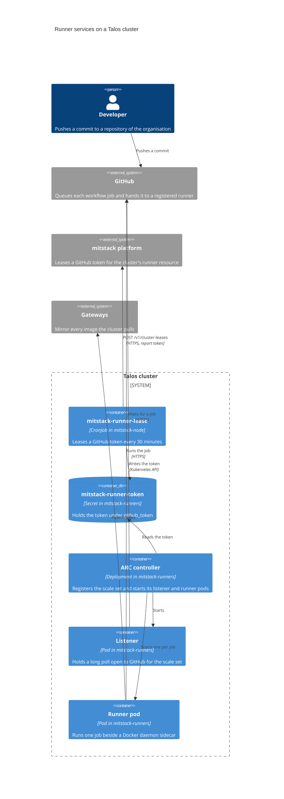
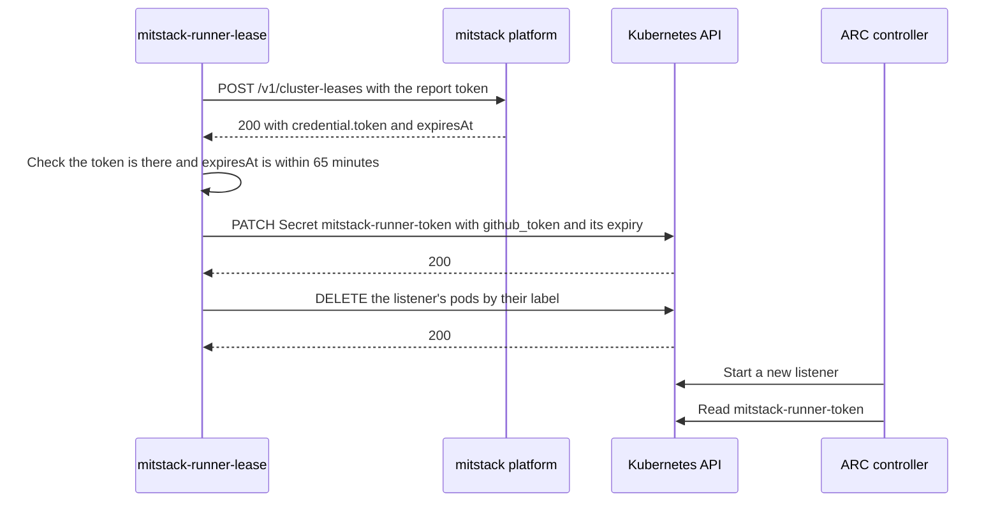
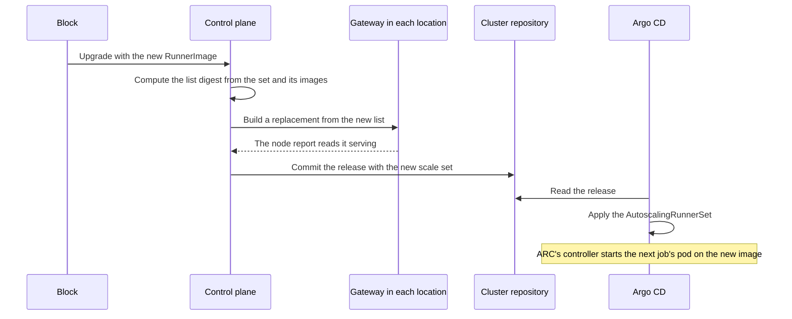

# Runner services

A cluster with runner services runs the GitHub Actions jobs of one
organisation as pods. ARC starts a pod for each job a repository queues and
removes the pod once the job ends. This page is for whoever writes the block's
operator, the program that builds and upgrades a block's cluster with this kit.
It explains what the kit adds, how to switch the services on, and how a token
and a release reach the cluster.

Back to [the README](../README.md).

## The terms this page uses

| Term | What it means here |
|---|---|
| Plane | The kit's `controlplane.Plane`, which describes one cluster to build |
| Runner inputs | The `components.RunnerInputs` a plane names to switch the runner services on |
| The platform | mitstack's API, which issues leases and receives the node report |
| Lease | A short-lived credential the platform grants a cluster, here a GitHub token |
| ARC | actions-runner-controller, GitHub's operator for self-hosted runners |
| Runner group | A group of an organisation's self-hosted runners, which decides the repositories they serve |
| dind | Docker in Docker: a Docker daemon in a sidecar container of the job's pod |
| emptyDir | A Kubernetes volume that starts empty with its pod and is deleted with it |
| Gateway | The kit's server in each location, which mirrors every image the cluster's nodes pull |
| Node report | The kit's job that posts each node's state to the platform |
| Report token | The token the node report and the lease job present to the platform |
| Burst member | A Cloud worker added for a burst of load, labelled `mitstack.dev/burst` |
| Worker | A node outside the control plane, either a Cloud pool server or a dedicated server |
| Taint | A mark on a node that keeps off every pod without a matching toleration |
| Toleration | A pod's declaration that it accepts a taint, so it may run on the tainted node |
| Argo CD | The kit's deploy tool, which applies every component's manifests to the cluster |
| Rerender | The kit's render of a running node's configuration for a new release, which keeps the settings that node already has |

A block and the other workspace terms are defined in
[the workspace glossary](https://github.com/mitstack-eu/mitstack-workspace/blob/main/docs/glossary.md).

## What a cluster with runner services runs

A cluster runs runner services when its plane names runner inputs. It then
holds the following parts, beside every component a cluster runs anyway:

- The namespace `mitstack-runners`, at the privileged Pod Security level,
  because each job's Docker daemon runs privileged.
- ARC's controller, which watches that namespace alone and runs on the
  control plane. The kit renders it from the gha-runner-scale-set-controller
  0.15.1 chart.
- One scale set, an AutoscalingRunnerSet named for the label a workflow's
  `runs-on` names. It registers in the organisation's runner group, starts no
  runner while no job waits, and starts at most the number of runners the
  operator sets.
- The scale set's listener, a pod ARC's controller starts on the control
  plane, which holds a long poll open to GitHub and asks the controller for a
  runner pod when a job waits.
- A runner pod for each job. It runs the actions-runner image beside a Docker
  daemon as a sidecar, so a job can build and run containers. Every volume it
  mounts is an emptyDir, it mounts no service account token, and it may run on
  a burst member. It never runs on a control-plane node.
- A fixed CPU and memory request on each container of the runner pod, the
  same for every block, with a limit equal to each request. Kubernetes then
  gives the pod its `Guaranteed` class, the class whose containers keep what
  they asked for. The runner container asks for whole cores, so a job's steps
  get cores of their own, as the next section explains. The figures live only
  in `components/runners.go`, so read them there. One job then fits on
  a cx23, Hetzner's 2 vCPU and 4 GB server and the smallest a Cloud pool may
  list. It fits beside every DaemonSet, the pods the kit runs once on each
  node, such as the mesh and network agents. A job that finds no room on any
  node waits, so a Cloud pool that scales adds a burst member for it, as
  [the README](../README.md#how-a-cloud-pool-scales-with-the-load) explains. A
  test in `rendered_set_test.go` at the kit's root sums those DaemonSets'
  requests and fails once the job no longer fits.
- The CronJob `mitstack-runner-lease` in `mitstack-node`, which runs on the
  control plane and keeps the GitHub token ARC reads from the Secret
  `mitstack-runner-token` fresh.

The three pod policies `mitstack-disallow-host-path`,
`mitstack-require-resource-limits` and `mitstack-restrict-image-registries`
skip `mitstack-runners`, as
[the README's table of skipped namespaces](../README.md#which-namespaces-the-pod-policies-skip)
explains. The cluster runs each one under its usual name, so nothing that
names a policy changes.

The Cilium policy `mitstack-runners-flows` lets every pod of the namespace
reach the API server and the cluster's DNS. Each pod also reaches GitHub on
port 443, at `github.com`, `api.github.com` and `*.actions.githubusercontent.com`,
which ARC's controller and listener need. Only a job's pod, which ARC labels
`app.kubernetes.io/component: runner`, reaches the rest of the internet, since
a job reaches whatever its workflow pulls or calls.

Every node's kubelet starts collecting unused images once 80% of a disk is in
use, and evicts pods once less than 15% of a disk is free for a minute. A
job's images and build caches fill a disk quickly, and an eviction stops a pod
gracefully where a full disk would stop the node. A node the kubelet marks with the
`node.kubernetes.io/disk-pressure` taint reads as not serving in the node
report, so the redundancy guard counts it as down.

## How a job gets cores of its own

A job's steps run in the runner container. When that container shares every
core of its node with the node's other pods, a step's timings vary with
whatever else runs there, and `nproc` prints the node's cores rather than the
job's.

Each worker's kubelet therefore runs the static CPU manager policy, which
gives a container of a `Guaranteed` pod that asks for whole cores those cores
alone. `nproc` in a step then prints the cores the runner asked for. The
Docker daemon and the init container ask for a fraction of a core, so they
run on the cores the node shares, beside the node's other pods.

The policy keeps at least one core shared for the system. The kubelet rounds
the CPU it keeps for the system up to whole cores, and Talos keeps 50m on
every node. On a node of N cores, N minus one cores can therefore go to jobs,
and the scheduler's sum of requests never passes that.

The control-plane nodes keep the default policy, since no job runs there.

## Why the runner token stays on the control plane

The runner token lets its holder register runners in the organisation's
runner groups. A runner registered that way could take jobs queued by any
repository of the organisation. A job's pod is privileged, so a job that
escapes its pod can read whatever its node holds, including the service
account tokens of the pods beside it.

The kit therefore keeps the three pods that use the runner token on the
control-plane nodes, where no job's pod runs:

1. ARC's controller reads the token to register the scale set.
2. The listener holds the token while it waits for jobs.
3. The lease job writes a new token into the Secret every 30 minutes.

Each of those pods selects the label Talos gives a control-plane node,
`node-role.kubernetes.io/control-plane`. When a plane sets `AppsOnWorkers`,
so its apps run on workers alone, Talos also gives each control-plane node a
NoSchedule taint under the same key, which keeps off every pod that has no
toleration for it. These three pods carry that toleration. The runner
pod's node affinity refuses the label. The account a job runs as mounts no
service account token, and no role bound to it reads the Secret, so it cannot
read the token through the Kubernetes API either.

Since a job never runs on a control-plane node, a cluster with runner services
needs at least one worker, or a Cloud pool that can add one, or every job
waits unscheduled. The plane does not refuse a cluster without either, since
it sees only the workers that exist and not how far the block's pool may grow.

This placement leaves two paths open. Several components on every cluster,
Argo CD's application controller among them, hold cluster-wide roles that may
read every Secret, the runner token included. Argo CD's application controller
selects only Linux nodes, so it may run on a worker beside a job, and a job
that escapes onto that worker could use its account. Jobs from different
repositories can also share a worker, and a job that escapes may reach what
that node holds for the other jobs on it. Closing the first path would take workers that run CI jobs and
nothing else, and closing the second would take one job per worker.

## How the parts fit together

## How an operator switches the services on

A block switches the services on by setting `Plane.Runners` to a
`components.RunnerInputs`. Both live in this repository,
`github.com/mitstack-eu/talos-cluster-kit`: `Plane` in the package
`controlplane`, in `controlplane/plane.go`, and `RunnerInputs` in the package
`components`. A plane whose `Runners` is nil runs no runner, and its cluster
renders as it did before.

A block built on the robot cluster module never sets the plane itself. That
module lives under `operator/robotcluster` and holds what an operator of a
cluster with a Robot worker shares, as the
[README](../README.md#the-robot-cluster-module-for-a-cluster-with-a-robot-worker)
describes. The block sets `Config.Runners` instead, a function that reads the
request and returns its `RunnerInputs`, and the module puts the answer on every
plane it renders. A nil `Config.Runners` runs no runner.

When the function returns an error, a subscribe or upgrade refuses with it
before any Hetzner change. `Cluster.Observe`, which reads the whole cluster's
state, then reads the cluster as unknown and names the error. An unsubscribe
never asks the function, so a request whose runners cannot be named still tears
its cluster down to absent.

| Field | What it holds | What the kit refuses |
|---|---|---|
| `Organization` | The GitHub organisation login, which gives the scale set its URL `https://github.com/<Organization>` | A value that is no GitHub login |
| `Group` | The runner group the scale set registers into | A value that is no DNS label |
| `ScaleSet` | The scale set's name, which is also the label a job's `runs-on` names | A value that is no DNS label |
| `RunnerImage` | The actions-runner image each job runs | An image without its digest |
| `DindImage` | The Docker daemon image each job's sidecar runs | An image without its digest |
| `MaxRunners` | The most jobs that run at once | A value below 1 |
| `LeaseResource` | The resource type whose GitHub token the lease job asks the platform for | An empty value |

The block's operator names the resource it requires from the platform as
`LeaseResource`, so the platform knows which GitHub App mints the token. The
kit holds no GitHub key and renders no token. The scale set names the Secret
`mitstack-runner-token`, and the lease job fills it.

The kit builds two sets from the inputs. `Set.WithRunnerServices` adds only
the served services: the namespace, ARC's controller and the three pod
policies that skip the namespace. A gateway mirrors that set, since it needs
no scale set. `Set.WithRunners` adds the same services and the scale set
rendered from the inputs, which the build and every release carry.

A build of a plane with runner inputs carries the runner services from its
first boot. A plane that gains them on an upgrade replaces each gateway first,
as the last section of this page shows, and its next release carries the rest.

The kit renders the disk eviction settings, and on a worker the static CPU
manager policy, into a node's configuration when it builds the node. A
rerender reads whether the running node carries the disk eviction settings,
and renders this release's kubelet settings for a node that does. A worker
built before the static policy therefore takes it at the next rollout of node
configuration. Talos restarts the kubelet with no reboot and drops the CPU
manager state the old policy left, which the kubelet otherwise refuses to
start with.

A cluster that gains the runner services by an upgrade keeps its nodes'
kubelet settings, and each node takes the settings only once it is rebuilt.

## How the GitHub token stays fresh

The platform leases a GitHub installation token, narrowed to the
organisation's self-hosted runners, which lives an hour. ARC's controller
reads it from the Secret to register the scale set. The CronJob
`mitstack-runner-lease` runs
`cluster-tokens.sh runner-lease` every 30 minutes, so a token stays valid
through one failed run. Each run asks for a new token, whatever the Secret
holds, and makes three calls in turn.

The Secret starts empty, so ARC registers the scale set only after the
CronJob's first run. That run comes at the next full or half hour, up to 30
minutes after the build. ARC's controller retries the registration with a
growing delay until the Secret holds a token. The calls of each run are these:

The listener keeps the token it started with, so the job deletes the
listener's pods once the new token is in the Secret. ARC's controller then
starts a listener that reads it. The job deletes only the listener's pods,
selected by their label, and no runner pod.

A run fails, and writes nothing, in each of these cases:

- The platform answers anything but 200. The run names the status and the
  resource, and the next run is the retry.
- The answer holds no token, or an expiry that is not after now and within 65
  minutes of now.
- The Secret refuses the patch. The run names the Secret and the status and
  leaves the listener running on the token it holds.

The job's account may patch the one Secret and delete pods by collection in
`mitstack-runners`. It may read, list or create nothing. Kubernetes lets that
account delete any pod of the namespace, so the label selector of the job's
call limits the deletion to the listener's pods. The job never prints the
token or passes it on a command line.

## How a runner release reaches the cluster

Every image a node pulls comes through the gateways' mirror, and a gateway
never changes once it runs. A new runner image, a new dind image or a new ARC
release therefore changes the gateways' list digest, and the upgrade replaces
each gateway before the release reaches the cluster. A change to `MaxRunners`,
`Group` or the organisation names no image, so it leaves the gateways alone.

A job that runs during the change ends on the image it started with. ARC's
controller starts each later job on the new image.

## Where the parts live

| File | What it holds |
|---|---|
| `components/runners.go` | `RunnerInputs`, its checks, and `Set.WithRunnerServices` and `Set.WithRunners` |
| `components/runners/runners.yaml` | The namespace and its Cilium policy |
| `components/runners/scale-set.yaml` | The template of the scale set, its runner pod, and the Role and RoleBinding that let ARC's controller create each listener's Role |
| `components/runners/policies/` | The three pod policies that skip `mitstack-runners`, which `scripts/render-components.sh` writes |
| `components/gha-runner-scale-set-controller/gha-runner-scale-set-controller.yaml` | ARC's controller and its CRDs, which `scripts/render-components.sh` renders |
| `controlplane/runners.go` and `controlplane/manifests/runner-token.yaml` | The runner token's Secret and the lease CronJob |
| `controlplane/scripts/cluster-tokens.sh` | The `runner-lease` verb the CronJob runs |
| `components/runners.go` | The CPU and memory each container of a job's pod asks for and is limited to |
| `nodeconfig/documents.go` | The kubelet's disk eviction settings and a worker's static CPU manager policy |
| `report/members.go` | The reading of a node under disk pressure |

[The development page](development.md) explains how to render the
controller and the policies again.
