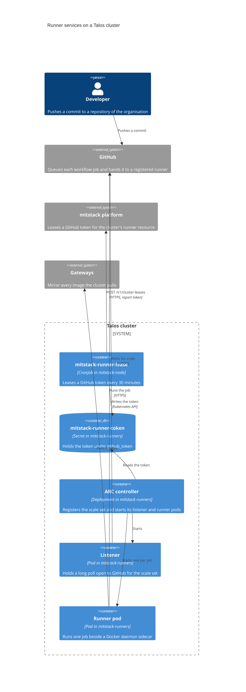
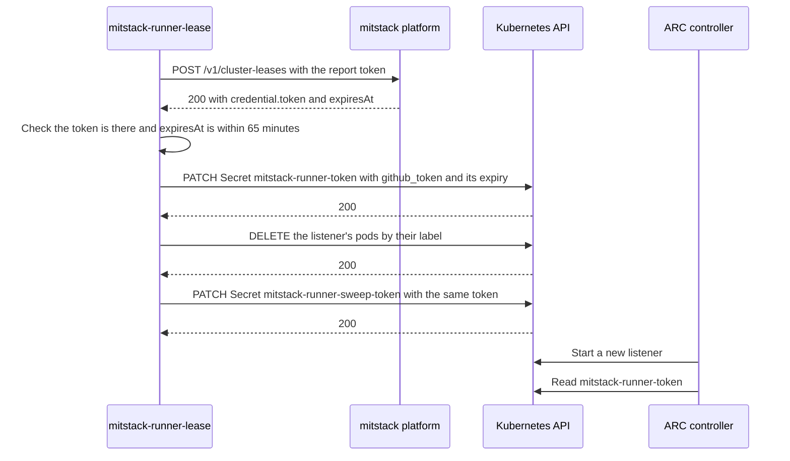
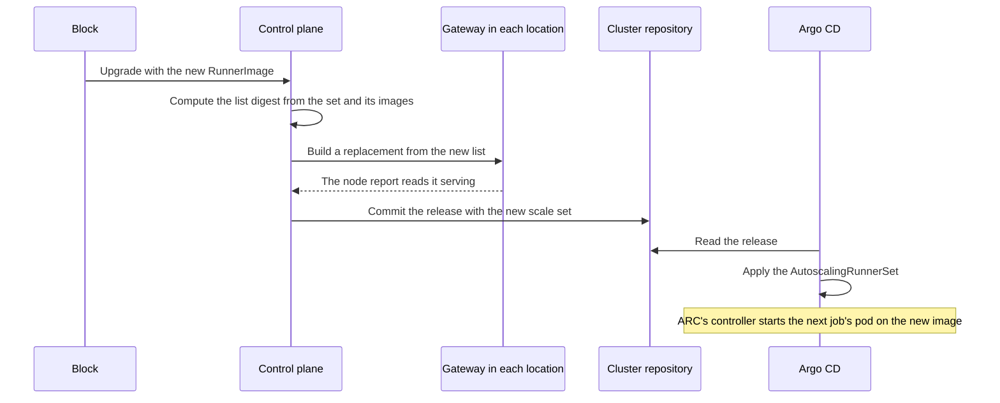

# Runner services

A cluster with runner services runs the GitHub Actions jobs of one
organisation as pods. ARC starts a pod for each job a repository queues and
removes the pod once the job ends. This page is for whoever writes the block's
operator, the program that builds and upgrades a block's cluster with this kit.
It explains what the kit adds, how to switch the services on, and how a token
and a release reach the cluster.

Back to [the README](../README.md).

## The terms this page uses

| Term | What it means here |
|---|---|
| Plane | The kit's `controlplane.Plane`, which describes one cluster to build |
| Runner inputs | The `components.RunnerInputs` a plane names to switch the runner services on |
| The platform | mitstack's API, which issues leases and receives the node report |
| Lease | A short-lived credential the platform grants a cluster, here a GitHub token |
| ARC | actions-runner-controller, GitHub's operator for self-hosted runners |
| Runner group | A group of an organisation's self-hosted runners, which decides the repositories they serve |
| Scale set | ARC's `AutoscalingRunnerSet`: the runners a workflow reaches by naming the scale set in `runs-on`, which ARC starts as jobs wait |
| dind | Docker in Docker: a Docker daemon in a sidecar container of the job's pod |
| emptyDir | A Kubernetes volume that starts empty with its pod and is deleted with it |
| Gateway | The kit's server in each location, which mirrors every image the cluster's nodes pull |
| Node report | The kit's job that posts each node's state to the platform |
| Report token | The token the node report and the lease job present to the platform |
| Talos | The operating system every node runs, set up by one machine configuration per node |
| Kubelet | The Kubernetes agent on each node, which starts the node's pods and gives them their CPU and memory |
| Cloud pool | The cluster's workers on Hetzner Cloud servers, which grows and shrinks with the load |
| EphemeralRunner | The object ARC keeps for each runner under the runner's name, which it creates before it registers the runner |
| Offline | GitHub's status for a registered runner that no longer reports in to GitHub |
| Dead runner | A runner GitHub still lists offline after ARC has let it go, which no job can ever run on |
| Runner sweep | The node report's removal of each dead runner of the cluster's scale set |
| Redundancy guard | block-kit's check that refuses to remove a node or gateway until enough of the others read serving in a node report |
| Right | A permission Kubernetes grants an account through a Role or ClusterRole, such as `list` on one kind of object |
| Capability | A service a block offers the apps subscribed to it, here CI runners, which the block reads as healthy or unhealthy |
| Burst member | A Cloud worker added for a burst of load, labelled `mitstack.dev/burst` |
| Worker | A node outside the control plane, either a Cloud pool server or a dedicated server |
| Worker image | The disk snapshot an install builds, which every Cloud worker boots from |
| Taint | A mark on a node that keeps off every pod without a matching toleration |
| Toleration | A pod's declaration that it accepts a taint, so it may run on the tainted node |
| Argo CD | The kit's deploy tool, which applies every component's manifests to the cluster |
| Rerender | The kit's render of a running node's configuration for a new release, from the cluster and node settings it reads back from that node |
| Node rollout | The kit's Job that gives each running node a release's configuration, one node at a time and without a reboot |
| Subscribe | The call mitstack sends the operator to build or change the cluster, which the operator answers one step at a time |
| Install | The subscribes that first build a cluster, and render every node's first configuration |
| Update | A later subscribe that moves a running cluster onto a newer release of its block, and so onto the kit release that block release carries. The platform's API and console call it an upgrade |
| Upgrade | A request that changes a running cluster's parameters, such as one that names runner inputs |
| Observe | The operator's read of the cluster's state, whose status names what the next subscribe would do |

A block and the other workspace terms are defined in
[the workspace glossary](https://github.com/mitstack-eu/mitstack-workspace/blob/main/docs/glossary.md).

## What a cluster with runner services runs

A cluster runs runner services when its plane names runner inputs. It then
holds the following parts, beside every component a cluster runs anyway:

- The namespace `mitstack-runners`, at the privileged Pod Security level.
  Each job's Docker daemon runs privileged or, on a runner group that isolates
  its jobs, holds added capabilities and unconfined profiles. The baseline
  level refuses both.
- ARC's controller, which watches that namespace alone and runs on the
  control plane. The kit renders it from the gha-runner-scale-set-controller
  0.15.1 chart.
- One scale set, an AutoscalingRunnerSet named for the label a workflow's
  `runs-on` names. It registers in the organisation's runner group, starts no
  runner while no job waits, and starts at most the number of runners the
  operator sets.
- The scale set's listener, a pod ARC's controller starts on the control
  plane, which holds a long poll open to GitHub and asks the controller for a
  runner pod when a job waits.
- A runner pod for each job. It runs the actions-runner image beside a Docker
  daemon as a sidecar, so a job can build and run containers. Every volume it
  mounts is an emptyDir, it mounts no service account token, and it may run on
  a burst member. It never runs on a control-plane node. With the runner
  inputs' switch `IsolateJobs` on, it runs in its own user namespace, as
  [How a runner group isolates its jobs](#how-a-runner-group-isolates-its-jobs)
  explains.
- A fixed CPU and memory request on each container of the runner pod, the
  same for every block, with a limit equal to each request. Kubernetes then
  gives the pod its `Guaranteed` class, the class whose containers keep what
  they asked for. The runner container asks for whole cores, so a job's steps
  get cores of their own, as the next section explains. The figures live only
  in `components/runners.go`, so read them there. By the sizes Hetzner
  publishes, one job then fits on a cx23, Hetzner's 2 vCPU and 4 GB server and
  the smallest a Cloud pool may list. It fits beside every DaemonSet, the pods
  the kit runs once on each node, such as the mesh and network agents. A job
  that finds no room on any node waits, so a Cloud pool that scales adds a
  burst member for it, as
  [the README](../README.md#how-a-cloud-pool-scales-with-the-load) explains. A
  test in `rendered_set_test.go` at the kit's root sums those DaemonSets'
  requests against the published sizes and fails once the job no longer fits.
- The CronJob `mitstack-runner-lease` in `mitstack-node`, which runs on the
  control plane and keeps the GitHub token ARC reads from the Secret
  `mitstack-runner-token` fresh. It writes the same token into the Secret
  `mitstack-runner-sweep-token`, which the node report reads to remove dead
  runners.

The three pod policies `mitstack-disallow-host-path`,
`mitstack-require-resource-limits` and `mitstack-restrict-image-registries`
skip `mitstack-runners`, as
[the README's table of skipped namespaces](../README.md#which-namespaces-the-pod-policies-skip)
explains. The cluster runs each one under its usual name, so nothing that
names a policy changes.

The Cilium policy `mitstack-runners-flows` lets every pod of the namespace
reach the API server and the cluster's DNS. Each pod also reaches GitHub on
port 443, at `github.com`, `api.github.com` and `*.actions.githubusercontent.com`,
which ARC's controller and listener need. Only a job's pod, which ARC labels
`app.kubernetes.io/component: runner`, reaches the rest of the internet, since
a job reaches whatever its workflow pulls or calls.

On a cluster installed with runner services, every node's kubelet starts
collecting unused images once 80% of a disk is in use, and evicts pods once
less than 15% of a disk is free for a minute. A
job's images and build caches fill a disk quickly, and an eviction stops a pod
gracefully where a full disk would stop the node. A node the kubelet marks with the
`node.kubernetes.io/disk-pressure` taint reads as not serving in the node
report, so the redundancy guard counts it as down.

## How a job gets cores of its own

A job's steps run in the runner container. When that container shares every
core of its node with the node's other pods, a step's timings vary with
whatever else runs there. The Linux command `nproc`, which prints how many
cores a process may use, then prints the node's cores rather than the job's.

Kubernetes counts CPU in thousandths of a core, so `1000m` is one whole core
and `250m` is a quarter of one. A container asks for whole cores when its CPU
request is a whole number of them, such as `1000m` or `2000m`.

Each worker of a cluster that runs CI jobs therefore runs the static CPU
manager policy once it has taken that setting, as
[How each node comes to run the kubelet settings](#how-each-node-comes-to-run-the-kubelet-settings)
explains. The policy is a kubelet setting that splits the node's cores in two:

1. A container of a `Guaranteed` pod that asks for whole cores gets those
   cores alone, and no other container runs on them.
2. Every other container shares the cores left over, which the kubelet calls
   the shared pool.

`nproc` in a step then prints the number of whole cores the runner container
asks for, which is 1 at the request `components/runners.go` sets. The Docker daemon asks
for a fraction of a core, and so does the init container, which copies files
from the runner image into a shared volume before the other containers start.
Both therefore run in the shared pool, beside the node's other pods.

The kubelet refuses the static policy unless some CPU is kept for the system,
so the shared pool never empties. Talos keeps 50m of CPU for the system on
every node, and the kubelet rounds that up to one whole core it keeps in the
shared pool. On a node of N cores, N minus one cores can therefore go to jobs.

A cx23 shows the arithmetic. It has 2 cores, so the kubelet keeps one in the
shared pool and one can go to a job's runner. The scheduler, which places
pods on nodes, offers pods the node's 2000m less Talos's 50m, so 1950m. Whole
cores it places there therefore never pass one either.

The control-plane nodes keep the kubelet's default policy, `none`, under which
every container shares every core. No job runs there.

## How each node comes to run the kubelet settings

The install alone decides whether a cluster's nodes run CI jobs. Every node
boots on a configuration the install renders: the control-plane nodes, the
dedicated worker, and the worker image every Cloud worker boots from, burst
members included. When the plane names runner inputs at the install, the
install renders the kubelet's CI settings into each of them.

The kit keeps no record of the install's choice outside the nodes, so a
rerender reads it back from the running node. A node that carries the disk
eviction settings takes the CI settings of the kit release an Update carries,
and a node without them takes none. An upgrade that names runner inputs on a
cluster installed without them therefore leaves every kubelet as the install
rendered it.

The table below is the one place this page names kit releases. It maps the
kit release the install ran to the settings it renders and to when a worker
comes to run the static policy.

| Kit release at the install | The kubelet's CI settings it renders | When a worker runs the static CPU manager policy |
|---|---|---|
| v0.117.0 or earlier, or any release on a plane without runner inputs | None | Never, since a rerender finds no disk eviction settings to read |
| v0.118.0 to v0.128.x | The disk eviction settings, on every node | A running worker, from the node rollout of the first Update onto v0.129.0 or later, with no reboot and no rebuild. A Cloud worker the cluster creates later, such as a burst member, boots from the install's worker image without the policy, and runs it from the first node rollout that reaches it |
| v0.129.0 or later | The disk eviction settings on every node, and the static CPU manager policy on each worker | From its first boot, since its configuration or the worker image it boots from carries the policy |

The platform sends an Update once the block release a subscription uses moves
to a newer one. The kit release that block release carries decides the row an
Update moves a running worker into.

A cluster in the first row takes the policy only from a new install. For a
running cluster, that means you delete it and create it again. mitstack sends
the operator an unsubscribe, which removes the cluster, and a later subscribe
builds it with runner inputs on a block release whose kit release sits in the
last row.

A removal deletes every Cloud resource that carries the subscription's labels,
as
[How a block drives the Cloud control plane](../README.md#how-a-block-drives-the-cloud-control-plane)
explains. Those include the worker image and the snapshot that holds the
cluster's keys. A block built on the robot cluster module also deletes the
cluster repository and releases the dedicated server, as
[A cluster with no dedicated server](../README.md#a-cluster-with-no-dedicated-server)
describes. `Cluster.Delete` in `operator/robotcluster/teardown.go` holds that
removal.

At a node rollout, Talos applies the new configuration without a reboot.
Talos stops the kubelet, deletes the CPU manager's state file
`cpu_manager_state` when the kubelet would refuse it under the new policy,
and starts the kubelet again. The kubelet refuses a state file written under
another policy, so without that step it would not start.

Kubernetes applies a CPU manager policy only to the pods the kubelet starts
after the change. Neither Talos nor the rollout drains the node first, which
would move its pods to other nodes before the change. A job pod already
running therefore keeps sharing its node's cores until it ends, and each later
job gets cores of its own.

### How you read which row a worker is in

The kubelet's running settings tell you the row. You read them through the
Kubernetes API's path to a node's kubelet, so you need a kubeconfig for the
cluster, for an account that may `get` the resource `nodes/proxy`. Run this
for a worker, with its node name in place of `<worker>`:

```bash
kubectl get --raw "/api/v1/nodes/<worker>/proxy/configz" | jq '.kubeletconfig | {evictionSoft, cpuManagerPolicy}'
```

| What it prints | What it means for the worker |
|---|---|
| `evictionSoft` null, `cpuManagerPolicy` `none` | The install rendered no CI settings, so the worker is in the first row and runs the policy only once the cluster is built again |
| `evictionSoft` set, `cpuManagerPolicy` `none` | The install rendered the disk eviction settings alone, so the worker is in the middle row and runs the policy once a node rollout of a kit release from the last row reaches it |
| `evictionSoft` set, `cpuManagerPolicy` `static` | The worker runs the policy |

The node report answers a narrower question, and needs no kubeconfig. The
kit posts it to the platform, which serves it at
`GET /v1/subscriptions/<id>/node-reports`. Each node's `machineConfig` in it
names the release the node's machine configuration was rendered from, by the
digest of that release's tools image. The tools image is the one container
image each kit release builds, which carries the kit's scripts and its
`machine-config` command. The report therefore shows whether a release's
node rollout has reached a worker. It cannot tell the row, since a node
without the disk eviction settings takes each later release's configuration
without them too.

### When the rollout reaches a worker created later

A burst member of a cluster whose install rendered the disk eviction settings
alone boots on the install's kit release. The node report names that release
as the source of its machine configuration, so the kit reads the member as
behind. The
member's jobs share its cores until a node rollout reaches it, which takes
these steps:

1. The kit waits for a node report it trusts: one made after the cluster's
   newest server was created, which names every node and reads each one
   Ready. Until then the cluster reads Unknown, and its status names the
   report it waits on.
2. The next subscribe commits the release's rollout file again, and its Job
   gives the member the release's configuration.
3. When the release's earlier Job already completed, that subscribe takes the
   rollout file out instead. Once a later node report no longer reads the
   earlier Job, the subscribe after it commits the file again, so the rollout
   reaches the member on the second subscribe.

The kit's observe names that step in the cluster's status, such as "the next
subscribe commits the release's machine configuration rollout", and the
platform sends a subscribe while the observe names a step. The kit does not
say when the platform observes the cluster after a node report arrives, so
this page cannot say how long a member runs without the policy.
[How an Update reaches each node's configuration](../README.md#how-an-update-reaches-each-nodes-configuration)
gives the rollout's full rules.

## Why the runner token stays on the control plane

The runner token lets its holder register runners in the organisation's
runner groups. A runner registered that way could take jobs queued by any
repository of the organisation. On a runner group that does not isolate its
jobs, a job's Docker daemon runs privileged. A job that escapes its pod can
then read whatever its node holds, including the service account tokens of
the pods beside it.

The kit therefore keeps the four pods that use the runner token on the
control-plane nodes, where no job's pod runs:

1. ARC's controller reads the token to register the scale set.
2. The listener holds the token while it waits for jobs.
3. The lease job writes a new token into the Secret every 30 minutes.
4. The node report reads the lease job's copy of it in
   `mitstack-runner-sweep-token` to remove dead runners.

Each of those pods selects the label Talos gives a control-plane node,
`node-role.kubernetes.io/control-plane`. When a plane sets `AppsOnWorkers`,
so its apps run on workers alone, Talos also gives each control-plane node a
NoSchedule taint under the same key, which keeps off every pod that has no
toleration for it. These four pods carry that toleration. The runner
pod's node affinity refuses the label. The account a job runs as mounts no
service account token, and no role bound to it reads the Secret, so it cannot
read the token through the Kubernetes API either.

Since a job never runs on a control-plane node, a cluster with runner services
needs at least one worker, or a Cloud pool that can add one, or every job
waits unscheduled. The plane does not refuse a cluster without either, since
it sees only the workers that exist and not how far the block's pool may grow.

This placement leaves two paths open. Several components on every cluster,
Argo CD's application controller among them, hold cluster-wide roles that may
read every Secret, the runner token included. Argo CD's application controller
selects only Linux nodes, so it may run on a worker beside a job, and a job
that escapes onto that worker could use its account. Jobs from different
repositories can also share a worker, and a job that escapes may reach what
that node holds for the other jobs on it. Closing the first path would take workers that run CI jobs and
nothing else, and closing the second would take one job per worker.

## How a runner group isolates its jobs

A runner group can run each job's pod in its own user namespace. A user
namespace is a Linux feature that maps the users inside a pod onto other users
of its node, so root inside the pod is an unprivileged user on the node. The
switch is the runner inputs' field `IsolateJobs`, and it is off unless the
block sets it. Off, the job's Docker daemon runs privileged and shares its
node's users, as the sections above describe.

### What a job's pod runs with the switch on

The pod sets `hostUsers: false`, which gives it its own user namespace. Its
Docker daemon runs with `privileged: false` and the settings in the table
below. A local test ran the daemon with all of them on kind, a Kubernetes
cluster whose nodes are Docker containers on one workstation, and then took
each setting away alone. Each row gives what failed without it.

Linux splits root's power into parts it calls capabilities, such as the power
to mount a filesystem, so a process can hold some of them alone. This section
uses the word capability only in that Linux sense. Seccomp is the kernel's filter of the system calls a process may make, and
AppArmor is a kernel profile of the files and actions a process may use.

| Setting on the `dind` container | What failed without it in the local test |
|---|---|
| `procMount: Unmasked`, which leaves the paths Kubernetes masks in `/proc` readable | `docker run` failed with "failed to disable IPv6 on container's interface eth0" |
| The added capability `SYS_ADMIN` | The image's start script failed with "mount: permission denied" |
| The added capability `NET_ADMIN` | The daemon stopped with "failed to create NAT chain DOCKER" |
| The added capability `SYS_PTRACE` | `docker exec`, and with it a service container's health check, failed with "failed to open /proc/<pid>/ns/ipc: Permission denied" |
| `seccompProfile` of type `Unconfined` | Under `RuntimeDefault`, `docker run` failed with "unable to join session keyring" |
| `appArmorProfile` of type `Unconfined` | Nothing, since the test never ran without it: its nodes had no AppArmor to enforce |

With these settings, `docker run`, `docker build`, `docker exec` and a
service container with a published port all worked in the local test. A
workflow step that runs `docker run --privileged` still fails, since the
daemon cannot mount the kernel's `/sys` for that container. The local test
showed this error, and which kernel rule refuses the mount is not established:

```text
docker: Error response from daemon: failed to create task for container: failed to create shim task: OCI runtime create failed: runc create failed: unable to start container process: error during container init: error mounting "sysfs" to rootfs at "/sys": mount src=sysfs, dst=/sys, dstFd=/proc/thread-self/fd/14, flags=MS_NOSUID|MS_NODEV|MS_NOEXEC: operation not permitted
```

### What each worker holds with the switch on

A Talos machine configuration is a list of documents, each of a type that
names what it sets, such as `SysctlConfig` for the kernel's settings. With the
switch on, each worker's machine configuration carries two more documents. The
control-plane nodes carry neither, since no job runs there.

Containerd is the runtime that starts every pod's containers on a node, and
runc is the program it starts each container with. The second document
changes how containerd runs runc.

| Document | What it sets | Why a job's pod needs it |
|---|---|---|
| `SysctlConfig` | The kernel setting `user.max_user_namespaces` to `11255` | Talos's kernel hardening sets the limit to 0, so the kernel would give no pod a user namespace. 11255 is the value Talos's guide to user namespaces sets |
| `CRICustomizationConfig` named `mitstack-job-isolation` | runc's `cgroup_writable = true` in containerd's configuration | runc then gives a pod's container a cgroup it may write, which the Docker daemon needs to start a container. A cgroup is the kernel's group that limits a set of processes' CPU and memory |

Talos restarts containerd whenever a `CRICustomizationConfig` is applied,
changed or removed, as its reference for that document says.

These pages of Talos v1.14, the release the kit pins, describe both
documents and the limit:

- [SysctlConfig](https://docs.siderolabs.com/talos/v1.14/reference/configuration/runtime/sysctlconfig)
- [CRICustomizationConfig](https://docs.siderolabs.com/talos/v1.14/reference/configuration/cri/cricustomizationconfig)
- [Talos's guide to user namespaces](https://docs.siderolabs.com/kubernetes-guides/security/usernamespace),
  whose value Talos's own test patch `hack/test/patches/usernamespace.yaml`
  sets too
- [Talos's page on customising containerd](https://docs.siderolabs.com/talos/v1.14/configure-your-talos-cluster/images-container-runtime/containerd.md)
- The hardening itself, the function `GetKernelParams` in
  `pkg/kernel/kspp/kspp.go` of the Talos v1.14.4 source, which sets
  `user.max_user_namespaces` to 0

### How a worker comes to carry the documents

The install alone decides whether the workers carry them, as it decides the
kubelet's CI settings. The install renders both documents into the dedicated
worker's configuration and into the worker image. Every Cloud worker boots
from that image, so a steady Cloud worker and a burst member carry them
alike. A rerender reads the switch back from the `mitstack-job-isolation`
document on the node. It refuses a node that holds a `CRICustomizationConfig`
under any other name, since the rerender would drop it.

The scale set follows the plane's runner inputs instead. Each subscribe
renders the cluster's manifests from them and commits any change for Argo CD
to apply, once every gateway serves the images they name. An upgrade that sets
the switch on for a cluster installed without it therefore changes the job
pods at its next subscribe, while every worker keeps a kernel that allows no
user namespace. No test has run such a pod, so what it does then is unproven.

An upgrade that sets the switch off returns the scale set to its privileged
daemon. Each worker keeps both documents, since nothing removes them. A
rerender reads the switch back from the node and renders both again.

For a running cluster, the switch therefore takes effect on every worker
only from a new install. You delete the cluster and create it again, as
[How each node comes to run the kubelet settings](#how-each-node-comes-to-run-the-kubelet-settings)
describes.

### What is unproven on Talos

The local test ran on kind with containerd 2.3.4 and runc 1.4.3, so every
finding above is unproven on Talos until a job runs there. Four questions are
open:

1. Whether Talos runs a job's pod with these settings as the local test's
   cluster did.
2. Whether containerd's restart, when a running worker takes the
   `CRICustomizationConfig`, stops a job running there.
3. Whether the pod needs the `appArmorProfile` of type `Unconfined` on
   Talos, since the test's nodes had no AppArmor.
4. Whether `SYS_PTRACE` is enough for `docker exec` there. Talos's hardening
   sets `kernel.yama.ptrace_scope` to 2, which lets only a process holding
   that capability trace another, and the workstation the test ran on reads 1.

## How a job's containers reach the network

A container that Docker starts inside a job, such as a step of an image build
or a service container, sends its traffic through one of Docker's bridges in
the job's pod. A bridge is a network device the Docker daemon creates:
`docker0` for its default network, and one whose name starts with `br-` for
each custom network, such as the one a job with `services:` gets.

The kit runs Istio in ambient mode, which writes redirect rules inside every
pod. Those rules treat traffic that arrives from a bridge as a call into the
pod. Without more, a container's fetch never leaves the pod, and a call from
one container to another by name is reset.

The runner pod's template therefore carries the annotation Istio documents for
Docker in Docker, `istio.io/reroute-virtual-interfaces`, with the value
`"docker0,br-+"`. For each entry, Istio's CNI agent, the pod on each node that
sets up a new pod's network for the mesh, writes two rules at the head of the
pod's `ISTIO_PRERT` chain, a list of rules in the kernel's packet filter. The
first sends the entry's TCP traffic to port 15001, where the mesh takes a
pod's outgoing calls, and the second stops the chain there. The `+` in `br-+`
is the packet filter's wildcard, so the entry matches the bridge of every
custom network. A container's traffic then leaves the pod the way a job's own
steps' traffic does.

ARC copies the template's annotations onto each runner pod. The listener
starts no Docker, so its template carries no annotation. The two entries live
in `dockerBridges` in `components/runners.go`.

Istio marks the annotation Alpha, so a later Istio release may change it. A
copy of both rules written by hand on a runner pod made a container on either
network reach the internet, one container reach another by name, and a
`docker build` fetch its package updates. No job has run on a pod that carries
the annotation itself yet, so whether the CNI agent takes `br-+` from it and
writes the rules is unproven. If it does not, the alternative is Istio's
annotation `ambient.istio.io/bypass-inbound-capture`, which drops the mesh's
inbound redirect for the whole pod, so calls into the pod no longer pass
through the mesh. The kit does not use it.

## How the parts fit together



## How an operator switches the services on

A block switches the services on by setting `Plane.Runners` to a
`components.RunnerInputs`. Both live in this repository,
`github.com/mitstack-eu/talos-cluster-kit`: `Plane` in the package
`controlplane`, in `controlplane/plane.go`, and `RunnerInputs` in the package
`components`. A plane whose `Runners` is nil runs no runner, and its cluster
renders as it did before.

A block built on the robot cluster module never sets the plane itself. That
module lives under `operator/robotcluster` and holds what an operator of a
cluster with a Robot worker shares, as the
[README](../README.md#the-robot-cluster-module-for-a-cluster-with-a-robot-worker)
describes. The block sets `Config.Runners` instead, a function that reads the
request and returns its `RunnerInputs`, and the module puts the answer on every
plane it renders. A nil `Config.Runners` runs no runner.

When the function returns an error, a subscribe or upgrade refuses with it
before any Hetzner change. `Cluster.Observe`, which reads the whole cluster's
state, then reads the cluster as unknown and names the error. An unsubscribe
never asks the function, so a request whose runners cannot be named still tears
its cluster down to absent.

| Field | What it holds | What the kit refuses |
|---|---|---|
| `Organization` | The GitHub organisation login, which gives the scale set its URL `https://github.com/<Organization>` | A value that is no GitHub login |
| `Group` | The runner group the scale set registers into | A value that is no DNS label |
| `ScaleSet` | The scale set's name, which is also the label a job's `runs-on` names | A value that is no DNS label |
| `RunnerImage` | The actions-runner image each job runs | An image without its digest |
| `DindImage` | The Docker daemon image each job's sidecar runs | An image without its digest |
| `MaxRunners` | The most jobs that run at once | A value below 1 |
| `LeaseResource` | The resource type whose GitHub token the lease job asks the platform for | An empty value |
| `IsolateJobs` | Whether each job's pod runs in its own user namespace, as [How a runner group isolates its jobs](#how-a-runner-group-isolates-its-jobs) explains. Off by default, which runs the Docker daemon privileged | Nothing |

The block's operator names the resource it requires from the platform as
`LeaseResource`, so the platform knows which GitHub App mints the token. The
kit holds no GitHub key and renders no token. The scale set names the Secret
`mitstack-runner-token`, and the lease job fills it.

The kit builds two sets from the inputs. `Set.WithRunnerServices` adds only
the served services: the namespace, ARC's controller and the three pod
policies that skip the namespace. A gateway mirrors that set, since it needs
no scale set. `Set.WithRunners` adds the same services and the scale set
rendered from the inputs, which the build and every release carry.

A build of a plane with runner inputs carries the runner services from its
first boot. A plane that gains them on an upgrade replaces each gateway first,
as [How a runner release reaches the cluster](#how-a-runner-release-reaches-the-cluster)
shows, and its next release carries the rest.
Its nodes keep the kubelet settings the install rendered, as
[How each node comes to run the kubelet settings](#how-each-node-comes-to-run-the-kubelet-settings)
explains.

## How the GitHub token stays fresh

The platform leases a GitHub installation token, narrowed to the
organisation's self-hosted runners, which lives an hour. ARC's controller
reads it from the Secret to register the scale set. The CronJob
`mitstack-runner-lease` runs
`cluster-tokens.sh runner-lease` every 30 minutes, so a token stays valid
through one failed run. Each run asks for a new token, whatever the Secret
holds, and makes four calls in turn. It asks the platform for a token,
writes it into the runners' Secret, restarts ARC's listener and writes the
token into the sweep's Secret.

The Secret starts empty, so ARC registers the scale set only after the
CronJob's first run. That run comes at the next full or half hour, up to 30
minutes after the build. ARC's controller retries the registration with a
growing delay until the Secret holds a token. The calls of each run are these:



The listener keeps the token it started with, so the job deletes the
listener's pods once the new token is in the Secret. ARC's controller then
starts a listener that reads it. The job deletes only the listener's pods,
selected by their label, and no runner pod.

A run fails, and writes nothing, in each of these cases:

- The platform answers anything but 200. The run names the status and the
  resource, and the next run is the retry.
- The answer holds no token, or an expiry that is not after now and within 65
  minutes of now.
- The Secret refuses the patch. The run names the Secret and the status and
  leaves the listener running on the token it holds.

A run can also fail after it has written the runners' Secret. The job writes
the sweep's Secret last, once the listener has restarted. When that Secret
refuses the patch, the run fails naming it and the status. The runners keep
registering with the new token, and the sweep reads the token of the run
before until the next run.

The job's account may patch the one Secret and delete pods by collection in
`mitstack-runners`, which is one call that deletes every pod a label selector
matches. It may also patch the sweep's one Secret in `mitstack-node`. It
may read, list or create nothing. Kubernetes lets that
account delete any pod of the namespace, so the label selector of the job's
call limits the deletion to the listener's pods. The job never prints the
token or passes it on a command line.

## How a dead runner is removed

ARC registers a runner with GitHub for each job. It gives the runner, the
EphemeralRunner object it keeps for it and the runner's pod one name, and
removes the registration once the job ends. A runner pod deleted or killed
mid-job can leave its registration behind. So can a restart of ARC's
controller, which keeps its list of registrations still to remove in memory.
GitHub then lists the runner offline, and the runner group fills with dead
entries.

The node report is a CronJob that starts a Job every 5 minutes, and each of
those Jobs runs the runner sweep, so the sweep adds no job of its own. A
report whose plane names runner inputs takes these steps:

1. It finds the id of the runner group the runner inputs name, as
   `GET /orgs/<Organization>/actions/runner-groups`, one page of 100.
2. It lists that group's runners, as
   `GET /orgs/<Organization>/actions/runner-groups/<id>/runners`, 100 to a
   page and at most 3 pages.
3. It then reads the pods and EphemeralRunners in `mitstack-runners`. ARC
   creates a runner's EphemeralRunner before it registers the runner, so a
   runner ARC still holds has one of the two by the time of this read.
4. It picks each listed runner that GitHub reads offline, whose name no pod
   or EphemeralRunner holds, and whose name is ARC's for the scale set. ARC
   names a runner after its scale set, then the random suffix of the
   EphemeralRunnerSet that holds it, then `runner` and the random suffix of
   its EphemeralRunner, as in `mitstack-ci-7xk2p-runner-q8w4z`.
5. It leaves a picked runner that GitHub still reads busy for a later run,
   since GitHub refuses to remove a runner while it holds a job.
6. It asks GitHub to remove the other picked runners one at a time, at most
   10 a run, as `DELETE /orgs/<Organization>/actions/runners/<id>`, and
   leaves the rest for the next run.
7. It stops asking once GitHub answers a removal with a rate limit, which is
   a 429, or a 403 with a `Retry-After` header or no requests left. GitHub
   asks a client it limits to stop calling for a while, so the rest wait for
   the next run.

Each run starts its 10 removals at a different place in the list of picked
runners. The place moves on by 10 every 5 minutes, worked out from the clock,
so 10 runners GitHub keeps refusing cannot hold back the rest. The sweep
stores nothing between runs for this.

The sweep tells its own runners from the rest of the organisation's by the
runner group and the name. GitHub's runner object carries `id`, `name`, `os`,
`status`, `busy`, `ephemeral`, `labels`, `runner_group_id` and `version`, and
none of them names the scale set. ARC registers a scale set in a runner group
only when the group holds none of that name, and otherwise takes over the one
there. A scale set of the same name in another runner group therefore keeps
its runners. The kit assumes one cluster per scale set name in a runner group:
a second cluster that registers the same name in the same group shares the
scale set, and its sweep could remove the first cluster's starting runners.

A runner starting up is offline with its EphemeralRunner, so the sweep keeps
it. A runner whose pod just went may still read online, so a later run
removes it. The sweep never removes a runner of another scale set or one ARC
did not name. When a GitHub list or the read of `mitstack-runners` fails, the
sweep removes nothing, since it cannot tell which runners ARC still holds.
These answers count as failed reads too:

- a runner-group answer with no `runner_groups` array
- a list answer with no `runners` array or no numeric `total_count`
- an offline runner whose `busy` is neither true nor false
- a read of `mitstack-runners` that prints no Kubernetes list

GitHub answers 404 for a runner it no longer lists, as when ARC removed it
after the list, so the sweep counts that runner removed. Whether GitHub also
answers 404 to a token that lacks the right to remove a runner is not yet
proven. A later sweep that removes the same runner again shows that GitHub
still lists it, so the block's check, described below, names that runner.

The report's `runners` member says what the sweep did. This run listed three
runners, removed one and left one busy runner for later. GitHub refused the
third with status 403, which means the token lacks the right to remove it:

```json
{
  "scaleSet": "mitstack-ci",
  "listed": 3,
  "removed": ["mitstack-ci-7xk2p-runner-q8w4z"],
  "unremoved": [{"id": 22, "name": "mitstack-ci-7xk2p-runner-m3n5b", "status": 403, "message": "the message GitHub answered with"}],
  "busy": ["mitstack-ci-7xk2p-runner-h5j6k"],
  "deferred": 1,
  "unlisted": 0
}
```

The fields mean this:

- `scaleSet` is the scale set's name.
- `listed` counts the runners of the group that carry ARC's name for the scale
  set.
- `removed` names each runner GitHub removed, or answered 404 for.
- `unremoved` holds each refusal, with GitHub's status and its message cut to
  256 characters.
- `busy` names each picked runner GitHub still reads busy, which the sweep
  leaves for a later run.
- `deferred` counts the busy runners and the picked runners the run did not
  ask about, past the 10 a run or after a rate limit, which wait for the next
  run. `Cluster.RunnersProblem`, the block's check described below, reads no
  `deferred` count, so a backlog reads no problem however many runs it takes
  to drain.
- `unlisted` counts the runners GitHub lists in the group past the third page,
  which the sweep did not read.

A run whose sweep picked its runners carries the fields above, even when it
removed none. A run whose sweep could not tell which runners to remove, or
stopped before it finished, carries `scaleSet` and `unread` in place of the
other fields, naming why. Before the lease job has written its first token, a
run carries `scaleSet` and `skipped` in their place.

The node report holds no right on any Secret. The lease job therefore writes
the token into `mitstack-runner-sweep-token` in `mitstack-node`, which the
report mounts as an optional volume, so a report runs before the first lease.
Each GitHub call reads the token from a header file and never from the
command line. Once the sweep has read the token, it drops every line holding
it from the read errors it posts. The sweep's one right beyond the report's
own is a list of EphemeralRunners, which hold no Secret data. The Role
`mitstack-node-report-runners` grants it in `mitstack-runners` alone, and only
a report with runner inputs holds it. Kubernetes creates a Role only in a
namespace that exists. The lease job's Role already lives in
`mitstack-runners`. `Plane.ownComponents` in `controlplane/manifests.go`
returns the node report's manifests and the lease job's in one list, so this
Role reaches the cluster with the lease job's and needs no new step to create
the namespace first.

A block built on the robot cluster module reads the member through
`Cluster.RunnersProblem`. It reads the newest report that names no failed
read, since a report whose other read failed carries no sweep. The text it
returns names each way that report shows the sweep failed, stopped or was
blocked, in these cases:

- the block cannot read the cluster's runner services or its node reports
- no report that names no failed read has reached the platform
- the newest such report is more than 15 minutes old, which is three report
  runs, so the sweep has stopped
- the report carries no `runners` member, as from a kit release without the
  sweep
- the sweep carries `unread` or `skipped`
- the sweep read another scale set than the one the cluster runs
- the sweep says neither how many runners it listed nor why it listed none
- GitHub refused a removal, named with its status and message
- `unlisted` is above zero, since a dead runner past the third page stays
  listed
- a runner reads busy in two sweeps 30 minutes or more apart
- a runner the newest sweep counts removed was counted removed by an older
  sweep too, so GitHub still lists it

The text is empty when that report shows none of these, and for a cluster
that runs no scale set. The block reads its runner capability as unhealthy
with the text, and a later clean run clears it.

The sweep never removes a busy runner, so a dead runner GitHub keeps reading
busy would stay listed with no other sign. GitHub's docs give no time within
which it fails the job of a runner that went away, so the 30 minutes is the
kit's own choice.

A backlog the sweep still works through reads empty too, however many runs it
takes, since no case reads `deferred`. A time-based check on `deferred` would
read unhealthy for a backlog that drains as designed at ten a run, and a group
that outgrows the drain already reads unhealthy through `unlisted` once it
passes the 300 runners the sweep reads.

## How a runner release reaches the cluster

Every image a node pulls comes through the gateways' mirror, and a gateway
never changes once it runs. A new runner image, a new dind image or a new ARC
release therefore changes the gateways' list digest, and the upgrade replaces
each gateway before the release reaches the cluster. A change to `MaxRunners`,
`Group` or the organisation names no image, so it leaves the gateways alone.



A job that runs during the change ends on the image it started with. ARC's
controller starts each later job on the new image.

## Where the parts live

| File | What it holds |
|---|---|
| `components/runners.go` | `RunnerInputs`, its checks, `Set.WithRunnerServices` and `Set.WithRunners`, the CPU and memory each container of a job's pod asks for and is limited to, and `dockerBridges`, the interfaces Istio reroutes out of a job's pod |
| `components/runners/runners.yaml` | The namespace and its Cilium policy |
| `components/runners/scale-set.yaml` | The template of the scale set, its runner pod, and the Role and RoleBinding that let ARC's controller create each listener's Role |
| `components/runners/policies/` | The three pod policies that skip `mitstack-runners`, which `scripts/render-components.sh` writes |
| `components/gha-runner-scale-set-controller/gha-runner-scale-set-controller.yaml` | ARC's controller and its CRDs, which `scripts/render-components.sh` renders |
| `controlplane/runners.go` and `controlplane/manifests/runner-token.yaml` | The runner token's Secret, the sweep's Secret and the lease CronJob |
| `controlplane/scripts/cluster-tokens.sh` | The `runner-lease` verb the CronJob runs |
| `nodeconfig/documents.go` | The kubelet's disk eviction settings, a worker's static CPU manager policy, and the two documents of a worker whose jobs run in their own user namespace |
| `nodeconfig/rerender.go` | `Rerender`, which reads whether a running node carries the disk eviction settings and the `mitstack-job-isolation` document |
| `report/members.go` | The reading of a node under disk pressure |
| `report/report.yaml` and `report/scripts/report.sh` | The runner sweep's settings, its list of EphemeralRunners and its `sweep_runners` function |
| `operator/robotcluster/runners.go` | `Cluster.RunnersProblem`, which reads the sweep's member for a block |

[The development page](development.md) explains how to render the
controller and the policies again.
